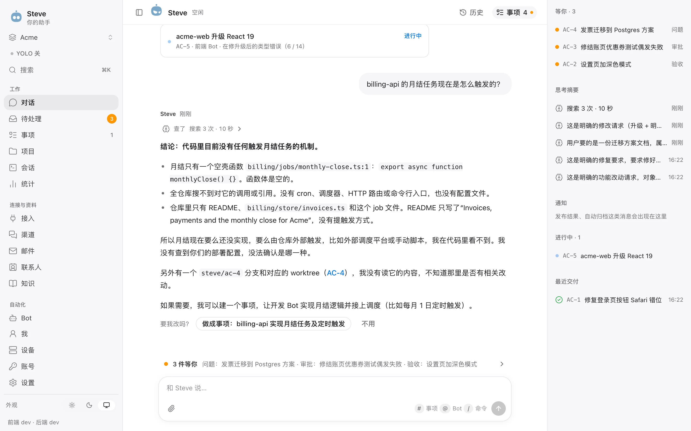
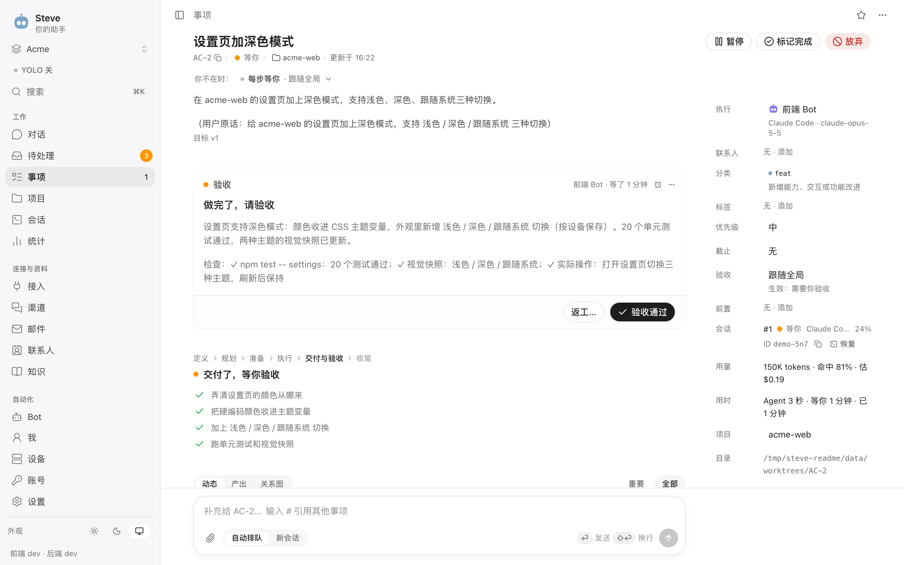
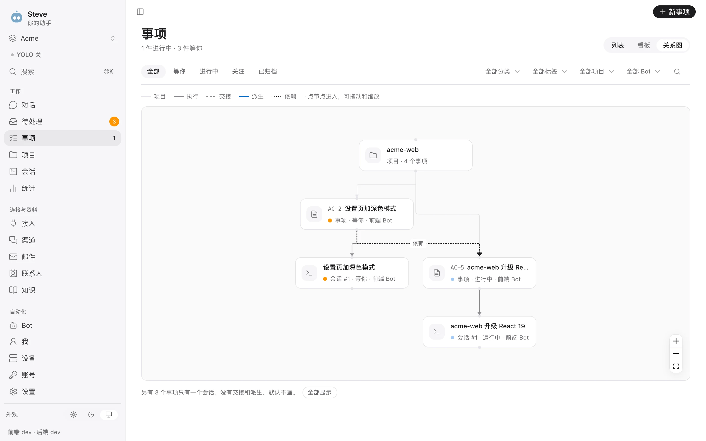
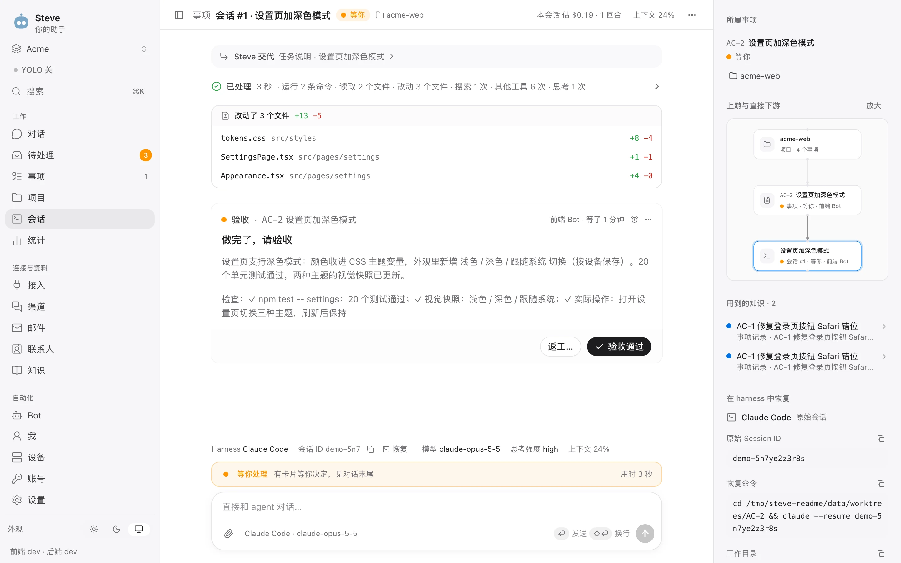
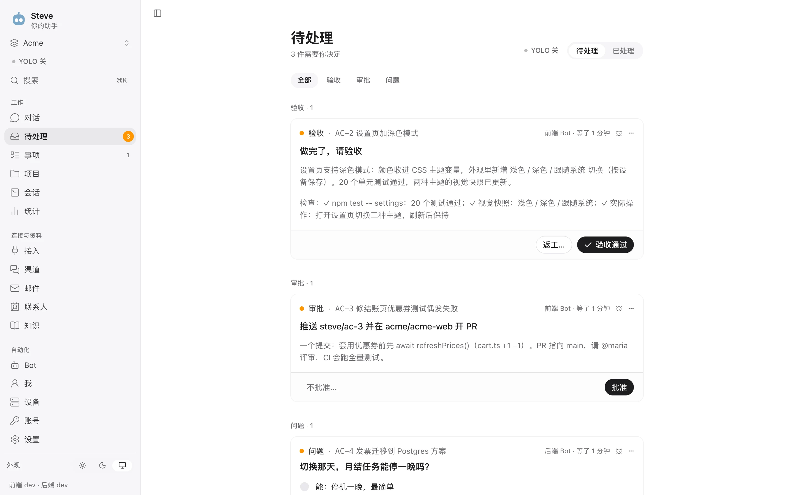
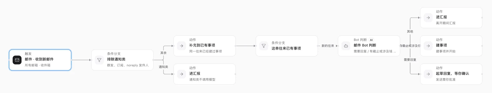
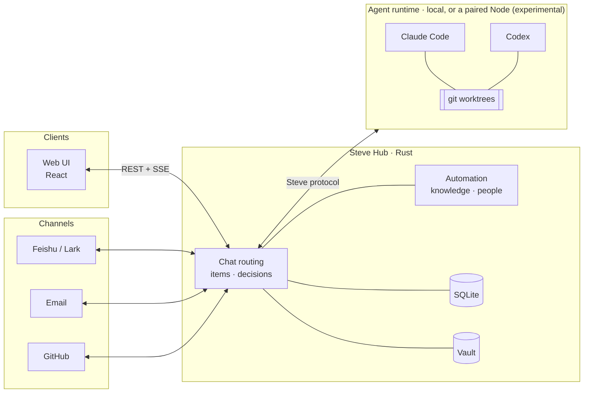

<div align="center">

<picture>
  <source media="(prefers-color-scheme: dark)" srcset="docs/assets/art/banner-en-dark.svg">
  
</picture>

[](https://github.com/Infranite/steve/releases) [](LICENSE) [](hub-rs) [](web) [](#requirements)

English · [简体中文](README.zh-CN.md)

[Principles](#design-principles) · [Features](#features) · [Extending](#extending-steve) · [How it works](#how-it-works) · [Quick start](#quick-start) · [Deployment](docs/deployment.md) · [Contributing](CONTRIBUTING.md)

<br>

<picture>
  <source media="(prefers-color-scheme: dark)" srcset="docs/assets/screenshots/chat-dark.webp">
  
</picture>

</div>

---

## Why Steve

Coding agents are good at the work itself. Run more than two or three of them and the bookkeeping falls apart: a dozen terminal tabs, context lost between sessions, permission prompts nobody answered, and no record of what was actually delivered or whether the checks passed.

Steve sits above Claude Code and Codex and keeps that record. It is one Rust binary on your own machine, with a SQLite database and an encrypted vault. You talk to it in a single chat. For each message it decides whether to answer directly, research your code and documents read-only, open a tracked item, or pass the message on to work already in progress. Items go to bots, and each item runs in its own git worktree.

| | 😵 Agents in terminal tabs | ✨ With Steve |
|---|---|---|
| **Keeping track** | Tabs, scrollback and memory | Items with a goal, plan, stage and delivery |
| **Isolation** | Agents share one checkout | One git worktree and `steve/<id>` branch per item |
| **Permission prompts** | Whichever tab you happen to look at | One Inbox, or YOLO within hard limits |
| **"Done"** | The agent says so | Checks passed, plan closed, proof from the goal |
| **Merging** | By hand, one branch at a time | Merge lanes: batched, fast-forward only |
| **Secrets** | Pasted into the prompt | Used through the vault, output redacted |

<div align="center">

<picture>
  <source media="(prefers-color-scheme: dark)" srcset="docs/assets/art/flow-en-dark.svg">
  
</picture>

</div>

Approvals, acceptances and agents' questions come to one Inbox. If you turn on YOLO mode, Steve makes the routine calls while you're away. It stays inside limits written in code, and every decision it makes can be undone. Feishu/Lark, email, GitHub, contacts and a knowledge base feed the same workspace, so agents work with real context. Each piece of knowledge has a disclosure level, so it isn't repeated where it shouldn't be.

## Design principles

<table>
<tr>
<td width="33%" valign="top">

#### ⚖️ The model proposes, code decides

Routing guards stop a question from quietly turning into an item. Steve coordinates the agents and does not second-guess them: a delivery with open plan steps or missing evidence is shown to you as such, never refused, and the harness's own permissions are respected.

</td>
<td width="33%" valign="top">

#### 🔁 Nothing runs twice

Agent tools send and end the turn, so nothing waits in memory. External effects carry stable ids, and flows commit each step before the next one runs. After a crash, an uncertain result is marked for reconciliation and never re-run blindly.

</td>
<td width="33%" valign="top">

#### 🛑 Autonomy has hard limits

YOLO only decides things that stay on your machine and can be undone. Money, high-sensitivity secrets, pushing, publishing and speaking as you are out of reach whatever the settings say. Breakers pause it when things go wrong.

</td>
</tr>
<tr>
<td width="33%" valign="top">

#### 🗝️ Agents use secrets without seeing them

Steve runs the command with the secret and hands the agent redacted output. The redactor also catches base64, URL, hex and JSON-escaped copies.

</td>
<td width="33%" valign="top">

#### 🙊 Knowledge has a disclosure level

Public, paraphrase only, reasoning only, or never. Messages to the outside pass a rule check and a second model's review before they are sent.

</td>
<td width="33%" valign="top">

#### ↩️ Changes can be undone

Configuration done through chat, corrections to automations, contact merges and YOLO decisions are all stored as changesets you can revert.

</td>
</tr>
</table>

## Features

### 💬 Chat and routing

Each message is sorted into one of nine routes: answer, research, item, suggest, ask, supplement, status, config or reroute. Code-level guards can overrule the model, and CI runs a routing eval built from real messages. When Steve can't tell whether a message is new work or belongs to an existing item, it asks.

- **Inline research** answers questions about your code and documents in the chat, citing `path:line`. Read-only is enforced three times: a tool allowlist (Read, Grep, Glob), a Hub guard that stops the run at the first non-read tool, and a `sandbox-exec` profile on macOS.
- An answer can end with *"Make it an item: …"*. Click it or just reply "do it".
- Each item has one card in the chat. It updates in place (running, waiting, delivered, released) and only moves to the bottom when it needs you.
- You can configure Steve by talking to it: *"Use Opus for the frontend bot, and switch on YOLO except for billing-api."* It drafts field-level changes to bots, projects, models, tags, flows and contacts. You apply them with one click and can undo for 24 hours.
- Replies can render A2UI surfaces: forms, choices, tabs and charts. Nothing the agent writes runs as code, and a form is submitted once, even across tabs and reloads.

### 📋 Items

An item moves from ready to active to closing to closed. Closing is a gate: it freezes the result, waits for running turns and external operations to finish, and commits only if nothing changed in between. Another round opens a new cycle and keeps the earlier ones. A small edit to the goal goes to the running session; a rewrite starts a fresh session with a handoff summary, and the replaced plan stays visible.

Acceptance is auto by default, or manual or waived. Auto takes the delivery as it is, with failed checks and open steps on the card, and you can send it back. What counts as done is read from the goal: if it says "deploy", the item closes only once the running Hub contains the commit. When an agent stops without delivering, Steve checks the remote against the completion rule (merged, or merged and tagged) and reminds the agent that its tools still work, so it delivers or asks. A turn the harness failed is continued too. Only after that does a card come to you.

- **Dependencies** are checked for cycles. A blocked item starts by itself when its dependencies finish, with a summary of what they did. Any point of a session can be **forked** into a new session or a child item, and the relation graph shows runs, handoffs, dependencies and forks.
- **Outputs** are versioned and open in their own viewers: rendered documents, highlighted code, CSV tables, PDFs, media, folders and branch diffs. Annotate a region, a passage or a whole file, then send all the notes as one message.
- **Each session has a message queue.** Edit or withdraw a queued message, *send now* to steer the running turn, or send it to a new session. Messages delivered just before a restart come back marked "check, don't redo".
- **Item debugging.** New items start one 30-minute window of detailed capture automatically; existing items are not enabled retroactively. Open Debug in an item's or session's menu to inspect blockers and recorded events. The owner can stop capture or start a new limited window; reads, restarts and continuing work do not extend it. Agents can query the same evidence with the read-only `steve_debug` tool. See [diagnostic capture and queries](docs/deployment.md#diagnostic-capture-and-queries) for access, retention and evidence limits.
- **Worktrees.** Every item gets the branch `steve/<id>` in its own worktree. Build caches are given back when items close or sit idle, no new worktree is made below a free-space floor, and deletion is crash-safe.
- List, board and graph views, with filters, bulk actions, tags, snooze, stars, due dates and automatic archiving. Categories are picked by the router or a keyword guesser, and unsure picks go to a review list.

<table>
<tr>
<td width="50%"><br><sub><b>An item</b>: goal, stage, plan and a delivery with its checks</sub></td>
<td width="50%"><br><sub><b>Relation graph</b>: runs, handoffs, dependencies and forks</sub></td>
</tr>
</table>

### 🤖 Bots

A bot is a harness (Claude Code or Codex) plus a model and thinking effort, a role, a persona, rules, a permission mode, an acceptance mode and a default project. Describe one in a sentence and Steve drafts it. `@Bot` hands work to that bot. Reassigning an item stops the old session and passes on the last progress. A bot can serve several workspaces with a different duty in each, and only sees the data of the one it is working in.

Steve stays out of your harness settings. It answers a permission prompt for that one call and never writes "always allow". It never edits your Codex config. Every session shows the command to resume it in the harness itself, and you can import your local Claude Code and Codex history.

- **Memories** are proposed from finished items, chat days, mail and agents, each with the quote it came from and the memory it would replace. Nothing takes effect until you confirm it.
- **Models per purpose.** Routing, chat, research, titles, extraction, YOLO, drafting, flows and mail each have their own model, effort and ordered fallbacks. Prices sync daily from Models.dev, and past estimates keep the prices of their day.

<p align="center"><br><sub><b>Agent session</b>: changed files, tools, cost and context, and the command to resume it in the harness</sub></p>

### 🟢 YOLO mode

With YOLO on, Steve decides tool permissions inside the item's own directory, local approvals, acceptance by checks, whether to continue a stalled agent, answers to agents' questions (only when confident), starting items whose dependencies are done, and releases of your own Steve (rate-limited).

No setting can widen these limits, and they are property-tested: money, high-sensitivity vault items, speaking as you without an `[AI]` mark, anything outside the item's directory, pushing or publishing, and anything the disclosure check flagged.

- **Shell guard.** Default deny, with its own POSIX shell parser. `eval`, `sh -c`, `sudo` and command substitution are refused, and `kill` only works on processes the agent started.
- **Countdowns and breakers.** While you're active, YOLO waits and shows *Now* and *I'll decide* buttons. It pauses the workspace after repeated failures, repeated undos, or a release it approved that went wrong.
- **Record and undo.** Every decision is recorded per window and item, with its cost. Five kinds of undo: revert the decision, roll back the release, recall the message, re-answer, or pause the item.

<p align="center"><br><sub><b>Inbox</b>: acceptances, approvals and questions in one place; YOLO picks up the routine ones</sub></p>

### 🚚 Merging and releases

Each target branch has a merge lane. Requests that arrive while a merge is in flight are batched, and you approve one card per batch; a request that arrives before you answer joins that batch and its card. The project page sets the batch window and size and has a *merge and release now* button. Conflicting members are backed out one at a time. Pushes are fast-forward only, a branch whose host requires a pull request or a merge queue is never pushed to directly, and after a restart nothing merges or releases twice. The project page also shows the lane profile Steve found (merge queue, required checks, release method) and the evidence for each.

On GitHub, Steve asks before opening a PR after you accept, and again before merging. For a private repository you can let accepting the item open a draft PR from its own branch without asking, once its commits pass a leak check. Effects go through a durable queue that reconciles with GitHub before retrying. Projects on the Hub's own machine, Steve included, can be released by script: build, drain running work, restart, and report the outcome once it's back. Rollback is refused when the old version can't read the current database.

### 🔌 Connections

Every outgoing message takes the same path: disclosure check, authorization, the send itself, a record of which knowledge was used at what level, and an audit entry. Your own account never sends without approval, and messages sent on your behalf say so.

- **Feishu / Lark.** Create a bot by scanning one QR code. Steve works as the bot or, through OAuth, as you, and receives messages over the long connection. Each chat becomes a space with an attention level (live, muted, blocked) and response rules (mention, DM, keyword, intent…) that can turn into flows. Personas set how much a reply reveals: name, role, that it's an AI, that it's Steve, who the owner is. Once a message has become an item, replies in its thread from whoever raised it, or from you, go straight to that item.
- **Email** over IMAP/SMTP, with presets. IDLE push sync, and views for *needs action*, *waiting on them* and drafts. HTML renders in a sandbox with remote images blocked. Sending always goes through an approval card bound to the content, and the server computes the recipients, so agents can't add any. Your first mailbox comes with a triage flow that drops notification mail before any model call.
- **GitHub** through a GitHub App (manifest flow) or a fine-grained token. Webhooks are HMAC-verified and deduplicated, with polling as a fallback. PRs link to items automatically, issues can become items, and a *PR checks failed* flow feeds failures back into the item. Comments and reviews on a linked PR, inline ones included, reach the item too when their author is an owner, member or collaborator of the repository. Agents get status, CI logs, comments (behind time-boxed grants) and `open_pr`.
- **Disconnecting** shows a dry run first, backs up the database and removes everything in one transaction.

### 📚 Knowledge and people

The knowledge base takes notes, files, items, chat, memories and read-only folders such as a wiki or an Obsidian vault. Chunking follows headings, and search handles Chinese and English. A citation like `[K1]` highlights the exact passage, and any citation that wasn't actually given to the model is removed. Each entry's disclosure level decides whether it can be quoted, paraphrased, used only for reasoning, or not used at all. Secrets and *never* entries aren't indexed.

Steve keeps contacts, organizations and teams. Identities are matched by handle, then email, then name. A name match only *proposes* a merge, and a merge can be split back exactly. Teams can be virtual or synced from the Feishu org chart, and a team can serve as a visibility scope. *Holdings* and *stewards* record who owns which bot, mailbox or device.

### 🔐 Vault

Each workspace has a master key in the OS key store (macOS Keychain, Linux Secret Service, or a protected directory). Each item has its own data key, and fields are encrypted with XChaCha20-Poly1305. Templates cover logins, cards, API credentials, SSH keys and more, and the template, not the client, decides which fields are secret. Revealing a secret takes a passkey (Touch ID or Face ID) with a single-use challenge bound to that field.

Bots use secrets through `steve_secret_use` without reading them. Each use needs an approval or a time-boxed grant, is recorded, and returns redacted output. Cards and high-sensitivity items can never be granted. A paste guard strips card numbers, API tokens and private keys before anything reaches a model.

### ⚡ Automation

A flow is a graph of 11 node kinds: trigger, filter, decision table, sub-flow, wait, approve, action, script, command, HTTP and bot. Each step is committed before the next, so a restart picks up where the run stopped.

- Effects need an upstream approval or a stored grant. Scripts run in a QuickJS sandbox with no network or files. HTTP is protected against SSRF across redirects and DNS, and secrets go only into headers and body. Command arguments are shell-quoted. Every run has a cost budget.
- Draft a flow from a sentence, ask Steve to change it on the canvas, or edit it from the chat. Saves are versioned and dry runs touch nothing. The canvas lights up the path a run took.
- Incoming events are deduplicated and grouped into signals. One click (*remind me / ignore / make an item*) applies the correction, adds an exception filter to the flow and remembers the rule, and the whole change can be undone.
- Schedules are written in plain language ("every weekday at 9"), with daylight-saving handling, catch-up policies and overlap protection.

<p align="center">
<picture>
  <source media="(prefers-color-scheme: dark)" srcset="docs/assets/screenshots/flow-dark.webp">
  
</picture>
<br><sub><b>Mail triage flow</b> on the canvas: notifications are filtered out before any model call, and a bot node branches the rest</sub>
</p>

### 📊 Stats and the rest

The stats page counts tokens (cache and reasoning included), cache hit rate, estimated cost next to what the harness reports, money the cache saved, items started and finished, lead, cycle and wait time, first-pass rate and rework. Filter by project, bot, model and source.

Sign-in is OIDC with PKCE. Workspaces are data boundaries, each with its own item prefix. The UI stays live over one SSE stream with resumable cursors, and a phone reconnects as soon as the page is visible again. There are in-place upgrades with backup and rollback, daily backups for macOS source installs, signed macOS releases that keep the vault key across rebuilds, a <kbd>⌘</kbd> <kbd>K</kbd> command palette, light and dark themes, and English or 简体中文.

<sub>Screenshots come from a demo workspace on the real Hub and web UI, with scripted agents. The UI is shown in Chinese; switch to English in Settings → Appearance.</sub>

## Extending Steve

There is no runtime plugin store yet; the Plugins page is a placeholder. Today you extend the Hub through typed extension points:

| Extension point | What you can add |
|---|---|
| **Hub Extension API** (`steve-hub/src/extension.rs`) | Connection providers, channel adapters, mail adapters, flow event sources, API routes and background jobs. Build a binary with `Assembly::builtin().with(MyExt)`. Conflicts stop the Hub at startup, naming the extension. Feishu, IMAP mail and GitHub are built this way. |
| **Flow seams** (`FlowSetup`) | Custom node kinds, actions, item finders and event adapters. |
| **Module seams** (`steve-modules`) | Item lifecycle hooks, declarative **item panels** in the sidebar (GitHub's *PR & checks* and the mail panel use them), prompt context and outbound checks. |
| **MCP tools for agents** | One loopback `steve` MCP server, with tokens scoped to a single item. It covers progress, questions, approvals, delivery and publishing, plus knowledge, mail, GitHub, contacts and secrets. |
| **Webhooks** | `POST /hooks/:connection_id`, signature-checked before anything is written. |
| **Knowledge store port** | SQLite FTS by default. [OpenViking](ops/openviking) is an optional vector backend (`STEVE_KB_STORE=openviking`). Every hit is re-checked against the Hub's own access rules. |

## Experimental and planned

- **Sessions run on a Node.** The Hub does not start agent processes itself: every session, Steve's own judgment calls and inline research run on the local Node, which is on by default (`STEVE_NODE_MODE=off` parks it).
- **Multiple devices** (experimental). A `steve-node` on another machine can pair with the Hub and run harnesses there. The listener is on by default; `STEVE_NODE_LISTEN=0` disables it, and diagnostic database copies never enable it. The Node always dials out, pairing uses a one-time code and a fingerprint check, and each Node keeps an execution journal for reconciliation. Devices are not automatically registered or assigned work: the owner generates a code and confirms the device in Devices; the Node claims the code through its CLI. `STEVE_NODE_BIND` remains unset until an operator selects a paired Node ([docs/deployment.md](docs/deployment.md#remote-nodes)).
- **Not built yet:** the Plugins page (use the extension points above), quiet hours and a daily digest (marked *Works once push is connected* in Settings), Gmail and Outlook API mail adapters, Feishu docs, calendar and approvals, and external vault backends (1Password, Bitwarden).

## How it works



- **Hub.** The single source of truth and the only place decisions are made: what runs, on which model, which permissions are granted, what's next in the queue. Authentication, the vault, channels and stats live here too.
- **Runtime drivers.** Agent protocols (ACP, MCP, stream-json) stop at the driver. The rest of Steve only deals in sessions, turns, events, tool calls and approvals, so a new harness should need one more driver and nothing else.
- **Modules.** Channels, mail, GitHub, knowledge, flows and the vault register through the [extension points above](#extending-steve). Events between modules go through a durable outbox.
- **Clients.** Everyone in a workspace, on every device, sees the same state live.

## Quick start

Install the precompiled Hub, Node, Web and command-line tools with Homebrew:

```sh
brew install infranite/tap/steve
steve setup
```

The setup wizard asks whether this machine is a Hub or Node. For a Hub it defaults to listening on `0.0.0.0:8440`, asks separately for the browser/OIDC callback URL, collects your OIDC settings, prepares its private runtime directory and macOS signing identity, checks the configuration, and registers a user service. For a Node it accepts the Hub's HTTPS address and reads the one-time pairing code from stdin; confirm the fingerprint in Hub **Devices**. Then start the role you configured:

```sh
steve hub start       # on the Hub
steve node start      # on a separate Node, after fingerprint confirmation
```

Service commands show a readable summary in a terminal. Use `steve hub status --json` or `steve node status --json` for machine-readable output; piping a service command also retains JSON output. The summary separates the service process, configured build and runtime identity that still needs verification. `doctor` checks the local installation and service configuration; verify the Hub's `/healthz`, browser login and Node connection separately.

Homebrew verifies and installs the published native binaries; no Python runtime, Steve source checkout, Cargo or npm build is needed. Setup preserves existing data and does not import harness logins. Running Agent tasks additionally requires the selected harness and its ACP adapter on the Node that executes them; the service and diagnostics remain available without these tools. See [deployment](docs/deployment.md#homebrew-installation) for supported platforms, configuration, lifecycle commands and upgrades. The source-build instructions below are for development.

### Requirements

| | |
|---|---|
| **Homebrew install** | Homebrew; no Python runtime dependency. Apple Silicon macOS, or Linux x86_64 with glibc 2.35+. Homebrew's own OS support policy also applies. |
| **Source build** | Git, stable Rust/Cargo, Node.js 24 LTS with npm |
| **Run** | Apple Silicon macOS 14+, or Linux x86_64 with glibc 2.35+ (Ubuntu 22.04+, Debian 12+). Windows isn't supported. |
| **Agent execution** | The selected [Claude Code](https://docs.anthropic.com/claude-code) or [Codex](https://github.com/openai/codex) harness, its ACP adapter and authentication on the executing Node |

### 1. Build from source *(development)*

```sh
git clone https://github.com/Infranite/steve.git
cd steve
npm ci
npm run build:web
cargo build --locked --manifest-path hub-rs/Cargo.toml -p steve-hub
```

### 2. Install the adapters for the harnesses you use

Steve talks to harnesses through their ACP adapters. These are required for Agent execution with the selected harness, but are not required to start the Hub or open its settings. Install only the adapters you use on each executing Node. The current implementation finds them in the global npm root:

```sh
npm install -g @agentclientprotocol/claude-agent-acp @zed-industries/codex-acp
```

Install the ones you use. If `claude` isn't at `/opt/homebrew/bin/claude`, set `CLAUDE_CODE_EXECUTABLE`. To point at adapters elsewhere, set `STEVE_ADAPTER_CLAUDE` / `STEVE_ADAPTER_CODEX`.

### 3. Run

```sh
STEVE_HOME="$HOME/.steve-dev" \
STEVE_DEV_LOGIN=1 \
STEVE_HOST=127.0.0.1 STEVE_PORT=8440 \
STEVE_WEB_DIR="$PWD/web/dist" \
  hub-rs/target/debug/steve-hub
```

Open **http://127.0.0.1:8440** and sign in. `STEVE_DEV_LOGIN=1` adds a one-click owner login that only works **from loopback**. It's for trying Steve out; for anything long-lived, set up OIDC (below).

> [!TIP]
> `STEVE_HOME` keeps this instance's data separate from `~/.steve`, the default. On Linux without a desktop keyring (Secret Service), the vault refuses to start: set `STEVE_VAULT_KEYSTORE=dir` and point `STEVE_VAULT_KEY_DIR` at a `0700` directory outside `STEVE_HOME`.

## Configuration

Steve reads its settings from the environment. For a service, put them in `$STEVE_HOME/steve.env` (template: [`ops/steve.env.example`](ops/steve.env.example)). Keep secrets out of the checkout and reference them with `*_FILE` variables.

For an existing Hub that completed managed setup, run `steve setup --reconfigure` (or add `--home /absolute/path/to/hub`) to edit its listening addresses, browser URL and existing OIDC issuer/client ID. It reads the current literal `steve.env`, preserves other lines and comments, and keeps the existing secret file and installation identity. Review the proposed changes and explicitly confirm before configuration checks, private backups and saving. It does not restart the service; use `steve hub restart` with the original home and service label when ready. See [reconfiguring an installed Hub](docs/deployment.md#reconfiguring-an-installed-hub) for checks and interruption recovery. This command does not reconfigure or re-pair Nodes.

| Variable | Purpose |
|---|---|
| `STEVE_HOME` | Data directory (default `~/.steve`) |
| `STEVE_HOST`, `STEVE_PORT` | Listen addresses, comma-separated, on one port (bare-binary default `127.0.0.1:8440`; `steve setup` writes `0.0.0.0:8440` and enables wildcard listening); for a proxy on another machine add the address it reaches, e.g. `127.0.0.1,100.64.0.2`. `0.0.0.0`/`::` is refused unless `STEVE_ALLOW_ANY_HOST=1` |
| `STEVE_WEB_DIR` | The built web UI the Hub serves |
| `STEVE_PUBLIC_URL` | A URL your integrations can reach, only needed for callbacks. No shared hosted endpoint is provided. |
| `STEVE_OIDC_ISSUER`, `STEVE_OIDC_CLIENT_ID`, `STEVE_OIDC_CLIENT_SECRET_FILE` | Sign-in through your OIDC provider |
| `STEVE_DISK_FLOOR_GB`, `STEVE_DISK_LOW_GB`, `STEVE_WORKTREE_IDLE_HOURS` | Disk guards for item worktrees |
| `STEVE_UPDATE_CHECK` | `0` turns off the periodic release check. Debug builds don't check unless it is `1` |
| `STEVE_YOLO` | `off` disables YOLO for the whole instance |
| `STEVE_KB_STORE` | `openviking` to use the optional vector backend (default: SQLite FTS) |
| `STEVE_VAULT_KEYSTORE` | `auto` (Keychain / Secret Service), `dir` with `STEVE_VAULT_KEY_DIR`, or `file` for tests |
| `STEVE_NODE_MODE` | `local` (default) runs sessions on the local Node; `off` parks them |
| `STEVE_TOOLCHAINS` | Default `on` (on a Node) sets each detected toolchain's places for a session whose principal is known: cargo's `target/` goes into the item's own `.steve/build/cargo`, and download and build caches that are only caches (npm, bun, pip, uv, poetry, conda, Go, NuGet, Bundler) into that person's own cache on the Node. A tool's home, config or credentials are never moved. Toolchains are data (23 built in); a moved build starts cold. Explicit `off` keeps the original places |
| `STEVE_PRINCIPAL_STATE` | Default `on` gives each new session's principal their own harness directory on its Node (`CLAUDE_CONFIG_DIR`, `CODEX_HOME`). The Node's owner starts from their own settings there (a login only when the settings carry it, such as Claude Code's `apiKeyHelper`); anyone else, and a Codex login, starts empty. A login setup UI/API is not yet available; see the [operator procedure and setup gap](docs/deployment.md#harness-setup) before continuing tasks. Existing sessions keep their recorded state; explicit `off` uses shared state for new sessions |
| `STEVE_CONFINE` | What a Node starts for a run goes into the OS sandbox with Steve's secrets, keys, databases and programs out of reach: on by default on macOS (seatbelt), `on` to opt in on Linux (bubblewrap), `off` to run unconfined. A harness with its own seatbelt sandbox (Codex) keeps that one instead, and tools that start their own `sandbox-exec` fail inside it |
| `STEVE_NODE_LISTEN`, `STEVE_NODE_BIND` | Experimental multi-device listener defaults to `1`; explicit `0` disables it. `STEVE_NO_RESUME=1` always disables remote execution. `STEVE_NODE_BIND` has no default: set only to an operator-selected paired Node ID |
| `STEVE_DISK_OBSERVE` | Default `on` (on a Node) records bounded asynchronous working-directory disk observations in its journal; explicit `off` disables new records. This grants no execution or cleanup permission ([budgets and retention](docs/deployment.md#node-disk-observations)) |
| `STEVE_NODE_PROXY_PEERS` | Optional exact IPs of TLS-terminating proxies for remote Node ingress; default is loopback only |

> [!IMPORTANT]
> Review authentication before you expose the listener beyond localhost. Agents running under Steve act with your local user's permissions; the Node's sandbox keeps only Steve's own control files out of their reach so far.

## Deployment

| Path | Best for | Automatic upgrades |
|---|---|---|
| **Local build** (above) | Trying Steve, development | Check only |
| **Source-based macOS service** — `zsh ops/install.sh` | A personal always-on Mac with a Keychain-backed vault | Through `ops/local-release.py` |
| **Managed Release bundle** — `steve-hub --supervise` | macOS or Linux servers under launchd/systemd | ✅ From Settings → About |

Installation steps, vault backends, service-manager settings and the upgrade lifecycle are in **[docs/deployment.md](docs/deployment.md)**.

## Repository layout

```text
hub-rs/          Rust workspace: the Hub binary and its crates
  crates/steve-hub        HTTP server (axum), REST + SSE, extensions, upgrades, background jobs
  crates/steve-core       items, lifecycle, chat routing, YOLO, merge lanes, model gateway
  crates/steve-modules    module seams (hooks, panels, changesets), contacts, accounts, vault
  crates/steve-acp        Claude Code / Codex sessions over ACP
  crates/steve-print      one-shot harness runs for Steve's own judgments
  crates/steve-research   read-only inline research (allowlist, guard, sandbox)
  crates/steve-mcp        the `steve` MCP server agents talk to
  crates/steve-channels   Feishu/Lark, spaces, personas, disclosure checks
  crates/steve-mail       IMAP/SMTP accounts, sync, drafts, triage
  crates/steve-github     GitHub App/token, webhooks, PRs, checks, effects
  crates/steve-knowledge  knowledge base, retrieval, citations, memories
  crates/steve-flow       signals, flows, schedules
  crates/steve-vault      redaction and paste guard; steve-keyhelper holds the macOS key
  crates/steve-stats      usage, cost and delivery metrics
  crates/steve-node*      the Hub–Node protocol and the Node runtime that runs every session
  crates/steve-store      SQLite schema and migrations
web/             React + Vite + Tailwind interface
ops/             install, release, backup, service and OpenViking scripts
docs/            architecture, protocol and release notes
```

## Contributing

Issues and pull requests are welcome. Before you open a PR, read **[CONTRIBUTING.md](CONTRIBUTING.md)**. It has the development checks, how release notes are written as fragments, and how versions and migrations are assigned at release time.

## License

[MIT](LICENSE). External agents, model providers and integrations are separate products with their own terms, and you install and configure them yourself.
