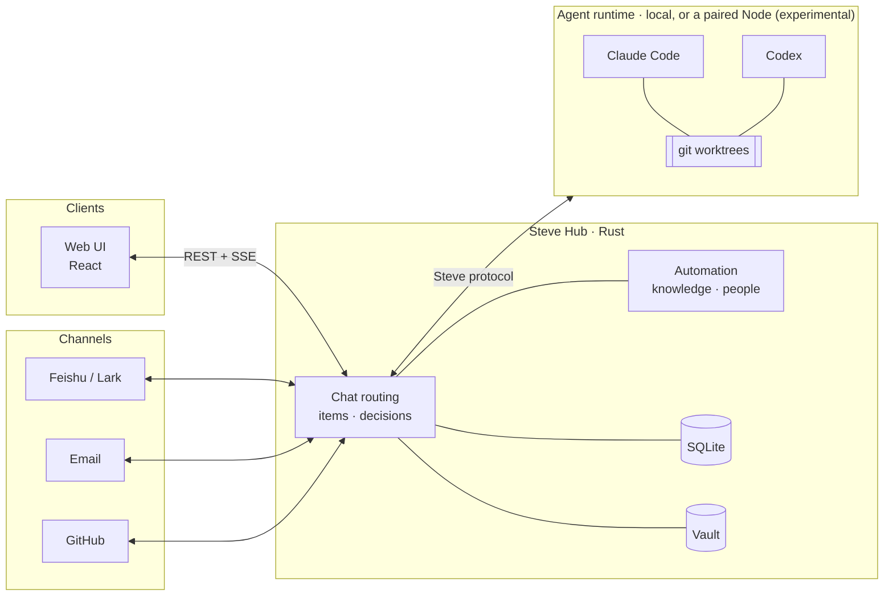

<div align="center">

<picture>
  <source media="(prefers-color-scheme: dark)" srcset="docs/assets/art/banner-en-dark.svg">
  
</picture>

[](https://github.com/Infranite/steve/releases) [](LICENSE) [](hub-rs) [](web) [](#requirements)

English · [简体中文](README.zh-CN.md)

[Principles](#design-principles) · [Features](#features) · [Extending](#extending-steve) · [How it works](#how-it-works) · [Quick start](#quick-start) · [Deployment](docs/deployment.md) · [Contributing](CONTRIBUTING.md)

<br>

<picture>
  <source media="(prefers-color-scheme: dark)" srcset="docs/assets/screenshots/chat-dark.webp">
  
</picture>

</div>

---

## Why Steve

Coding agents are good at doing the work. They aren't good at **keeping track of it**. You end up with a dozen terminal tabs, lost context, forgotten approvals and no record of what was delivered.

Steve is the layer above the agents. It runs on your own machine, owns the state, and gives you one place to:

- **Hand things off in plain language.** One chat routes each message for you. Steve answers directly, researches inline, creates a tracked item, or forwards a follow-up to work already in progress.
- **Let a team of bots do the work.** Each bot has its own harness, model, role, rules and memories. Items run in their own git worktrees, depend on each other, fork and hand off.
- **Stay in control of what matters.** Approvals, acceptances and questions arrive in one Inbox. YOLO mode decides routine things while you're away. It works within hard limits, and every decision it makes can be undone.
- **Bring your world in.** Feishu/Lark, email, GitHub, contacts and a knowledge base feed the same workspace, so agents work with real context. Each piece of knowledge carries a disclosure level, so it isn't repeated where it shouldn't be.

Everything stays on infrastructure you control: a single Rust binary, a SQLite database and an encrypted vault.

## From one sentence to shipped work

<div align="center">

<picture>
  <source media="(prefers-color-scheme: dark)" srcset="docs/assets/art/flow-en-dark.svg">
  
</picture>

</div>

Every message goes through the same pipeline. Steve decides what it is, the right bot does the work in its own worktree, and you only step in where it matters. With YOLO on, Steve covers the routine steps too.

## Design principles

A few rules run through the whole codebase. They are why Steve can be left alone with real work.

<table>
<tr>
<td width="33%" valign="top">

#### ⚖️ Code has the last word

The model proposes and tested rules decide. Routing guards stop a question from silently becoming an item. A delivery is refused while plan steps are still open. "Done" may require proof of a build, a deploy or a real check.

</td>
<td width="33%" valign="top">

#### 🔁 Nothing runs twice

Agent tools *send and end the turn*, so nothing waits in memory. External effects carry stable ids. Flows commit each step before the next one runs. After a crash, an uncertain result is marked for reconciliation and never re-run blindly.

</td>
<td width="33%" valign="top">

#### 🛑 Autonomy with hard limits

YOLO decides what stays on your machine and can be undone. Money, high-sensitivity secrets, pushing, publishing and speaking as you are out of reach whatever the settings say. Breakers pause it when things go wrong.

</td>
</tr>
<tr>
<td width="33%" valign="top">

#### 🗝️ Agents use secrets without seeing them

Steve runs a command with the secret and gives the agent only redacted output. The redactor also catches base64, URL, hex and JSON-escaped copies.

</td>
<td width="33%" valign="top">

#### 🙊 Disclosure-aware by default

Every piece of knowledge has a level: public, *paraphrase only*, *reasoning only* or never. Messages to the outside world pass a rule check and a review by a second model before they go out.

</td>
<td width="33%" valign="top">

#### ↩️ Every change can be undone

Configuration made by talking to Steve, corrections to automations, contact merges and YOLO decisions all come back as changesets you can undo.

</td>
</tr>
</table>

## Features

### 💬 A conversation that knows what to do

- **Routing** sorts each message into one of nine kinds: answer, research, item, suggest, ask, supplement, status, config or reroute. Code-level guards can overrule the model, and a routing eval of real messages runs in CI.
- **Inline research** answers questions about your code and documents in the chat. Read-only is enforced three times: a tool allowlist (Read, Grep, Glob), a Hub guard that stops the run at the first non-read tool, and on macOS a `sandbox-exec` profile. Answers cite `path:line`.
- **Offers instead of interruptions.** An answer can end with *"Make it an item: …"*. You click it or just reply "do it". When Steve isn't sure whether a message is new work or belongs to an existing item, it asks.
- **One living card per item.** The card in the chat updates in place (running, waiting, delivered, released) and only moves to the bottom when it needs you.
- **Configure by talking.** For example: *"Use Opus for the frontend bot, and switch on YOLO except for billing-api."* Steve drafts field-level changes to bots, projects, models, tags, flows and contacts; you apply them with one click and can undo for 24 hours.
- **Agent-drawn UI.** Replies can render A2UI surfaces: forms, choices, tabs and charts. Nothing the agent writes runs as code, and each form is submitted only once, even across tabs and reloads.

### 📋 Items: a real work model

- **Lifecycle with a closing gate.** Items move from ready to active to closing to closed. Closing freezes the result, waits for running turns and external operations to finish, and commits only if nothing changed in between. A new round starts a new **cycle**, and earlier cycles are kept.
- **Versioned goals and plans.** A small change to the goal is passed on to the running session. A rewrite starts a fresh session with a handoff summary. Replaced plans stay visible as earlier rounds.
- **Acceptance you can trust.** Acceptance is manual, auto or waived. *Auto* only accepts when every check passed and no plan step is open. **Proof** is read from the goal itself: if it says "deploy", the item closes only once the running Hub contains the commit.
- **Steve takes over first.** When an agent stops without delivering, Steve checks the remote for the completion rule (merged, or merged and tagged), then continues the agent a few times. Only after that does it ask you. Idle sessions get a single *continue / I'll look / give up* card.
- **Relations.** Dependencies are checked for cycles, and blocked items start by themselves when their dependencies finish, with a summary of what those did. You can **fork** any point of a session into a new session or a child item. The **relation graph** shows runs, handoffs, dependencies and forks.
- **List, board and graph** views, filters, bulk actions, categories and tags (the category is picked by the router or a keyword guesser, and unsure picks go to a review list), snooze, star and due dates, plus automatic archiving.
- **Outputs, versioned.** Each output opens in its own viewer: rendered documents, highlighted code, CSV tables, PDFs, media, folders and branch diffs. **Annotate** a region, a passage or a whole file, then send all your notes as one message.
- **Message queue per session.** You can edit or withdraw a queued message, *send now* to steer the running turn, or send it to a new session. Messages delivered just before a restart come back marked "check, don't redo".
- **Worktrees and disk.** Every item gets `steve/<id>` in its own worktree. Build caches are given back when items close or sit idle, and no new worktree is made below a free-space floor. Deletion is crash-safe.

<table>
<tr>
<td width="50%"><br><sub><b>An item</b>: goal, stage, plan and a delivery with its checks</sub></td>
<td width="50%"><br><sub><b>Relation graph</b>: runs, handoffs, dependencies and forks</sub></td>
</tr>
</table>

### 🤖 A team of bots

- **Bots** each have a harness (Claude Code or Codex), a model and thinking effort, a role, a persona, rules, a permission mode, an acceptance mode and a default project. Describe a bot in one sentence and Steve drafts it.
- **Handoff.** `@Bot` hands work to that bot. Reassigning an item stops the old session and passes on the last progress. A bot can serve several workspaces with a different duty in each, and it sees only that workspace's data.
- **Memories you approve.** Steve proposes memories from finished items, chat days, mail and agents, each with the quote it came from and the memory it would replace. Nothing takes effect until you confirm it.
- **Models per purpose.** Routing, chat, research, titles, extraction, YOLO, drafting, flows and mail each have their own model, with ordered fallbacks and effort. Prices sync daily from Models.dev, and past estimates keep the prices of their day.
- **Harness-friendly.** Steve answers permission prompts *once* and never writes "always allow" into your harness settings. It never edits your Codex config. It shows the command to resume any session in the harness itself, and it can import your local Claude Code and Codex history.

<p align="center"><br><sub><b>Agent session</b>: changed files, tools, cost and context, and the command to resume it in the harness</sub></p>

### 🟢 YOLO: autonomy with brakes

- **What it can decide:** tool permissions inside the item's own directory, local approvals, acceptance by checks, continuing stalled agents, answering agents' questions (only when confident), starting items whose dependencies are done, and releasing your own Steve (rate-limited).
- **Hard limits no setting can widen:** money, high-sensitivity vault items, speaking as you without an `[AI]` mark, anything outside the item's directory, pushing or publishing, and anything the disclosure check flagged. These limits are property-tested.
- **Shell guard.** Default deny, with its own POSIX shell reader: `eval`, `sh -c`, `sudo` and command substitution are refused, and `kill` only works on processes the agent started.
- **Countdowns and breakers.** YOLO waits while you're active and gives you *Now* and *I'll decide* buttons. It pauses the workspace after repeated failures, repeated undos, or a release that went wrong.
- **Record and undo.** Every decision is recorded per window and item, with its cost. There are five kinds of undo: revert the decision, roll back the release, recall the message, re-answer, or pause the item.

<p align="center"><br><sub><b>Inbox</b>: acceptances, approvals and questions in one place; YOLO picks up the routine ones</sub></p>

### 🚚 Delivery: merge lanes and releases

- **Merge lanes** per target branch. Requests that arrive while a merge is in flight are batched, and you approve one card per batch. Conflicting members are backed out one by one. Pushes are fast-forward only. After a restart nothing merges or releases twice.
- **Lane profile** on the project page: merge queue, required checks and release method, each with the evidence it was found from.
- **GitHub wrap-up.** After you accept, Steve asks before opening a PR and again before merging. Effects go through a durable queue that reconciles with GitHub before retrying.
- **Release by script** for projects on the Hub's machine, Steve itself included: build, drain running work, restart, then report the outcome after it comes back. Rollback is refused when the old version can't read the current database.

### 🔌 Connections

- **Feishu / Lark:** create a bot by scanning one QR code. Steve can work as the bot or, through OAuth, as you, and it receives messages over the long connection. Each chat becomes a **space** with an attention level (live / muted / blocked) and **response rules** (mention, DM, keyword, intent…) that can turn into flows. **Personas** set how much a reply reveals (name, role, that it's an AI, that it's Steve, who the owner is). A loop guard mutes runaway spaces.
- **Outgoing messages** take one path: disclosure check, then authorization, the send itself, a record of which knowledge was used and at what level, and an audit entry. Your own account never sends without approval, and messages sent on your behalf are marked as such.
- **Email** (IMAP/SMTP with presets): IDLE push sync and views for *needs action*, *waiting on them* and drafts. HTML renders in a sandbox with remote images blocked. Sending always goes through an approval card bound to the content, and the server computes the recipients, so agents can't add any. A triage flow installs with your first mailbox and drops notification mail before any model call.
- **GitHub:** a GitHub App (manifest flow) or a fine-grained token. Webhooks are HMAC-verified and deduplicated, with polling as a fallback. PRs link to items automatically, issues can become items, and a *PR checks failed* flow feeds failures back into the item. Agents get status, CI logs, comments (behind time-boxed grants) and `open_pr`.
- **Disconnecting** shows a dry run first, backs up the database and removes everything in one transaction.

### 📚 Knowledge and people

- **Knowledge base** from notes, files, items, chat, memories and read-only folders (a wiki or an Obsidian vault). Chunking is heading-aware, and search works for both Chinese and English text. Citations like `[K1]` highlight the exact passage, and any citation that wasn't actually given to the model is removed.
- **Disclosure levels** on every entry decide whether it can be quoted, paraphrased, used only for reasoning, or not used at all. Secrets and *never* entries are not indexed.
- **Contacts, organizations and teams.** Identities are matched by handle, then email, then name. A name match only *proposes* a merge, and merges can be split exactly. Teams can be virtual or synced from the Feishu org chart, and a team can serve as a visibility scope. *Holdings* and *stewards* record who owns which bot, mailbox or device.

### 🔐 Vault

- **Encryption.** Each workspace has a master key in the OS key store (macOS Keychain, Linux Secret Service, or a protected directory). Each item has its own data key, and fields are encrypted with XChaCha20-Poly1305.
- **Templates** for logins, cards, API credentials, SSH keys and more. The template, not the client, decides which fields are secret.
- **Revealing a secret requires a passkey** (Touch ID or Face ID), with a single-use challenge bound to the field.
- **Bots use secrets without reading them** through `steve_secret_use`. Each use needs an approval or a time-boxed grant, is recorded, and returns redacted output. Cards and high-sensitivity items can never be granted. A paste guard strips card numbers, API tokens and private keys before anything reaches a model.

### ⚡ Automation

- **Flows** are graphs built from 11 node kinds: trigger, filter, decision table, sub-flow, wait, approve, action, script, command, HTTP and bot. Every step is committed before the next one, so a restart resumes from where it stopped.
- **Safe by construction.** Effects need an upstream approval or a stored grant. Scripts run in a QuickJS sandbox with no network or files. HTTP is protected against SSRF across redirects and DNS, and secrets go only into headers and body. Command arguments are shell-quoted. Every run has a cost budget.
- **Authoring.** Draft a flow from a sentence, ask Steve to change it on the canvas, or edit it from the chat. Saves are versioned and dry runs touch nothing. A canvas trace lights up the path a run took.
- **Signals and corrections.** Incoming events are deduplicated and grouped. One click (*remind me / ignore / make an item*) applies the correction, adds an exception filter to the flow and remembers the rule, and the whole change can be undone.
- **Schedules in plain language** ("every weekday at 9"), with daylight-saving handling, catch-up policies and overlap protection.

<p align="center">
<picture>
  <source media="(prefers-color-scheme: dark)" srcset="docs/assets/screenshots/flow-dark.webp">
  
</picture>
<br><sub><b>Mail triage flow</b> on the canvas: notifications are filtered out before any model call, and a bot node branches the rest</sub>
</p>

### 📊 Stats and platform

- **Stats:** tokens (including cache and reasoning), cache hit rate, estimated cost against what the harness reports, money saved by the cache, items started and finished, lead/cycle/wait time, first-pass rate and rework. You can filter by project, bot, model and source.
- **Workspaces and sign-in:** OIDC with PKCE. Workspaces are data boundaries with their own item prefix.
- **Live everywhere:** one SSE stream with resumable cursors, and phones reconnect the moment the page becomes visible again.
- **Operations:** in-place upgrades with backup and rollback, daily backups for macOS source installs, signed macOS releases that keep the vault key across rebuilds, a <kbd>⌘</kbd> <kbd>K</kbd> command palette, light and dark themes, and English or 简体中文.

<sub>Screenshots come from a demo workspace on the real Hub and web UI, with scripted agents. The UI is shown in Chinese; switch to English in Settings → Appearance.</sub>

## Extending Steve

Steve does not have a runtime plugin store yet. The Plugins page is a placeholder for a later phase. What exists today are typed extension points in the Hub:

| Extension point | What you can add |
|---|---|
| **Hub Extension API** (`steve-hub/src/extension.rs`) | Connection providers, channel adapters, mail adapters, flow event sources, API routes and background jobs. Build a binary with `Assembly::builtin().with(MyExt)`. Conflicts stop the Hub at startup, naming the extension. Feishu, IMAP mail and GitHub are built this way. |
| **Flow seams** (`FlowSetup`) | Custom node kinds, actions, item finders and event adapters. |
| **Module seams** (`steve-modules`) | Item lifecycle hooks, declarative **item panels** in the sidebar (GitHub's *PR & checks* and the mail panel use them), prompt context and outbound checks. |
| **MCP tools for agents** | A single loopback `steve` MCP server whose tokens are scoped to one item. It covers progress, questions, approvals, delivery and publishing, plus knowledge, mail, GitHub, contacts and secrets. |
| **Webhooks** | `POST /hooks/:connection_id`, verified by signature before anything is written. |
| **Knowledge store port** | SQLite FTS by default. [OpenViking](ops/openviking) is an optional vector backend (`STEVE_KB_STORE=openviking`). Every hit is re-checked against the Hub's own access rules. |

## Experimental and planned

What you can rely on today, and what's still on the way:

- **Multiple devices (experimental, off by default).** A `steve-node` on another machine can pair with the Hub and run harnesses there. The Node always dials out, pairing uses a one-time code and a fingerprint check, and each Node keeps an execution journal for reconciliation. It is enabled with `STEVE_NODE_LISTEN=1` / `STEVE_NODE_BIND` / `STEVE_NODE_MODE=local`, pairing is CLI-only for now, and the design is still in progress ([docs/hub-node-client.md](docs/hub-node-client.md)).
- **Plugins page:** planned. Use the extension points above.
- **Planned, not built yet:** quiet hours and a daily digest (marked *Works once push is connected* in Settings), Gmail and Outlook API mail adapters, Feishu docs, calendar and approval areas, and external vault backends (1Password, Bitwarden).

## How it works



- **The Hub is the brain.** It is the single source of truth and the only place decisions are made: what runs, on which model, which permissions are granted, what's next in the queue. It also handles authentication, the vault, channels and stats.
- **Harnesses do the work.** Agent protocols (ACP, MCP, stream-json) end inside the runtime driver. The rest of Steve only sees its own vocabulary: sessions, turns, events, tool calls and approvals. Supporting another harness is meant to take one more driver.
- **Modules plug into the Hub.** Channels, mail, GitHub, knowledge, flows and the vault register through the extension and module seams [described above](#extending-steve). Events between modules travel through a durable outbox.
- **Clients are windows.** Everyone in a workspace, on every device, sees the same state live.

The design is in [docs/hub-node-client.md](docs/hub-node-client.md) and the wire contract in [docs/node-protocol.md](docs/node-protocol.md).

## Quick start

### Requirements

| | |
|---|---|
| **Build** | Git, stable Rust/Cargo, Node.js 24 LTS with npm |
| **Run** | Apple Silicon macOS 14+, or Linux x86_64 with glibc 2.35+ (Ubuntu 22.04+, Debian 12+). Windows isn't supported. |
| **Agents** *(optional)* | [Claude Code](https://docs.anthropic.com/claude-code) and/or [Codex](https://github.com/openai/codex), installed and signed in |

### 1. Build

```sh
git clone https://github.com/Infranite/steve.git
cd steve
npm ci
npm run build:web
cargo build --locked --manifest-path hub-rs/Cargo.toml -p steve-hub
```

### 2. Install the agent adapters *(optional)*

Steve talks to harnesses through their ACP adapters. It finds them in the global npm root:

```sh
npm install -g @agentclientprotocol/claude-agent-acp @zed-industries/codex-acp
```

Install only the ones you use. If `claude` isn't at `/opt/homebrew/bin/claude`, set `CLAUDE_CODE_EXECUTABLE`. To point at adapters elsewhere, set `STEVE_ADAPTER_CLAUDE` / `STEVE_ADAPTER_CODEX`.

### 3. Run

```sh
STEVE_HOME="$HOME/.steve-dev" \
STEVE_DEV_LOGIN=1 \
STEVE_HOST=127.0.0.1 STEVE_PORT=8440 \
STEVE_WEB_DIR="$PWD/web/dist" \
  hub-rs/target/debug/steve-hub
```

Open **http://127.0.0.1:8440** and sign in. `STEVE_DEV_LOGIN=1` enables a one-click local owner login that is accepted **from loopback only**. Use it to try Steve. For anything long-lived, configure OIDC instead (see below).

> [!TIP]
> `STEVE_HOME` keeps this instance's data separate. It defaults to `~/.steve`.

## Configuration

Steve reads its settings from the environment. For a service, put them in `$STEVE_HOME/steve.env` (template: [`ops/steve.env.example`](ops/steve.env.example)). Keep secrets out of the checkout and reference them with `*_FILE` variables.

| Variable | Purpose |
|---|---|
| `STEVE_HOME` | Data directory (default `~/.steve`) |
| `STEVE_HOST`, `STEVE_PORT` | Listen address (default `127.0.0.1:8440`) |
| `STEVE_WEB_DIR` | The built web UI the Hub serves |
| `STEVE_PUBLIC_URL` | A URL your integrations can reach, only needed for callbacks. No shared hosted endpoint is provided. |
| `STEVE_OIDC_ISSUER`, `STEVE_OIDC_CLIENT_ID`, `STEVE_OIDC_CLIENT_SECRET_FILE` | Sign-in through your OIDC provider |
| `STEVE_DISK_FLOOR_GB`, `STEVE_DISK_LOW_GB`, `STEVE_WORKTREE_IDLE_HOURS` | Disk guards for item worktrees |
| `STEVE_UPDATE_CHECK` | `0` turns off the periodic release check |
| `STEVE_YOLO` | `off` disables YOLO for the whole instance |
| `STEVE_KB_STORE` | `openviking` to use the optional vector backend (default: SQLite FTS) |
| `STEVE_VAULT_KEYSTORE` | `auto` (Keychain / Secret Service), `dir` with `STEVE_VAULT_KEY_DIR`, or `file` for tests |
| `STEVE_NODE_LISTEN`, `STEVE_NODE_BIND`, `STEVE_NODE_MODE` | Experimental multi-device Nodes, off by default |

> [!IMPORTANT]
> Review authentication before you expose the listener beyond localhost. Agents running under Steve act with your local user's permissions.

## Deployment

| Path | Best for | Automatic upgrades |
|---|---|---|
| **Local build** (above) | Trying Steve, development | Check only |
| **Source-based macOS service** — `zsh ops/install.sh` | A personal always-on Mac with a Keychain-backed vault | Through `ops/local-release.py` |
| **Managed Release bundle** — `steve-hub --supervise` | macOS or Linux servers under launchd/systemd | ✅ From Settings → About |

Installation steps, vault backends, service-manager settings and the upgrade lifecycle are in **[docs/deployment.md](docs/deployment.md)**.

## Repository layout

```text
hub-rs/          Rust workspace: the Hub binary and its crates
  crates/steve-hub        HTTP server (axum), REST + SSE, extensions, upgrades, background jobs
  crates/steve-core       items, lifecycle, chat routing, YOLO, merge lanes, model gateway
  crates/steve-modules    module seams (hooks, panels, changesets), contacts, accounts, vault
  crates/steve-acp        Claude Code / Codex sessions over ACP
  crates/steve-print      one-shot harness runs for Steve's own judgments
  crates/steve-research   read-only inline research (allowlist, guard, sandbox)
  crates/steve-mcp        the `steve` MCP server agents talk to
  crates/steve-channels   Feishu/Lark, spaces, personas, disclosure checks
  crates/steve-mail       IMAP/SMTP accounts, sync, drafts, triage
  crates/steve-github     GitHub App/token, webhooks, PRs, checks, effects
  crates/steve-knowledge  knowledge base, retrieval, citations, memories
  crates/steve-flow       signals, flows, schedules
  crates/steve-vault      redaction and paste guard; steve-keyhelper holds the macOS key
  crates/steve-stats      usage, cost and delivery metrics
  crates/steve-node*      the Hub–Node protocol and the Node runtime (experimental)
  crates/steve-store      SQLite schema and migrations
web/             React + Vite + Tailwind interface
ops/             install, release, backup, service and OpenViking scripts
docs/            architecture, protocol and release notes
```

## Contributing

Issues and pull requests are welcome. Before you open a PR, read **[CONTRIBUTING.md](CONTRIBUTING.md)**. It has the development checks, how release notes are written as fragments, and how versions and migrations are assigned at release time.

## License

[MIT](LICENSE). External agents, model providers and integrations are separate products with their own terms, and you install and configure them yourself.
