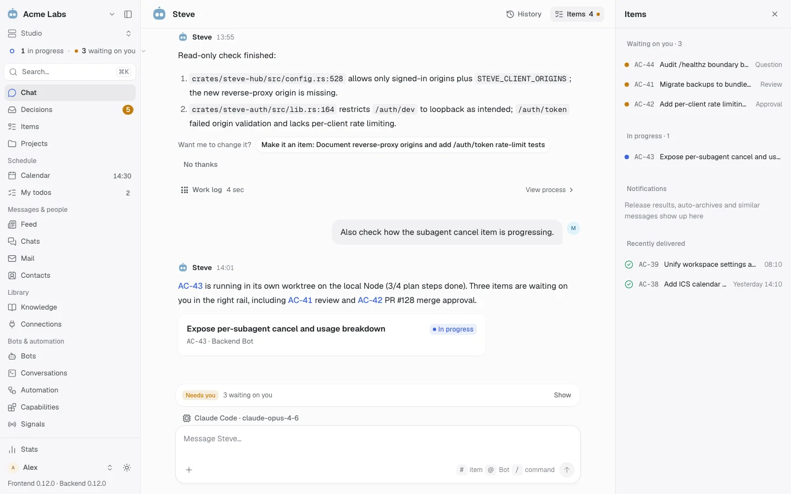
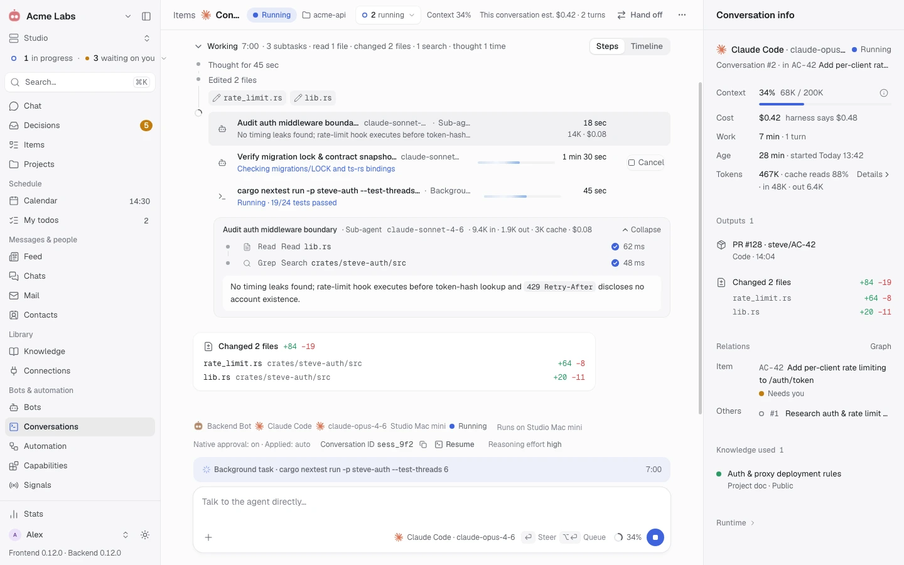
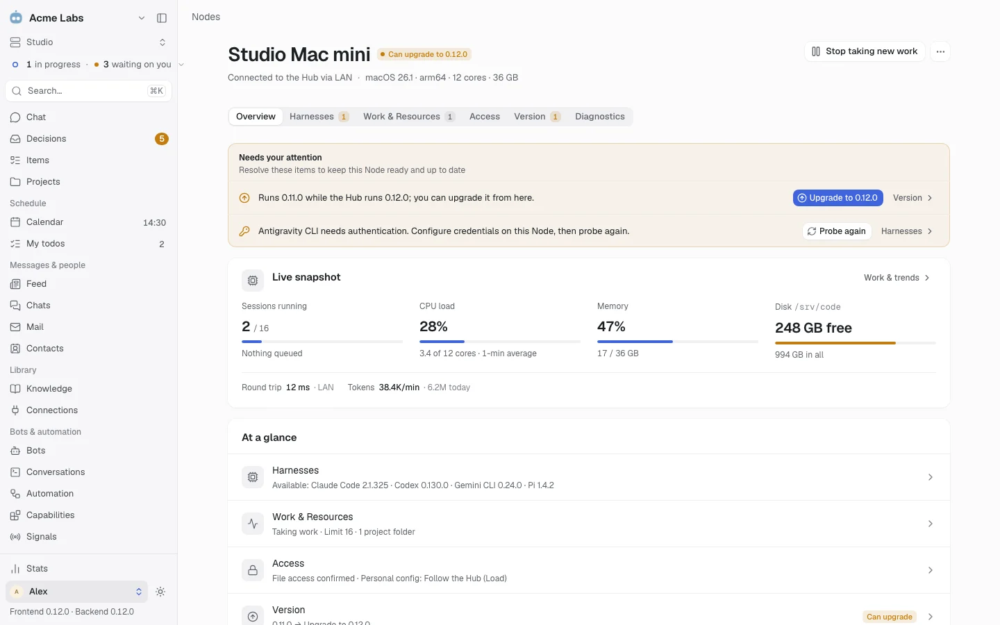

<div align="center">

<picture>
  <source media="(prefers-color-scheme: dark)" srcset="docs/assets/art/banner-en-dark.svg">
  
</picture>

<p><strong>Say it once. It gets done.</strong><br/>A self-hosted workspace that coordinates coding agents across worktrees, tools, and machines — with one inbox for every human decision.</p>

[](https://github.com/Infranite/steve/releases) [](LICENSE) [](hub-rs) [](web) [](#requirements)

English · [简体中文](README.zh-CN.md)

[Why Steve](#why-steve) · [Architecture](#architecture) · [Capabilities](#core-capabilities) · [Harnesses](#supported-harnesses) · [Quick start](#quick-start) · [Concepts](#concepts-at-a-glance) · [Security](#security-and-privacy) · [Deployment](docs/deployment.md)

</div>

<picture>
  <source media="(prefers-color-scheme: dark)" srcset="docs/assets/screenshots/chat-dark.webp">
  
</picture>

- **One chat for all your coding agents** — Coordinate Claude Code, Codex, Antigravity CLI (`agy`), Gemini CLI, Copilot, OpenCode, Cursor, Pi, and 10 more CLIs from one thread.
- **Isolated worktrees with real delivery records** — Every task runs in its own git branch with a tracked goal, plan, check evidence, and reviewable outputs.
- **One inbox for every human decision** — Reviews, questions, secret grants, and PR merges land in **Decisions**, with hard safety limits at every permission level.
- **Restarts and upgrades never interrupt active runs** — Your local runner stays alive across Hub updates, and you can pair extra Macs or Linux machines anytime.
- **Your data and secrets stay on your own machines** — Local storage, automatic encrypted backups, and OS-keystore secrets, without ever editing your CLI configs.

```sh
brew install infranite/tap/steve
steve setup
```

## Why Steve

Coding agents handle single tasks well, but running several at once breaks down on bookkeeping: scattered terminal tabs, lost context, missed permission prompts, and no clear record of what passed or shipped.

| | Agents in terminal tabs | With Steve |
|---|---|---|
| **Tracking** | Tabs, scrollback, and memory | Tracked items with goals, plans, delivery tags, and check proof |
| **Isolation** | Agents share one working tree | One git worktree and isolated build cache per item, plus OS sandboxing |
| **Approvals** | Whichever tab you notice | One **Decisions** inbox, or each CLI's own native approval mode |
| **Subagents & tasks** | Buried in raw terminal logs | Structured subagents and background tasks with per-subagent cancel |
| **Merging** | Manual branch juggling | One PR per item; merged only after CI and exact-commit human approval |
| **Secrets** | Pasted into prompts or `.env` | Stored in an encrypted vault and injected into commands without exposing keys |

## Architecture

<picture>
  <source media="(prefers-color-scheme: dark)" srcset="docs/assets/art/arch-en-dark.svg">
  
</picture>

- **Hub (`steve-hub`)** — Holds workspace state, routes conversations, enforces approvals and secrets, and serves the live API and backups.
- **Node (`steve-node`)** — Runs coding CLIs in isolated worktrees with OS sandboxing in a separate process, so Hub restarts never interrupt active work.
- **Clients (`web/`, `apple/`)** — Multi-Hub web app plus native macOS 14+ (menu bar status) and iOS 17+ apps that stay synced in real time.

See **[docs/architecture.md](docs/architecture.md)** for protocol, storage, projection, confinement, and crate internals.

## Core capabilities

### Coordinator and chat routing
- **Coordinator, not a silent worker**: Steve answers directly, runs read-only code research with `path:line` citations, or dispatches tracked items to worker Bots and Teams.
- **Deterministic rules first**: Commands (`/汇报`), `@Bot` mentions, quoted items, and confirmations skip the router model; code guards stop questions from becoming items.
- **Chat-driven config**: Adjust bots, projects, models, tags, and flows in plain language with 24-hour undo and interactive A2UI forms ([details](docs/concepts.md#chat-routing-and-durable-threads)).

### Tracked items and delivery
<picture>
  <source media="(prefers-color-scheme: dark)" srcset="docs/assets/screenshots/item-dark.webp">
  
</picture>

- **Verified closeout**: Track versioned goals (`vN`), multi-round plans, Type vs Delivery tags, and check evidence; design-only tasks pause at a human **design gate**.
- **Previewable outputs**: Open non-code deliverables in built-in viewers or publish immutable Hub preview links (`steve publish <file|folder>`) with revocable share tokens.
- **Safe PR merging**: Agents open pull requests and never push to your default branch; Steve merges only after acceptance, green CI, and exact-commit approval ([details](docs/concepts.md#items-and-delivery-semantics)).

### One Decisions inbox and three-level Permissions
<picture>
  <source media="(prefers-color-scheme: dark)" srcset="docs/assets/screenshots/inbox-dark.webp">
  
</picture>

- **Single inbox**: Delivery reviews, PR merges, tool permissions, agent questions, secret grants, and outbound drafts land in **Decisions**, with snooze and 24-hour undo.
- **Workspace Permissions (`Ask` / `Auto` / `Full access`)**: Defaults to **Ask**; **Auto** enables each supported CLI's own native auto mode without simulating it elsewhere; **Full access** uses declared full-access modes behind an explicit risk confirmation.
- **Hard boundaries**: Plan/read-only sessions never widen, Node ceilings hold, and questions, Steve tools, vault secrets, personal sends, design gates, and PR merges always require your confirmation ([details](docs/concepts.md#permissions)).

### Sessions, subagents, and handoff
<picture>
  <source media="(prefers-color-scheme: dark)" srcset="docs/assets/screenshots/session-dark.webp">
  
</picture>

- **Subagents & background tasks**: Child tool calls nest under each subagent with live status, cost, and per-subagent **Cancel** where supported.
- **Same-Bot handoff**: On quota limits, repeated provider errors, or your request, Steve keeps the same Bot and switches only to its fallback `harness + model + effort`.
- **Full transparency**: Inspect context usage, estimated vs reported cost, changed files, message queues, and the exact local CLI resume command ([details](docs/concepts.md#deterministic-session-handoff)).

### Multi-machine Nodes and Devices
<picture>
  <source media="(prefers-color-scheme: dark)" srcset="docs/assets/screenshots/node-dark.webp">
  
</picture>

- **Tabbed Node inspection**: Prioritized alerts, live CPU/memory/disk/token vitals, 24-hour trends, harness status, and copyable diagnostics per machine.
- **Queues & binding**: Tune per-Node concurrency (default 32, adjustable 1–256 live) and bind worker Bots or Teams explicitly to paired machines.
- **Updates & boot-time macOS Nodes**: Upgrade managed adapters and verified CLIs from **Devices**, and use `steve node enable-boot` so secondary Macs run without desktop login ([guide](docs/deployment.md#pairing-a-separate-node)).

### Navigation, knowledge, and integrations
<picture>
  <source media="(prefers-color-scheme: dark)" srcset="docs/assets/screenshots/menu-dark.webp">
  
</picture>

- **Clear navigation & identity**: Unified actor avatars for people, Bots, Teams, and orgs (separate from harness/model marks), five-section sidebar, pinned **Stats**, and `<kbd>⌘K</kbd>` search.
- **Connected context**: Built-in **Feishu / Lark**, **Email** (IMAP/SMTP), **GitHub**, and read-only **Calendar** bring team context in without sending on your behalf.
- **Knowledge, flows, & stats**: Personal knowledge stores people, projects, preferences, and notes (code lessons become `AGENTS.md` proposals), alongside durable flows, **Feed**, and **Stats** ([details](docs/concepts.md#knowledge-digest-and-people)).

## Supported harnesses

**18 built-in ACP harnesses** ([`builtins.toml`](hub-rs/crates/steve-harness-spec/src/builtins.toml)) plus custom ACP adapters via `harness.json`.

| Harness | ID | Installation | Auto / Full access | Runtime adapter |
|---|---|---|---|---|
| **Claude Code** | `claude-code` | npm (`@agentclientprotocol/claude-agent-acp`) | `auto` / `bypassPermissions` | Verified — subagents + cancel, bg tasks, CLI updates |
| **Codex** | `codex` | npm (`@agentclientprotocol/codex-acp`) | `agent` / `agent-full-access` | Verified — subagents + cancel, rollout usage, CLI updates |
| **Antigravity CLI** | `antigravity` | `PATH` (`agy`) | Pending #610 | Verified — subagents, bg tasks, workflows, `agy update` |
| **Kimi Code** | `kimi-code` | npm (`@moonshot-ai/kimi-code`) | — / `auto` | Verified — subagents, bg tasks, CLI updates |
| **Pi** | `pi` | npm (`@openma/pi-acp` + `@earendil-works/pi-coding-agent`) | — / Full-access only | Verified — optional `pi-subagents`, CLI updates |
| **Gemini CLI** | `gemini` | npm (`@google/gemini-cli`) | — / Supported | Generic ACP |
| **GitHub Copilot CLI** | `github-copilot-cli` | npm (`@github/copilot`) | — / `autopilot` | Generic ACP |
| **OpenCode** | `opencode` | npm (`@opencode/cli`) | — / — | Generic ACP |
| **Qwen Code** | `qwen-code` | npm (`@qwen-code/qwen-code`) | — / Supported | Generic ACP |
| **goose** | `goose` | npm (`@aaif/goose-acp`) | `smart_approve` / `auto` | Generic ACP |
| **Grok Build** | `grok-build` | npm (`@xai-official/grok`) | — / Supported | Generic ACP |
| **Kilo Code** | `kilo` | npm (`@kilocode/cli`) | — / — | Generic ACP |
| **Factory Droid** | `factory-droid` | npm (`droid`) | — / `auto-high` | Generic ACP |
| **CodeBuddy Code** | `codebuddy-code` | npm (`@tencent-ai/codebuddy-code`) | — / `fullAccess` | Generic ACP |
| **Cursor** | `cursor` | `PATH` (`cursor-agent`) | — / — | Generic ACP |
| **Kiro CLI** | `kiro` | `PATH` (`kiro-cli`) | — / — | Generic ACP |
| **Mistral Vibe** | `mistral-vibe` | `PATH` (`vibe-acp`) | `smart-approve` / `auto-approve` | Generic ACP |
| **Qoder CLI** | `qoder` | `PATH` (`qodercli`) | — / Supported | Generic ACP |

## Quick start

```sh
brew install infranite/tap/steve
steve setup          # guided Hub or Node setup (--lang en|zh-CN)
steve hub start      # start Hub (or steve node start / steve node enable-boot)
steve hub doctor     # offline health & config check
```

### Requirements
- **Prebuilt (Homebrew / release archive)**: Apple Silicon macOS 14+ or Linux `x86_64` (glibc 2.35+, `systemd --user`). Windows is not supported. Sign in to any coding CLI you plan to use on the executing machine.
- **From source**: Git, Rust (`edition = 2024`, CI `1.99.1`), Node.js 24 LTS, Python 3.11+.

<details><summary>Build and run from source (development)</summary>

```sh
git clone https://github.com/Infranite/steve.git && cd steve
npm ci && npm run build:web
cargo build --locked --manifest-path hub-rs/Cargo.toml -p steve-hub
STEVE_HOME="$HOME/.steve-dev" hub-rs/target/debug/steve-hub --adapters install claude-code codex
STEVE_HOME="$HOME/.steve-dev" STEVE_DEV_LOGIN=1 STEVE_HOST=127.0.0.1 STEVE_PORT=8440 STEVE_WEB_DIR="$PWD/web/dist" hub-rs/target/debug/steve-hub
```
Open **http://127.0.0.1:8440** (or run `python3 ops/dev.py up` for Vite HMR on `127.0.0.1:18441`). See [docs/deployment.md](docs/deployment.md#homebrew-installation).
</details>

## Concepts at a glance
| Concept | Meaning |
|---|---|
| **Coordinator vs Worker Bot** | Steve routes, researches, and coordinates; tracked items run on worker Bots or Teams. |
| **Item & Delivery** | Tracked work with its own git worktree, plan, tags, outputs, and verified closeout. |
| **Decisions (`#/inbox`)** | Single inbox for reviews, PR merges, tool approvals, questions, secret grants, and reply drafts. |
| **Permissions** | Workspace-level Ask / Auto / Full access without weakening Steve-level gates or Node ceilings. |
| **Same-Bot handoff** | Switches a Bot to its fallback `harness + model + effort` on quota or provider errors. |

Full domain rules live in **[docs/concepts.md](docs/concepts.md)**.

## Security and privacy
- **Access control**: Access tokens, single-use QR pairing, or optional OIDC; bare `steve-hub` listens on localhost only unless explicitly opened.
- **Encrypted vault**: Master keys live in your OS keystore; viewing secrets requires a Passkey check, and agents inject secrets into commands without reading the vault.
- **Sandboxing & isolation**: OS confinement blocks Steve's own keys, database, and binaries, alongside per-user harness state and isolated build caches.
- **Outbound checks**: Knowledge carries disclosure levels (`public`, `conclusion`, `reasoning`, `never`), and external sends pass rule checks plus a cross-model audit ([details](docs/architecture.md#security-confinement-and-backups)).

> [!IMPORTANT]
> Review authentication before exposing the Hub beyond localhost; coding agents act with the executing OS user's permissions outside confined paths.

## Deployment and operations
- **Install & upgrade**: Homebrew or release archives; upgrade signed Hubs via `steve upgrade` or **Settings → About**, and Nodes from **Devices**.
- **Automatic encrypted backups**: Every release bundles `restic` for daily, pre-upgrade, pre-destructive, and manual snapshots (`steve-hub --admin backup|backup-list|restore`).
- **Guides ([docs/deployment.md](docs/deployment.md))**: [Homebrew & reconfigure](docs/deployment.md#homebrew-installation) · [Backups](docs/deployment.md#backups) · [Upgrades](docs/deployment.md#managed-release-bundles-and-automatic-upgrades) · [Remote & boot Nodes](docs/deployment.md#pairing-a-separate-node) · [Harnesses & MCP](docs/deployment.md#harness-setup) · [Auth & Apple apps](docs/deployment.md#access-tokens-and-clients) · [Metrics](docs/deployment.md#metrics-and-health).

## Extending Steve
- **Runtime plugins**: Install verified `connector`, `channel`, and `theme` packages live from [`Infranite/steve-extensions`](https://github.com/Infranite/steve-extensions) ([docs/deployment.md#plugins](docs/deployment.md#plugins)).
- **MCP & A2A**: One Hub `/mcp` endpoint serves Bot sessions and external MCP clients; `POST /a2a` exposes standard A2A task endpoints.
- **Compile-time seams**: Custom extensions, flow nodes, module hooks, webhooks, and optional OpenViking vector knowledge store ([docs/architecture.md#extensibility](docs/architecture.md#extensibility)).

## Status and roadmap
Steve is **pre-1.0 (`0.x`)**. Public APIs, protocols, and on-disk formats may change on `MINOR` releases until `1.0.0` ([versioning](CONTRIBUTING.md#changes-and-releases)).
- **Experimental**: Paired remote `steve-node` hosts (enabled by default, actively hardening).
- **Planned *(not yet implemented)***: Pluggable storage/cache/export/backup drivers (remote restic targets, production PostgreSQL), expanded Feed/RSS/digest notifications, Gmail/Outlook API & Feishu docs/calendar/approvals adapters, external vaults (1Password/Bitwarden), deny-by-default view sandbox, and streaming A2A.

## Contributing
Issues and PRs are welcome. Read **[CONTRIBUTING.md](CONTRIBUTING.md)** for local checks, Conventional Commits, and automated releases via `ops/cut-release.py` (never pick versions or edit `docs/releases/`).

## License
**[MIT License](LICENSE)**. External coding CLIs and integrations remain under their own terms; affectUI Pro components in `web/src/components/affect/` keep their affectUI license header.

<sub>All screenshots are rendered from the real Steve web UI using synthetic fixtures — no production data is used.</sub>
