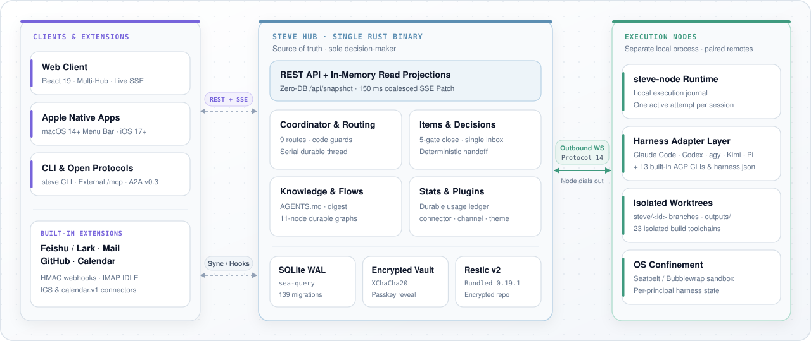
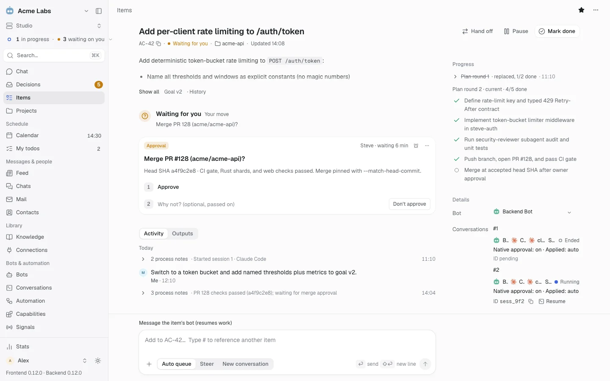
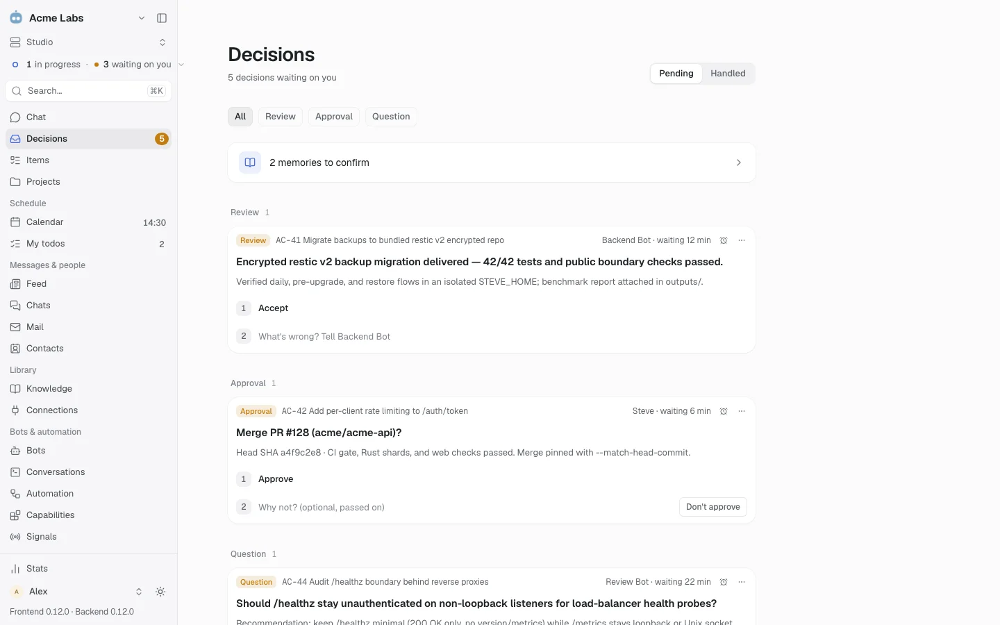
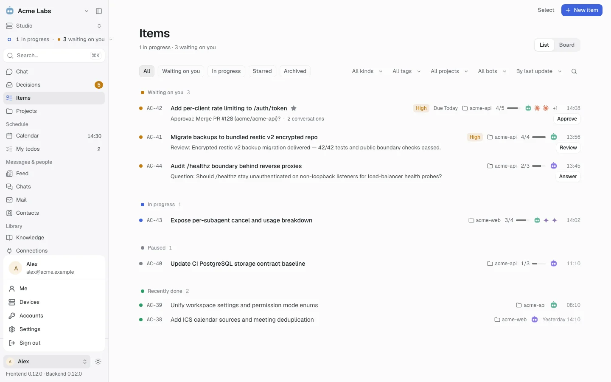

<div align="center">

<picture>
  <source media="(prefers-color-scheme: dark)" srcset="docs/assets/art/banner-en-dark.svg">
  
</picture>

<p><strong>A self-hosted workspace that coordinates coding agents across worktrees, tools, and machines — with one inbox for every human decision.</strong></p>

[](https://github.com/Infranite/steve/releases) [](LICENSE) [](hub-rs) [](web) [](#requirements)

English · [简体中文](README.zh-CN.md)

[Why Steve](#why-steve) · [Architecture](#architecture) · [Capabilities](#core-capabilities) · [Harnesses](#supported-harnesses) · [Quick start](#quick-start) · [Concepts](#concepts-at-a-glance) · [Security](#security-and-privacy) · [Deployment](docs/deployment.md)

</div>

<picture>
  <source media="(prefers-color-scheme: dark)" srcset="docs/assets/screenshots/chat-dark.webp">
  
</picture>

- **One coordinator above 18 ACP coding CLIs** — Claude Code, Codex, Antigravity CLI (`agy`), Gemini CLI, GitHub Copilot CLI, OpenCode, Cursor, Pi, and 10 more run in isolated `steve/<id>` git worktrees with structured subagent and background task tracking.
- **One inbox for every human decision** — Delivery reviews, SHA-pinned PR merges, agent questions, vault secret grants, and outbound drafts land in **Decisions**; native approval (YOLO) uses each harness's own mode and never bypasses Steve tools, secrets, or merges.
- **Built to survive restarts and span machines** — A single Rust Hub backed by SQLite WAL, in-memory SSE projections, bundled encrypted `restic` v2 backups, and a separate-process local Node (plus experimental paired remote `steve-node` hosts).
- **Local-first security without touching your harness config** — Per-workspace XChaCha20-Poly1305 vault in your OS keystore with Passkey reveal, Seatbelt/Bubblewrap OS confinement, per-principal harness state, and audience-aware disclosure checks.

```sh
brew install infranite/tap/steve
steve setup
```

---

## Why Steve

Coding agents handle individual tasks well. Running several in parallel breaks down on bookkeeping: scattered terminal tabs, lost context between sessions, unanswered permission prompts, and no durable record of what was delivered or whether checks passed.

Steve adds a typed control plane above the coding CLIs you already use. You work from a single conversation; Steve decides whether to answer directly, run three-layer read-only research with `path:line` citations, or dispatch a tracked item to a worker Bot in its own worktree.

| | Agents in terminal tabs | With Steve |
|---|---|---|
| **Tracking** | Tabs, scrollback, and memory | Tracked items with versioned goals, multi-round plans, delivery tags, and check evidence |
| **Isolation** | Multiple agents share one checkout | One git worktree (`steve/<id>`) per item, 23 isolated build toolchains, OS confinement |
| **Approvals** | Whichever tab you happen to open | One **Decisions** inbox, or each harness's own native approval mode |
| **Subagents & background tasks** | Buried in raw terminal logs | Structured `subtask` tracking with nested child tools, usage, and per-subagent cancel |
| **Merging** | Manual branch juggling | One PR per item; Steve merges via `gh pr merge --match-head-commit` after CI and SHA-pinned approval |
| **Secrets** | Pasted into prompts or env files | Encrypted vault in OS keystore; injected into commands on the execution Node without reading the vault |

---

## Architecture

Steve separates **state and decisions (Hub)**, **agent execution (Node)**, and **presentation (Clients)** behind typed Rust contracts.

<picture>
  <source media="(prefers-color-scheme: dark)" srcset="docs/assets/art/arch-en-dark.svg">
  
</picture>

- **Hub (`steve-hub`)**: Single source of truth and sole decision-maker — routing, capacity queues, model selection, permission rulings, vault, channels, read projections, encrypted backups, and metrics. Runs on SQLite WAL behind a `sea-query` repository contract; an in-memory projector serves `GET /api/snapshot` with zero DB queries and streams 150 ms-coalesced `Patch` frames over SSE.
- **Node (`steve-node`)**: Executes one attempt at a time per session with a local execution journal, terminates ACP/MCP/CLI protocols, and enforces OS confinement. By default (`STEVE_NODE_MODE=service`), the Hub's own local Node runs in a separate process so Hub restarts and upgrades do not interrupt active turns. Paired remote Nodes always dial outbound over WebSocket (`PROTOCOL = 14`).
- **Clients (`web/`, `apple/`)**: Multi-Hub React web app plus native macOS 14+ (with menu bar status) and iOS 17+ clients sharing the same web UI, Keychain credentials, and typed wire views generated from `steve-types`.

See **[docs/architecture.md](docs/architecture.md)** for the full Hub–Node protocol, storage contract, read-side projections, and 32-crate workspace layout.

---

## Core capabilities

### Coordinator and chat routing

Steve (the main bot) acts as a **coordinator**, not a silent worker. Every message enters a per-space serial durable reply pipeline with lease fencing and idempotency keys:

- **Deterministic shortcuts first**: `/汇报`, `@Bot` mentions, quoted item focus, offer confirmations, and obvious greetings bypass the router model completely.
- **Nine routes with code guards**: `answer`, `research`, `item`, `suggest`, `ask`, `supplement`, `status`, `config`, and `reroute`. Code guards stop questions from turning into items and prevent closed items from being silently supplemented.
- **Three-layer read-only research**: Non-owner contexts enforce adapter `plan` mode, an ACP kind/path guard blocking sensitive home directories (`.ssh`, `.steve`, `.aws`, `.config/gh`, `Library/Keychains`), and an OS read-only sandbox. In the instance owner's private main chat, asking Steve to inspect or fix something on the Hub host runs with that OS user's permissions while Steve's own keys, database, and binaries stay protected.
- **Conversational configuration & A2UI**: Configure bots, projects, models, tags, flows, and contacts in plain language via transactional changesets with 24-hour undo. Replies can render declarative A2UI forms, choices, tabs, and charts with single-submission semantics.

### Tracked items and delivery semantics

<picture>
  <source media="(prefers-color-scheme: dark)" srcset="docs/assets/screenshots/item-dark.webp">
  
</picture>

- **Five-gate closing**: Items move through `ready → active → closing → closed` (plus `paused`). `closing` freezes the git worktree result and verifies no active turns/queued messages, no open required operations, no worktree drift, settled acceptance (`automatic` default, `human`, or `waived`), and no new open decisions before closing. Reopening creates a new cycle while keeping earlier rounds.
- **Type vs Delivery tags & design gates**: Each item carries one **Type** tag (`Fix`, `Feature`, `Docs`, `Refactor`, `Ops`, `Chore`) and multi-select **Delivery** tags (`Plan`, `Code`, `Report`, `Content`, `Data`, `Operation`). Design-only deliverables pause at a human **design gate** (`implement`, `keep design only`, or `revise`) that YOLO cannot bypass.
- **Outputs, preview links, and SHA-pinned merges**: Non-Git deliverables live in `<STEVE_HOME>/workspaces/<item>/outputs`. Bots (`steve_deliver_file`) and humans (`steve publish <file|folder>`) create immutable Hub preview links (static HTML by default, or an isolated no-network sandboxed prototype) with optional revocable share tokens. GitHub PRs merge only after acceptance, CI pass, and a human approval pinned to the exact repository, PR number, head SHA, and cycle (`gh pr merge --match-head-commit`; host auto-merge is never enabled).
- **Dependencies, forks, and goal edits**: Cycle-checked prerequisites obey durable `WaitContract` timeouts. Any session point can be forked into a new session or child item. Goal edits deliver `vN` directly to the running session rather than replacing it silently.

### Single decision inbox and native approval (YOLO)

<picture>
  <source media="(prefers-color-scheme: dark)" srcset="docs/assets/screenshots/inbox-dark.webp">
  
</picture>

- **One place for human judgment**: **Decisions** (`#/inbox`) collects six decision kinds (`accept`, `approve`, `ask`, `propose`, `fail`, `confirm`) across three tiers (`decide`, `draft`, `folded`) — covering delivery reviews, SHA-pinned PR merges, ACP tool permissions, agent questions, `no_executor` coordinator cards (when no worker Bot can take an item), `handoff_unavailable` alerts, vault secret grants, mail approvals, and project `AGENTS.md` proposals. Settled decisions stay in **Handled** for 7 days with 24-hour undo where reversible.
- **Native harness approval (YOLO)**: Turning on **Native approval (YOLO)** requests `PermissionMode::Auto` only on harnesses that natively support it (`claude-code`, `codex`, `goose`, `mistral-vibe`, `antigravity`), taking effect at the next idle boundary or session open. Unsupported harnesses stay on `ask` (no simulated YOLO), `full_access_only` adapters such as Pi are excluded, and agent questions, Steve tools, vault secrets, personal external sends, design gates, and PR merges always require human confirmation.

### Sessions, subagents, and deterministic handoff

<picture>
  <source media="(prefers-color-scheme: dark)" srcset="docs/assets/screenshots/session-dark.webp">
  
</picture>

- **Structured subagents and background tasks**: Harnesses report subagents, background tasks, and native workflows as typed `subtask` events in the unified `steve.v1` transcript. Child tool calls nest under their parent subtask, active subtasks surface in the top running capsule, and adapters advertising `can_cancel` (Claude Code, Codex) expose per-subagent **Cancel**.
- **Deterministic session handoff**: On provider quota exhaustion, repeated provider errors, or an explicit owner request, Steve keeps the **same Bot** (preserving its identity, permissions, memories, and Team) and switches only its execution surface (`harness + model + effort`) from its fallback list — waiting instead when quota reset is within `quotaWaitMinutes` (default `10`). If all surfaces fail, Steve raises a `handoff_unavailable` coordinator card instead of silently switching Bots. Offline remote Nodes hand over waiting sessions after `STEVE_NODE_HANDOFF_MIN` minutes (default `30`).
- **Full transparency**: Every session panel displays context window usage, estimated vs harness-reported cost, changed files, knowledge citations, a message queue (steer with `Enter`, queue with `⌥Enter`), and the exact CLI command to resume in the harness itself. Steve never edits your harness settings or writes "always allow".

### Multi-machine Nodes and Devices

<picture>
  <source media="(prefers-color-scheme: dark)" srcset="docs/assets/screenshots/node-dark.webp">
  
</picture>

- **Task-oriented Node inspection**: Each Node opens a six-tab view (**Overview**, **Harnesses**, **Work & Resources**, **Access**, **Version**, **Diagnostics**) surfacing prioritized action items, live CPU/memory/network/disk/token vitals, 24-hour trends, per-Node harness probes, and sanitized copyable diagnostics.
- **Capacity queues and execution binding**: Each Node defaults to **32 concurrent session turns** (configurable 1–256 in **Devices** without restarting); excess turns queue durably. Workspace owners bind worker Bots and Teams explicitly to compatible paired Nodes.
- **Harness updates and boot-time macOS Nodes**: Check and upgrade managed npm ACP adapters — plus verified external CLIs (`claude-code`, `codex`, `antigravity`, `pi`, `kimi-code`) — directly from **Devices**. On macOS, `steve node enable-boot` registers a signed boot LaunchDaemon running as your original non-root user so remote Nodes come online without desktop login and upgrade from **Devices** without `sudo`.

### Navigation, identity, and connected workspace

<picture>
  <source media="(prefers-color-scheme: dark)" srcset="docs/assets/screenshots/menu-dark.webp">
  
</picture>

- **Avatar-as-identity & scannable menu IA**: Every actor (`person`, `bot`, `system`, `org`, `team`) renders through one `ActorAvatar` contract while harnesses and model makers stay separate marks. The desktop sidebar groups work into five sections — Primary, Schedule (next meeting time + due todo count), Messages & people, Library, and Bots & automation — with **Stats** pinned in the footer beside the **Account** menu (`Me`, `Devices`, `Accounts`, `Settings`, `Sign out`) and `<kbd>⌘K</kbd>` command palette.
- **Connected context**: Built-in **Feishu / Lark** (QR bot + OAuth self, spaces, personas, thread-to-item routing), **Email** (IMAP/SMTP with IDLE push, sandboxed HTML, server-computed recipients, content-bound approval + disclosure audit), **GitHub** (App or fine-grained PAT, HMAC webhooks, PR/issue linking, collaborator review routing, CI failure flowback), and read-only **Calendar** (`steve-calendar`: ICS subscription/upload, `calendar.v1` connector plugins, meeting deduplication, 4 read-only MCP tools).
- **Redefined knowledge & durable automation**: Personal knowledge indexes people, organizations, projects, owner rules/preferences, commitments, and owner materials (separating past items and chat into `scope=records` search), while codebase engineering lessons route to project `AGENTS.md` confirmation proposals. `steve-digest` organizes stored messages for an opt-in Digest Bot; `steve-flow` runs 11-node-kind durable graphs (QuickJS scripts, SSRF-guarded HTTP, shell-quoted commands, Bot nodes) with versioned edits, dry runs, and natural-language schedules. **Feed** separates scheduled reports and timezone-aware personal notifications from chat; **Stats** tracks durable token/cost ledgers (synced daily from Models.dev) and delivery metrics.

---

## Supported harnesses

Steve ships **18 built-in ACP harnesses** declared in [`hub-rs/crates/steve-harness-spec/src/builtins.toml`](hub-rs/crates/steve-harness-spec/src/builtins.toml) plus custom ACP adapters via `<STEVE_HOME>/harness.json` (`STEVE_HARNESS_MANIFEST`).

| Harness | ID | Installation | Native approval (YOLO) | Verified runtime adapter (`steve-acp`) |
|---|---|---|---|---|
| **Claude Code** | `claude-code` | npm-managed (`@agentclientprotocol/claude-agent-acp`) | Yes (`auto`) | Verified — RFD subagents (cancel + child nesting), bg tasks, managed + external CLI updates |
| **Codex** | `codex` | npm-managed (`@agentclientprotocol/codex-acp`) | Yes (`agent`) | Verified — RFD subagents (cancel + child nesting), rollout usage, managed + external CLI updates |
| **Antigravity CLI** | `antigravity` | `PATH` (`agy`) | Yes (`auto`) | Verified — tool-fallback subagents, bg tasks, native workflows, external `agy update` |
| **Kimi Code** | `kimi-code` | npm-managed (`@moonshot-ai/kimi-code`) | — | Verified — tool-fallback subagents & bg tasks, context-only usage, external CLI updates |
| **Pi** | `pi` | npm-managed (`@openma/pi-acp` + `@earendil-works/pi-coding-agent`) | Full-access only | Verified — optional `pi-subagents` with per-subtask usage, managed + external CLI updates |
| **Gemini CLI** | `gemini` | npm-managed (`@google/gemini-cli`) | — | Generic ACP |
| **GitHub Copilot CLI** | `github-copilot-cli` | npm-managed (`@github/copilot`) | — | Generic ACP |
| **OpenCode** | `opencode` | npm-managed (`@opencode/cli`) | — | Generic ACP |
| **Qwen Code** | `qwen-code` | npm-managed (`@qwen-code/qwen-code`) | — | Generic ACP |
| **goose** | `goose` | npm-managed (`@aaif/goose-acp`) | Yes (`smart_approve`) | Generic ACP |
| **Grok Build** | `grok-build` | npm-managed (`@xai-official/grok`) | — | Generic ACP |
| **Kilo Code** | `kilo` | npm-managed (`@kilocode/cli`) | — | Generic ACP |
| **Factory Droid** | `factory-droid` | npm-managed (`droid`) | — | Generic ACP |
| **CodeBuddy Code** | `codebuddy-code` | npm-managed (`@tencent-ai/codebuddy-code`) | — | Generic ACP |
| **Cursor** | `cursor` | `PATH` (`cursor-agent`) | — | Generic ACP |
| **Kiro CLI** | `kiro` | `PATH` (`kiro-cli`) | — | Generic ACP |
| **Mistral Vibe** | `mistral-vibe` | `PATH` (`vibe-acp`) | Yes (`smart-approve`) | Generic ACP |
| **Qoder CLI** | `qoder` | `PATH` (`qodercli`) | — | Generic ACP |

- **13 npm-managed** adapters install into `<STEVE_HOME>/adapters` (`steve setup` or `steve adapters install <id>`); **5 `PATH`-discovered** CLIs are installed with their own installers and detected automatically.
- Custom `harness.json` declarations cannot override built-in IDs and never inject arbitrary environment variables (harness credentials stay on the executing Node).

---

## Quick start

### Install with Homebrew *(recommended)*

```sh
brew install infranite/tap/steve
steve setup
```

`steve setup` runs an interactive wizard (Chinese or English via `--lang zh-CN|en` or `STEVE_LANG`): choose **Hub** or **Node**, set listen addresses (default `0.0.0.0:8440` with the web UI on port `8441`), pick npm-managed ACP adapters, create the local macOS signing identity, issue the owner's first access token, register the service, and start it. Non-TTY runs print plain prompts and leave service startup to you:

```sh
steve hub start         # start the Hub service
steve node start        # start a paired Linux Node (after fingerprint confirmation in Devices)
steve node enable-boot  # register and start a boot-time macOS Node (one sudo prompt)
```

Verify health anytime with `steve hub status`, `steve hub doctor`, or `steve node doctor`. See **[docs/deployment.md#homebrew-installation](docs/deployment.md#homebrew-installation)** for flags, `--reconfigure`, and second installations.

### Requirements

| | Requirement |
|---|---|
| **Prebuilt install (Homebrew / release archive)** | Apple Silicon macOS 14+ (`aarch64-apple-darwin`), or Linux `x86_64` with glibc 2.35+ (Ubuntu 22.04+ / Debian 12+) and `systemd --user`. Windows is not supported. No Python runtime needed; Node.js is installed as a Homebrew dependency for npm-managed ACP adapters. |
| **Agent execution** | Any supported coding CLI installed and signed in on the executing Node. Hub services and diagnostics work without any harness installed. |
| **Build from source *(development)*** | Git, Rust (`edition = 2024`; CI pins `1.99.1`), Node.js 24 LTS + npm, `/bin/zsh` (for legacy source-release tests), Python 3.11+ (for boundary/release scripts). |

<details>
<summary>Build and run from source (development)</summary>

```sh
git clone https://github.com/Infranite/steve.git
cd steve
npm ci
npm run build:web
cargo build --locked --manifest-path hub-rs/Cargo.toml -p steve-hub

# Install the ACP adapters you plan to use into an isolated dev home
STEVE_HOME="$HOME/.steve-dev" hub-rs/target/debug/steve-hub --adapters install claude-code codex

# Run with loopback-only one-click dev login
STEVE_HOME="$HOME/.steve-dev" \
STEVE_DEV_LOGIN=1 \
STEVE_HOST=127.0.0.1 STEVE_PORT=8440 \
STEVE_WEB_DIR="$PWD/web/dist" \
  hub-rs/target/debug/steve-hub
```

Open **http://127.0.0.1:8440**. For daily source development, `python3 ops/dev.py up` runs an incremental debug Hub on `127.0.0.1:18440` with Vite HMR on `127.0.0.1:18441` (`~/.steve-dev`). On headless Linux without Secret Service, set `STEVE_VAULT_KEYSTORE=dir` and `STEVE_VAULT_KEY_DIR` to a `0700` directory outside `STEVE_HOME`.

</details>

---

## Concepts at a glance

| Concept | Summary |
|---|---|
| **Hub / Node / Client** | Hub holds state and decisions; Node runs harnesses with an execution journal; Web and Apple clients render synced projections. |
| **Coordinator vs Worker Bot** | Steve routes, researches, and coordinates. Tracked items dispatch to worker Bots or Teams; if none can execute, Steve opens one `no_executor` card. |
| **Item & Closing Gate** | A tracked unit of work (`ready → active → closing → closed`) with one **Type** tag, multi-select **Delivery** tags, isolated worktree, and 5-gate closeout. |
| **Decisions (`#/inbox`)** | Single entry for reviews, SHA-pinned PR merges, tool approvals, agent questions, vault grants, proposals, and channel reply drafts. |
| **Native approval (YOLO)** | Delegates local tool approval strictly to harnesses with native auto-approval; never simulates YOLO or waives Steve-level gates. |
| **Deterministic handoff** | Switches a Bot's fallback execution surface (`harness + model + effort`) on quota/provider errors or owner request while keeping the same Bot identity. |
| **Redefined knowledge** | Stores people, orgs, projects, preferences/rules, commitments, and owner files; work items/chat stay in separate `records` search; codebase rules go to project `AGENTS.md` proposals. |

Read **[docs/concepts.md](docs/concepts.md)** for full details on each concept.

---

## Security and privacy

- **Authentication**: Username + access token (`steve-hub --access token create`), single-use QR pairing, or optional OIDC (Authorization Code + PKCE, 30-day SHA-256 session cookies). `STEVE_DEV_LOGIN=1` is enforced loopback-only via `ConnectInfo<SocketAddr>`. Bare `steve-hub` defaults to `127.0.0.1:8440` and refuses `0.0.0.0`/`::` unless `STEVE_ALLOW_ANY_HOST=1`.
- **Encrypted vault**: Per-workspace 256-bit master key in your OS keystore (macOS Keychain via stable-signature `steve-keyhelper`, Linux Secret Service, or an external `0700` key directory). Each entry uses its own data key encrypted with XChaCha20-Poly1305. Secret reveal requires a single-use WebAuthn Passkey challenge bound to the field. `steve_secret_use` injects secrets into env/stdin/temp file and executes strictly on the session's execution Node with no Hub-local shell fallback; high-sensitivity items and cards can never be granted.
- **OS confinement (`STEVE_CONFINE`)**: Level `1` (default) uses macOS Seatbelt (`sandbox-exec`) or Linux Bubblewrap (`bwrap`) to keep Steve's keys, database, and binaries out of reach, restrict writes to the workspace and tool caches, and hide the Node owner's harness homes from non-owner sessions. Level `2` starts runs from a fresh login environment. Harnesses with their own sandbox (Codex) keep it.
- **Per-principal state & toolchains**: `STEVE_PRINCIPAL_STATE=on` (default) isolates each user's harness directory while linking the Node's own sign-in without copying credentials. `STEVE_TOOLCHAINS=on` isolates caches and build targets across 23 built-in toolchains.
- **Disclosure levels & outbound audit**: Knowledge entries are tagged `public`, `conclusion`, `reasoning`, or `never` (never indexed). Outbound messages to external audiences pass deterministic rules and a cross-model audit (`exclude_model` avoids the drafting model); failed or timed-out checks block sending.

> [!IMPORTANT]
> Review authentication before exposing the Hub beyond localhost. Coding agents running under Steve act with the executing OS user's permissions outside the files protected by `STEVE_CONFINE`.

---

## Deployment and operations

| Deployment path | Best for | Upgrades |
|---|---|---|
| **Homebrew & managed service (`brew install infranite/tap/steve && steve setup`)** | macOS 14+ (Apple Silicon) and Linux `x86_64` servers | `steve upgrade` (signed macOS Hub) or **Settings → About** (`steve-hub --supervise`); Nodes upgrade from **Devices** |
| **Separate macOS boot Node (`steve setup node && steve node enable-boot`)** | Always-on secondary Macs without desktop login | Signed in-place updates from **Devices** without `sudo` |
| **Source checkout (`ops/dev.py` / `ops/local-release.py`)** | Contributors and local development | Local rebuild |

- **Default paths and ports**:
  - Data directories: `~/.steve` (Hub) and `~/.steve-node` (separate Node), overridden by `STEVE_HOME` / `--home`.
  - Ports: Hub API `8440` (`STEVE_PORT`), separate Web UI `8441` (`STEVE_WEB_PORT`, Hub + 1 on `steve setup`), optional tailcat Node listener `8442` (`STEVE_TAILCAT_PORT`, Hub + 2), local service Node `8443` (`STEVE_LOCAL_NODE_PORT`, Hub + 3), optional Prometheus metrics `127.0.0.1:9464` (`STEVE_METRICS=prometheus`).
- **Encrypted backups (`restic` v2)**: Every release archive bundles verified upstream `restic` 0.19.1 next to `steve-hub`. Daily (after 03:30 local time, default 7-day retention), pre-upgrade (always on), pre-destructive, manual, and diagnostic backups share one encrypted repository at `<STEVE_HOME>/backups/restic` with keys in the OS KeyStore and SQLite `quick_check` + SHA-256 verification. Offline management: `steve-hub --admin backup|backup-list|restore <id> (--database-only | --to <dir>)`.
- **Key operational guides in [docs/deployment.md](docs/deployment.md)**:
  - [Homebrew installation & setup](docs/deployment.md#homebrew-installation) · [Reconfiguring a Hub](docs/deployment.md#reconfiguring-an-installed-hub)
  - [Backups and restore](docs/deployment.md#backups) · [Managed releases and upgrades](docs/deployment.md#managed-release-bundles-and-automatic-upgrades)
  - [Pairing remote Nodes](docs/deployment.md#pairing-a-separate-node) · [macOS Node boot service](docs/deployment.md#macos-node-boot-service)
  - [Harness setup & updates](docs/deployment.md#harness-setup) · [Capabilities (MCP, skills, A2A)](docs/deployment.md#capabilities-mcp-servers-skills-and-remote-agents)
  - [Access tokens, OIDC & Apple apps](docs/deployment.md#access-tokens-and-clients) · [Metrics and health](docs/deployment.md#metrics-and-health)

---

## Extending Steve

- **Runtime plugins**: Install prebuilt, SHA-256-verified archives while the Hub runs from any plugin library (`steve-store.json`; official library [`Infranite/steve-extensions`](https://github.com/Infranite/steve-extensions), configurable via `STEVE_PLUGIN_LIBRARY`). Three plugin kinds are supported under contract 1: **`connector`** (external services + optional `calendar.v1`), **`channel`** (messaging systems as self or bot via `ext_ws` / `ext_ws.bot`), and **`theme`** (data-only web skins). See [docs/deployment.md#plugins](docs/deployment.md#plugins).
- **Unified MCP server & Capabilities**: Every Bot session connects to one Hub `/mcp` endpoint with **8 core tools** plus up to **32 pinned tools** discovered via `steve_tools_search` and invoked through schema-checked `steve_tool_call` across workspace MCP servers, A2A agents, and connectors. External MCP clients (Claude Desktop, Cursor, etc.) connect to `/mcp` with a user access token (`Bearer stt_…`) for a scoped read/dispatch subset.
- **A2A server**: Exposes `GET /.well-known/agent-card.json` and JSON-RPC 2.0 `POST /a2a` (`protocolVersion: "0.3.0"`: `message/send`, `tasks/get`, `tasks/cancel`).
- **Compile-time extension points**:
  - **Hub Extension API** (`steve-hub/src/extension.rs`, `EXTENSION_API = 2`): `Assembly::builtin().with(...)` registers connection providers, channel/mail adapters, event sources, routes, and jobs (`Assembly::builtin()` ships `feishu.bot`, `feishu.self`, `ext_ws`, `mail.imap`, `github`, and `calendar`).
  - **Flow & Module seams**: Custom flow node kinds/actions via `FlowSetup`; item hooks, declarative sidebar item panels, prompt context, outbound checks, and undoable changesets via `steve-modules`.
  - **Webhooks & Knowledge store port**: Signature-checked `POST /hooks/{id}` and `POST /hooks/github`; optional OpenViking vector backend (`STEVE_KB_STORE=openviking`) with Hub-side access re-checking.

---

## Status and roadmap

Steve is **pre-1.0 (`0.x`)**. Public contracts (Hub HTTP API, Hub–Node protocol, plugin SDK, and on-disk formats) are still evolving and may introduce breaking changes on `MINOR` releases until frozen at `1.0.0` (see [versioning rules](CONTRIBUTING.md#changes-and-releases)).

- **Experimental**:
  - **Multi-device remote Nodes**: `steve-node` pairing and remote execution are enabled by default (`STEVE_NODE_LISTEN=1`) and actively hardening.
- **Planned *(not yet implemented)***:
  - **Pluggable storage, cache, export, and backup destination drivers** (including remote `restic` REST backup destinations and production PostgreSQL beyond the current `#[cfg(test)]` contract suite).
  - **Feed & notification expansion**: RSS ingestion, personal report subscriptions, scheduled digest generation, and personal notification event types beyond `work.item.done` and `briefing.ready`.
  - **Additional integrations & vault backends**: Gmail and Outlook API mail adapters (IMAP/SMTP works today), Feishu docs/calendar/approvals, and external vault backends (1Password, Bitwarden).
  - **Deny-by-default view-based OS sandbox** (currently running in shadow mode alongside `STEVE_CONFINE`).
  - **Streaming & push for A2A**, and verified timed output-token telemetry from harnesses (realtime TPS currently uses streamed-text estimates via API only).

---

## Contributing

Issues and pull requests are welcome. Read **[CONTRIBUTING.md](CONTRIBUTING.md)** before opening a PR for:

- Local development checks (`cargo nextest`, `npm run check`, `npm run test:web`, browser smoke tests, boundary & guard checks).
- Conventional Commits format (`type(scope): imperative summary`, plus `Upgrade:` trailers when operator action is required).
- Automated version computation and release note generation (`ops/cut-release.py` — never pick a version or hand-write `docs/releases/`).

---

## License

Licensed under the **[MIT License](LICENSE)**. External coding CLIs, model providers, and third-party integrations are separate products governed by their own terms. Pro UI components under `web/src/components/affect/` remain under the affectUI license as noted in their file headers.

<sub>Screenshots are rendered from the real Steve web UI using deterministic synthetic fixtures — no production data is used. Switch language anytime in Settings → Appearance.</sub>
