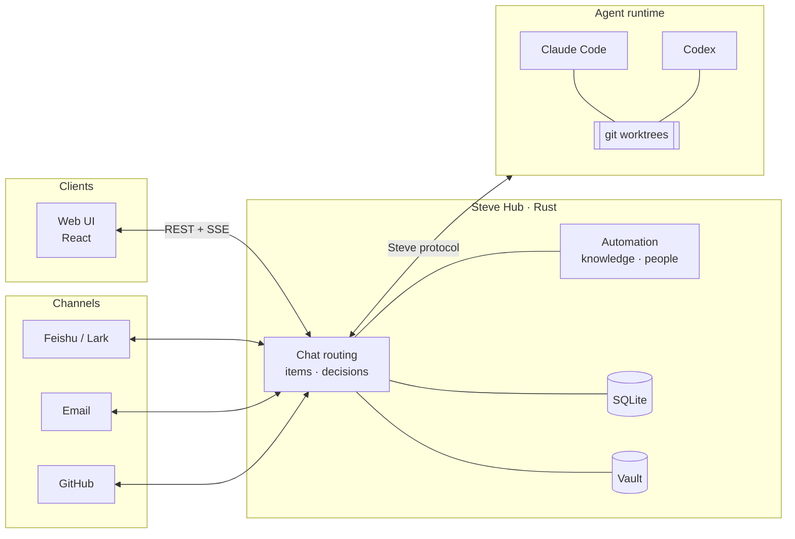

<div align="center">

# Steve

**Your self-hosted assistant that turns a sentence into delivered work.**

Talk to Steve the way you'd talk to a capable colleague. It answers what it can, looks things up when it needs to,<br>
and hands real work to coding agents like Claude Code and Codex. It keeps every item moving, and it asks you only when it matters.

[](https://github.com/Infranite/steve/releases)
[](LICENSE)
[](hub-rs)
[](web)
[](#requirements)

English · [简体中文](README.zh-CN.md)

[Features](#features) · [How it works](#how-it-works) · [Quick start](#quick-start) · [Deployment](docs/deployment.md) · [Contributing](CONTRIBUTING.md)

</div>

---

## Why Steve

Coding agents are good at doing the work. They aren't good at **keeping track of it**. You end up with a dozen terminal tabs, lost context, forgotten approvals and no record of what was delivered.

Steve is the layer above the agents. It runs on your own machine, owns the state, and gives you one place to:

- **Hand things off in plain language.** One chat routes each message for you. Steve answers directly, researches inline, creates a tracked item, or forwards a follow-up to work already in progress.
- **Let agents work without supervision, safely.** Each item gets its own git worktree, a lifecycle and an audit trail. Steve takes over when an agent stalls and checks whether the work is actually done.
- **Stay in control of what matters.** Approvals, releases and decisions arrive in one Inbox. YOLO mode lets Steve decide routine things while you're away, and every choice it made is recorded.
- **Bring your world in.** Feishu/Lark, email, GitHub, contacts and a knowledge base feed the same workspace, so agents work with real context.

Everything stays on infrastructure you control: a single Rust binary, a SQLite database and an encrypted vault.

## Features

<table>
<tr>
<td width="50%" valign="top">

### 💬 One conversation
A main chat that triages every message: answer, research, create an item, send to an item, check progress or change configuration. Use `@` to hand off to a specific bot, link people or reference items. Drafts survive reloads and upgrades.

</td>
<td width="50%" valign="top">

### 📋 Items, from intake to wrap-up
Each piece of work moves through *intake → triage → define → plan → prepare → execute → deliver & review → wrap up*. It runs in an isolated worktree inside your project. You accept, rework or drop the result.

</td>
</tr>
<tr>
<td valign="top">

### 🤖 Agent harnesses
Runs **Claude Code** and **Codex** over the Agent Client Protocol. Model and thinking effort are set per bot, with fallback chains. Interrupted turns resume after restarts, and uncertain outcomes are reconciled, never blindly re-run.

</td>
<td valign="top">

### ✅ Inbox and approvals
Permission requests, delivery reviews and release approvals wait in one place, with a full decision history. **YOLO** mode handles routine choices on a countdown while you're away and shows what it picked and why.

</td>
</tr>
<tr>
<td valign="top">

### 🔌 Connections
**Feishu/Lark** bots and channels with interactive cards, **email** accounts (IMAP sync, drafts, sending), **GitHub** repositories and pull requests. Bots can have their own personas and roles.

</td>
<td valign="top">

### 📚 Knowledge and people
Index folders and notes into a knowledge base with retrieval and citations. Contacts, organizations and teams keep their own memories, so agents know who they're working with.

</td>
</tr>
<tr>
<td valign="top">

### ⚡ Automation
Signals, rule-based flows and schedules on a visual canvas. Each run can be traced step by step.

</td>
<td valign="top">

### 📊 Stats and outputs
Usage, cost, time, quality and intervention metrics. You can browse, preview and annotate every file an item produced.

</td>
</tr>
<tr>
<td valign="top">

### 🔐 Built to be trusted
OIDC sign-in, shared workspaces, an encrypted credential vault (macOS Keychain or a protected key directory) and secrets loaded from files. Daily backups, plus a backup before every release.

</td>
<td valign="top">

### 🚀 Upgrades in place
Check, read release notes and upgrade from Settings. The supervisor drains active work, backs up SQLite, verifies the new version and rolls back if verification fails.

</td>
</tr>
</table>

The interface is available in **English** and **简体中文** and has a command palette (<kbd>⌘</kbd> <kbd>K</kbd>) for everything.

## How it works



- **The Hub is the brain.** It is the single source of truth and the only place decisions are made: what runs, on which model, which permissions are granted, what's next in the queue. It also handles authentication, the vault, channels and stats.
- **Harnesses do the work.** Agent protocols (ACP, MCP, stream-json) end inside the runtime driver. The rest of Steve only sees its own vocabulary: sessions, turns, events, tool calls and approvals. Adding a new harness means adding one driver.
- **Clients are windows.** Everyone in a workspace, on every device, sees the same state live.

The design is in [docs/hub-node-client.md](docs/hub-node-client.md) and the wire contract in [docs/node-protocol.md](docs/node-protocol.md).

## Quick start

### Requirements

| | |
|---|---|
| **Build** | Git, stable Rust/Cargo, Node.js 24 LTS with npm |
| **Run** | Apple Silicon macOS 14+, or Linux x86_64 with glibc 2.35+ (Ubuntu 22.04+, Debian 12+). Windows isn't supported. |
| **Agents** *(optional)* | [Claude Code](https://docs.anthropic.com/claude-code) and/or [Codex](https://github.com/openai/codex), installed and signed in |

### 1. Build

```sh
git clone https://github.com/Infranite/steve.git
cd steve
npm ci
npm run build:web
cargo build --locked --manifest-path hub-rs/Cargo.toml -p steve-hub
```

### 2. Install the agent adapters *(optional)*

Steve talks to harnesses through their ACP adapters. It finds them in the global npm root:

```sh
npm install -g @agentclientprotocol/claude-agent-acp @zed-industries/codex-acp
```

Install only the ones you use. If `claude` isn't at `/opt/homebrew/bin/claude`, set `CLAUDE_CODE_EXECUTABLE`. To point at adapters elsewhere, set `STEVE_ADAPTER_CLAUDE` / `STEVE_ADAPTER_CODEX`.

### 3. Run

```sh
STEVE_HOME="$HOME/.steve-dev" \
STEVE_DEV_LOGIN=1 \
STEVE_HOST=127.0.0.1 STEVE_PORT=8440 \
STEVE_WEB_DIR="$PWD/web/dist" \
  hub-rs/target/debug/steve-hub
```

Open **http://127.0.0.1:8440** and sign in. `STEVE_DEV_LOGIN=1` enables a one-click local owner login that is accepted **from loopback only**. Use it to try Steve. For anything long-lived, configure OIDC instead (see below).

> [!TIP]
> `STEVE_HOME` keeps this instance's data separate. It defaults to `~/.steve`.

## Configuration

Steve reads its settings from the environment. For a service, put them in `$STEVE_HOME/steve.env` (template: [`ops/steve.env.example`](ops/steve.env.example)). Keep secrets out of the checkout and reference them with `*_FILE` variables.

| Variable | Purpose |
|---|---|
| `STEVE_HOME` | Data directory (default `~/.steve`) |
| `STEVE_HOST`, `STEVE_PORT` | Listen address (default `127.0.0.1:8440`) |
| `STEVE_WEB_DIR` | The built web UI the Hub serves |
| `STEVE_PUBLIC_URL` | A URL your integrations can reach, only needed for callbacks. No shared hosted endpoint is provided. |
| `STEVE_OIDC_ISSUER`, `STEVE_OIDC_CLIENT_ID`, `STEVE_OIDC_CLIENT_SECRET_FILE` | Sign-in through your OIDC provider |
| `STEVE_DISK_FLOOR_GB`, `STEVE_DISK_LOW_GB`, `STEVE_WORKTREE_IDLE_HOURS` | Disk guards for item worktrees |
| `STEVE_UPDATE_CHECK` | `0` turns off the periodic release check |

> [!IMPORTANT]
> Review authentication before you expose the listener beyond localhost. Agents running under Steve act with your local user's permissions.

## Deployment

| Path | Best for | Automatic upgrades |
|---|---|---|
| **Local build** (above) | Trying Steve, development | Check only |
| **Source-based macOS service** — `zsh ops/install.sh` | A personal always-on Mac with a Keychain-backed vault | Through `ops/local-release.py` |
| **Managed Release bundle** — `steve-hub --supervise` | macOS or Linux servers under launchd/systemd | ✅ From Settings → About |

Installation steps, vault backends, service-manager settings and the upgrade lifecycle are in **[docs/deployment.md](docs/deployment.md)**.

## Repository layout

```text
hub-rs/          Rust workspace: the Hub binary and its crates
  crates/steve-hub        HTTP server (axum), REST + SSE, config, background jobs
  crates/steve-core       items, decisions, chat routing, model gateway
  crates/steve-acp        Claude Code / Codex adapters over ACP
  crates/steve-node*      agent runtime and the Hub–Node protocol
  crates/steve-channels   Feishu/Lark, personas
  crates/steve-mail       email accounts, sync, sending
  crates/steve-github     repositories, pull requests
  crates/steve-knowledge  knowledge base, retrieval, citations
  crates/steve-flow       signals, automation flows, schedules
  crates/steve-vault      accounts, connections, secret vault
  crates/steve-store      SQLite schema and migrations
web/             React + Vite + Tailwind interface
ops/             install, release, backup and service scripts
docs/            architecture, protocol and release notes
```

## Contributing

Issues and pull requests are welcome. Before you open a PR, read **[CONTRIBUTING.md](CONTRIBUTING.md)**. It has the development checks, how release notes are written as fragments, and how versions and migrations are assigned at release time.

## License

[MIT](LICENSE). External agents, model providers and integrations are separate products with their own terms, and you install and configure them yourself.
