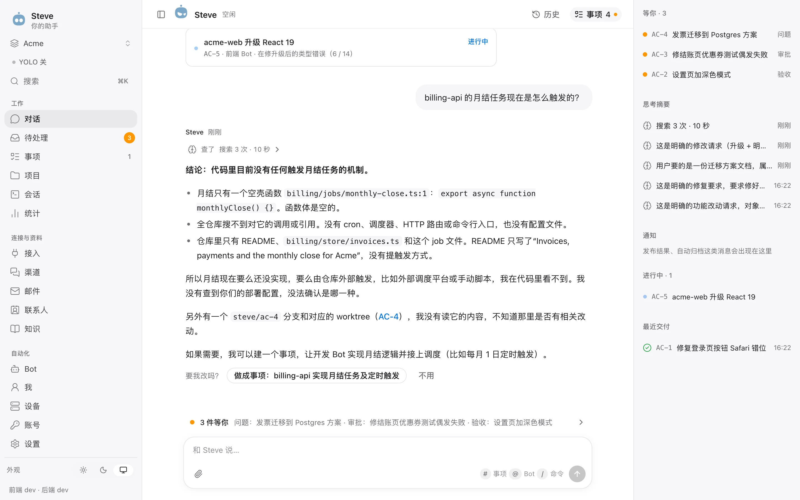
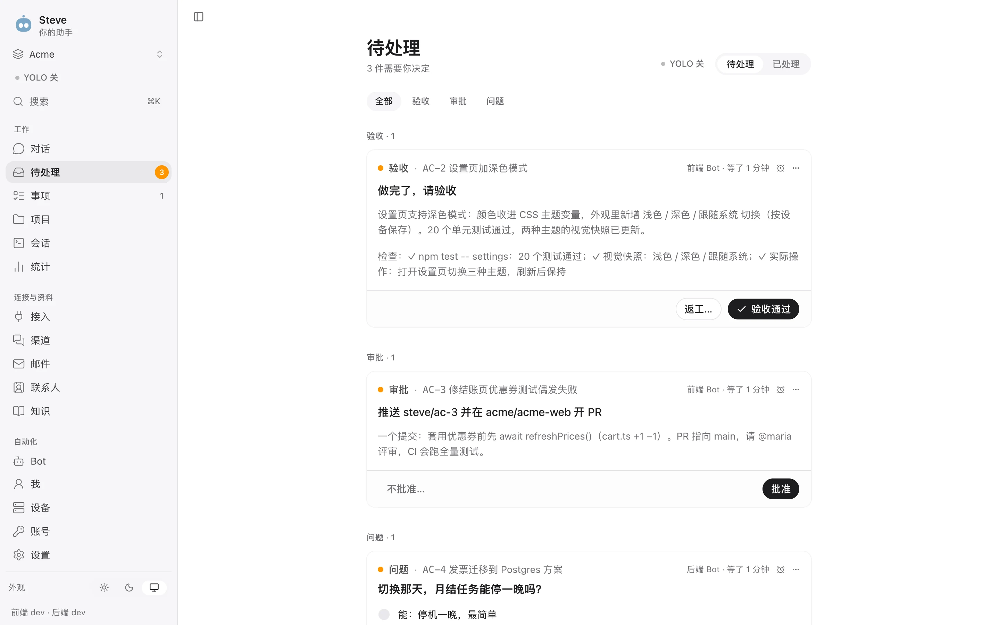
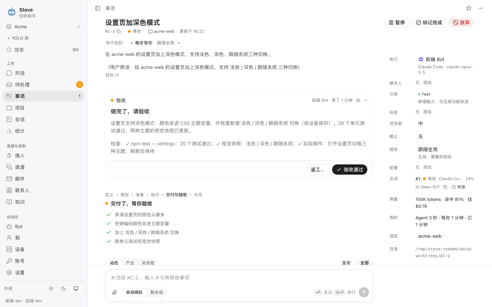
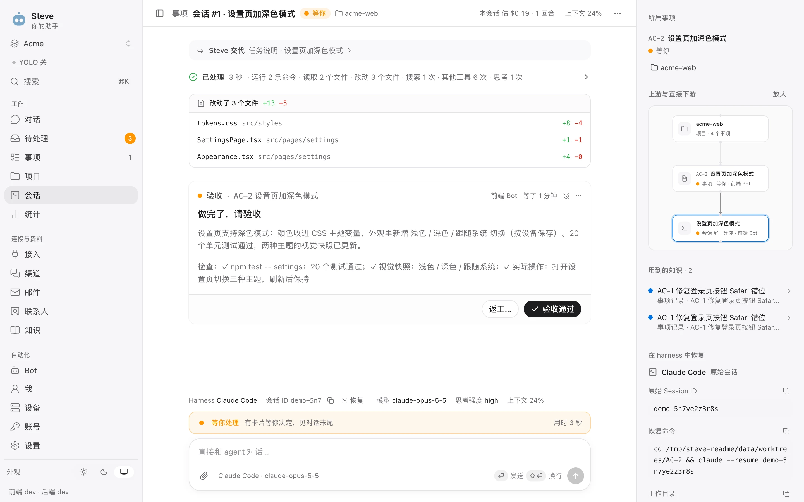
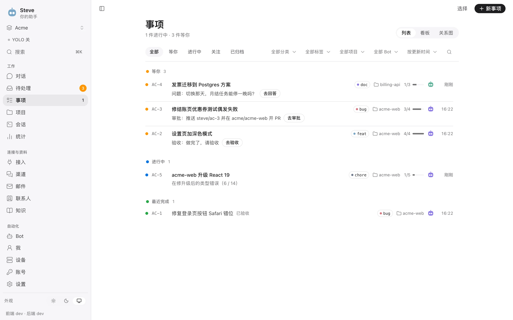
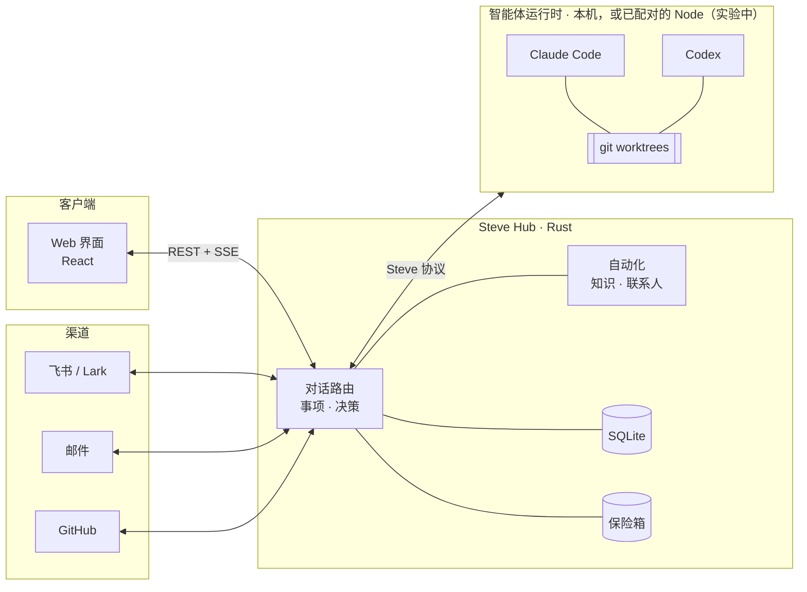

<div align="center">

# Steve

**自托管的助理工作台：一句话交代，交付回来。**

像对一位靠谱的同事那样跟 Steve 说话。能答的它直接答，需要查的它就地查，<br>
真正的活交给 Claude Code、Codex 这样的编码智能体去做。每个事项它都盯到底，只在关键处来问你。

[](https://github.com/Infranite/steve/releases)
[](LICENSE)
[](hub-rs)
[](web)
[](#环境要求)

[English](README.md) · 简体中文

[设计原则](#设计原则) · [功能](#功能) · [扩展](#扩展-steve) · [工作原理](#工作原理) · [快速开始](#快速开始) · [部署](docs/deployment.md) · [参与贡献](CONTRIBUTING.md)

<br>

<picture>
  <source media="(prefers-color-scheme: dark)" srcset="docs/assets/screenshots/chat-dark.webp">
  
</picture>

</div>

---

## 为什么是 Steve

编码智能体擅长干活，但不擅长**记账**：开着十几个终端标签，上下文丢了，审批忘了，交付了什么也没人记得。

Steve 是智能体之上的那一层。它跑在你自己的机器上，掌握全部状态，在一个地方帮你：

- **用大白话交代事情**：一个对话入口，每条消息由 Steve 判断去向：直接回答、就地调研、新建事项，或者补充给正在进行的事项。
- **让一组 Bot 分工干活**：每个 Bot 有自己的 harness、模型、职责、规范和记忆。事项在各自的 git worktree 里运行，彼此之间可以有依赖、可以派生、可以交接。
- **关键的事你说了算**：验收、审批和提问都汇到一个收件箱。YOLO 模式在你不在时处理例行决定：它在硬边界之内行事，每个决定都能撤销。
- **把你的世界接进来**：飞书、邮件、GitHub、联系人和知识库都在同一个工作区，智能体干活时有真实的上下文。每条知识都带披露级别，不该说的场合不会被说出去。

所有东西都在你自己的设施上：一个 Rust 可执行文件、一个 SQLite 数据库和一个加密保险箱。

## 看一眼

<table>
<tr>
<td width="50%"><br><b>待处理</b>：要验收的交付、要批准的推送、要回答的问题，都在一处。</td>
<td width="50%"><br><b>事项</b>：目标、所处阶段、计划、附带检查记录的交付，以及由谁在做。</td>
</tr>
<tr>
<td><br><b>智能体会话</b>：改了哪些文件、用了哪些工具、花费和上下文，以及在 harness 里恢复会话的一行命令。</td>
<td><br><b>事项列表</b>：哪些在等你、哪些在跑、哪些刚交付。</td>
</tr>
</table>

<sub>截图来自一个演示工作区：真实的 Hub 和 Web 界面，智能体按脚本运行。</sub>

## 设计原则

有几条原则贯穿整个代码库，正因为有它们，才敢把真实的工作交给 Steve 自己跑。

| 原则 | 落到实处是什么样 |
|---|---|
| **代码说了算** | 模型只提建议，由经过测试的规则做决定。路由护栏防止一个问题被悄悄做成事项。计划步骤没走完，交付会被拒绝。“完成”可能要求构建、部署或真实操作的证据。 |
| **任何事都不做两遍** | 智能体工具都是“发出即结束本回合”，内存里没有在等的东西。外部操作带稳定的 id。流程每一步先落库再往下走。崩溃后，结果不确定的执行标记为“待对账”，绝不盲目重跑。 |
| **自主，但有硬边界** | YOLO 只决定留在本机、能撤销的事。钱、高敏感密钥、推送、发布、以你的身份说话，不管怎么设置都碰不到。出问题时熔断器会让它停下。 |
| **智能体用密钥，但看不到密钥** | Steve 带着密钥替智能体执行命令，智能体只拿到脱敏后的输出。脱敏器还能识别 base64、URL、十六进制和 JSON 转义后的副本。 |
| **默认考虑披露** | 每条知识都有级别：公开、可转述结论、仅用于推理、不可使用。消息发出前要先过规则检查，再由另一个模型复核。 |
| **每个改动都能撤销** | 用对话改的配置、对自动化的纠正、联系人合并、YOLO 的决定，都以变更集的形式回来，可以撤销。 |

## 功能

### 💬 一个知道该怎么办的对话

- **路由**把每条消息归为九类之一：回答、调研、事项、建议、追问、补充、进度、配置、改判。代码护栏可以推翻模型的判断，CI 里还会回放一套由真实消息组成的路由评测。
- **就地调研**直接在对话里回答关于代码和文档的问题。只读由三层分别保证：工具白名单（Read、Grep、Glob）、碰到第一个非读工具就终止的 Hub 守卫，以及 macOS 上的 `sandbox-exec` 沙箱。回答会标出 `path:line`。
- **提议，而不是打断**：回答末尾可以附一句“要我改吗？→ 做成事项：…”，点一下或回一句“改吧”就行。拿不准一条消息是新工作还是属于已有事项时，Steve 会问你。
- **每个事项一张活卡片**：对话里的卡片原地更新（进行中、等你、已交付、已发布），只有需要你时才移到最下面。
- **用对话改配置**：比如“前端 Bot 改用 Opus，开 YOLO，billing-api 除外”。Steve 起草字段级的改动，范围覆盖 Bot、项目、模型、标签、流程和联系人；你一键应用，24 小时内可以撤销。
- **智能体画的界面**：回复里可以渲染 A2UI 组件，包括表单、选项、标签页和图表。智能体写的任何东西都不会被当成代码执行，每个表单也只会提交一次，跨标签页、刷新都一样。

### 📋 事项：一套真正的工作模型

- **带关单闸门的生命周期**：事项经历 就绪 → 进行 → 收尾 → 关闭。收尾时冻结结果，等进行中的回合和外部操作都结束，并且期间没有任何变化，才真正关单。再来一轮就开新**周期**，之前的周期原样保留。
- **目标和计划都有版本**：目标小改，直接告诉正在跑的会话；大改则带交接摘要开新会话。被替换的计划作为早先的轮次保留可见。
- **靠得住的验收**：验收分手动、自动、免验收三种。自动验收只在所有检查都通过、没有未完成的计划步骤时才生效。**完成证据**从目标本身读出：目标里写了“部署”，就要等运行中的 Hub 确实包含这个提交才关单。
- **Steve 先接管**：智能体没交付就停下时，Steve 先去远端核对完成规则（已合并，或已合并并打 tag），再让智能体继续几次，最后才来问你。闲置的会话只会收到一张“继续 / 我来看 / 放弃”的卡片。
- **事项之间的关系**：添加依赖时会检查是否成环，被阻塞的事项在依赖完成后自动开始，并带上依赖做了什么的摘要。可以从会话的任意位置**派生**新会话或子事项。**关系图**展示运行、交接、依赖和派生。
- **列表、看板和关系图**三种视图，支持筛选、批量操作、分类和标签（分类由路由或关键词判断，拿不准的进复核列表），还有暂缓、星标、截止日期和自动归档。
- **产出有版本**：每种产出用对应的方式查看，包括渲染后的文档、高亮代码、CSV 表格、PDF、媒体、文件夹和分支 diff。可以对某个区域、一段文字或整个文件做**批注**，最后一次性发出。
- **每个会话一个消息队列**：排队中的消息可以编辑、撤回，可以“立即发送”去打断并引导当前回合，也可以发到新会话。重启前刚送达的消息回来时会标注“先核对，别重做”。
- **Worktree 和磁盘**：每个事项在自己的 worktree 里，分支是 `steve/<id>`。事项关闭或闲置时归还构建缓存，剩余空间低于下限时不再新建 worktree，删除过程能扛住崩溃。

### 🤖 一组 Bot

- **Bot** 各有自己的 harness（Claude Code 或 Codex）、模型和思考强度、职责、人设、规范、权限模式、验收方式和默认项目。用一句话描述，Steve 就能帮你起草一个 Bot。
- **交接**：`@Bot` 把活交给指定 Bot。改派事项时会停掉旧会话，并把最后的进展交给新 Bot。一个 Bot 可以服务多个工作区、在每个工作区有不同的职责，但只看得到当前工作区的数据。
- **记忆要你确认**：Steve 会从完成的事项、每天的对话、邮件和智能体那里提出候选记忆，附上出处原话和它要替换的旧记忆。你确认之前，什么都不生效。
- **按用途选模型**：路由、对话、调研、标题、提取、YOLO、起草、流程和邮件各有自己的模型，配有备用模型链和思考强度。价格每天从 Models.dev 同步，历史估算沿用当天的价格。
- **对 harness 友好**：权限提示只答“这一次”，从不往你的 harness 设置里写“始终允许”。从不改你的 Codex 配置。任何会话都给出在 harness 里恢复的命令，也能导入你本机的 Claude Code 和 Codex 历史。

### 🟢 YOLO：能自己走，也刹得住

- **它能决定的**：事项目录内的工具权限、本地审批、按检查结果验收、让卡住的智能体继续、回答智能体的提问（只在有把握时）、启动依赖已完成的事项、发布你自己的 Steve（有频率限制）。
- **任何设置都放不宽的硬边界**：钱、高敏感保险箱条目、不带 `[AI]` 标记地以你的身份说话、事项目录以外的任何东西、推送或发布、被披露检查拦下的内容。这些边界有基于属性的测试覆盖。
- **Shell 守卫**：默认拒绝，用自己的 POSIX shell 解析器。`eval`、`sh -c`、`sudo` 和命令替换一律拒绝，`kill` 只能杀智能体自己启动的进程。
- **倒计时和熔断**：你在的时候它会等，并给出“现在就做”和“我来决定”两个按钮。连续失败、连续被撤销，或者它批准的发布出了问题，整个工作区的 YOLO 都会暂停。
- **记录和撤销**：每个决定按时段和事项记录，附带花费。撤销有五种：撤销决定、回滚发布、撤回消息、重新回答、暂停事项。

### 🚚 交付：合并通道与发布

- **合并通道**按目标分支划分。有合并正在进行时到达的请求会合成一批，你每批只需批准一张卡片。有冲突的成员逐个剔除，推送只做快进，重启后不会重复合并或重复发布。
- **项目页的通道档案**：合并队列、必需检查和发布方式，每条都附上依据。
- **GitHub 收尾**：你验收后，Steve 先问你再开 PR，合并前再问一次。外部操作走持久队列，重试前先和 GitHub 对账。
- **脚本发布**：对 Hub 所在机器上的项目（包括 Steve 自己），流程是构建、排空进行中的工作、重启，回来后报告结果。旧版本读不了当前数据库时，拒绝回滚。

### 🔌 连接

- **飞书 / Lark**：扫一次码就能创建机器人。Steve 既能以机器人身份工作，也能通过 OAuth 以你的身份工作，消息走长连接接收。每个会话是一个**空间**，有关注级别（实时 / 不提醒 / 屏蔽）和**响应规则**（@、私聊、关键词、意图……），规则可以转成流程。**人设**决定回复透露多少（名字、职责、是不是 AI、是不是 Steve、主人是谁）。防循环守卫会把失控的空间静音。
- **发出的消息**只走一条路径：披露检查、授权、发送、记录用了哪些知识及其级别、审计。你自己的账号不经批准从不发消息，代你发出的消息会注明。
- **邮件**（IMAP/SMTP，内置常见服务预设）：IDLE 推送同步，有“需要处理”“等对方”和草稿等视图。HTML 在沙箱里渲染，远程图片默认拦截。发送一律要过和内容绑定的审批卡片，收件人由服务端计算，智能体加不进去。接入第一个邮箱时会自动装上分诊流程，通知类邮件在调用任何模型之前就被分流。
- **GitHub**：可以用 GitHub App（manifest 流程）或细粒度 token 接入。Webhook 做 HMAC 校验和去重，没有 webhook 时轮询兜底。PR 自动关联事项，issue 可以转成事项，“PR 检查失败”流程会把失败回灌给事项。智能体可以查状态和 CI 日志、发评论（有时限的授权）、开 PR。
- **断开连接**前先给出演练预览，备份数据库，然后在一个事务里清理干净。

### 📚 知识与联系人

- **知识库**的来源包括笔记、文件、事项、对话、记忆和只读文件夹（wiki 或 Obsidian 库）。按标题切块，中英文都能检索。`[K1]` 这类引用能高亮到具体段落，没有真正给到模型的引用会被删掉。
- **披露级别**：每条知识决定它能否被引用、转述、仅用于推理，或完全不用。密钥和“不可使用”的条目不会进索引。
- **联系人、组织和团队**：身份依次按账号、邮箱、姓名匹配。姓名匹配只会**提议**合并，合并后也能精确拆回。团队可以是虚拟的，也可以从飞书组织架构同步，团队还能当作可见范围使用。“名下”和“负责人”记录谁拥有哪个 Bot、邮箱或设备。

### 🔐 保险箱

- **加密**：每个工作区一把主密钥，存在系统密钥库（macOS 钥匙串、Linux Secret Service，或受保护的目录）。每个条目有自己的数据密钥，字段用 XChaCha20-Poly1305 加密。
- **模板**：登录、银行卡、API 凭据、SSH 密钥等。哪些字段是密文由模板决定，不由客户端决定。
- **查看密文要用通行密钥**（Touch ID / Face ID），挑战一次有效，并且绑定到具体字段。
- **Bot 用密钥但读不到密钥**：通过 `steve_secret_use` 使用。每次使用都要审批或有时限的授权，会留下记录，返回的是脱敏输出。银行卡和高敏感条目永远不能授权。粘贴守卫会在内容到达模型之前剥掉卡号、API token 和私钥。

### ⚡ 自动化

- **流程**是由 11 种节点组成的图：触发、过滤、决策表、子流程、等待、审批、动作、脚本、命令、HTTP、Bot。每一步先落库再往下走，重启后从断点继续。
- **构造上就安全**：有副作用的操作必须在上游有审批节点或已有授权。脚本跑在 QuickJS 沙箱里，没有网络也没有文件。HTTP 防 SSRF，覆盖重定向和 DNS，密钥只能进请求头和请求体。命令参数会做 shell 转义。每次运行都有花费预算。
- **编写方式**：用一句话起草流程，在画布上让 Steve 改，或者在对话里改。每次保存都是新版本，演练不产生任何副作用。画布上的轨迹会点亮一次运行走过的路径。
- **信号与纠正**：进来的事件会去重、成组。点一下（提醒我 / 忽略 / 建事项），就会应用纠正、往流程里插一个例外过滤、记下这条规则，整个改动都能撤销。
- **用中文写定时**（“每个工作日 9 点”），处理夏令时，可设补跑策略和重叠保护。

### 📊 统计与平台

- **统计**：token（含缓存和推理）、缓存命中率、估算花费与 harness 自报的对比、缓存省下的钱、事项吞吐、前置 / 周期 / 等待时间、一次通过率和返工。可以按项目、Bot、模型和来源筛选。
- **工作区与登录**：OIDC（PKCE）登录。工作区是数据边界，各有自己的事项前缀。
- **处处实时**：一条 SSE 流，游标可续传；手机页面回到前台时立刻重连。
- **运维**：原地升级（带备份和回滚）、每日校验备份、带签名的 macOS 版本（重建后仍能读取保险箱密钥）、<kbd>⌘</kbd> <kbd>K</kbd> 命令面板、浅色 / 深色主题，以及中英文界面。

## 扩展 Steve

Steve 目前还没有运行时的插件商店，“插件”页面是为后续阶段留的位置。现在可用的是 Hub 里这些有类型约束的扩展点：

| 扩展点 | 可以加什么 |
|---|---|
| **Hub Extension API**（`steve-hub/src/extension.rs`） | 连接提供方、渠道适配器、邮件适配器、流程事件源、API 路由和后台任务。用 `Assembly::builtin().with(MyExt)` 构建自己的二进制。有冲突时 Hub 启动失败，并点名是哪个扩展。飞书、IMAP 邮件和 GitHub 都是这样接入的。 |
| **流程接缝**（`FlowSetup`） | 自定义节点类型、动作、事项查找器和事件适配器。 |
| **模块接缝**（`steve-modules`） | 事项生命周期钩子、侧栏里的声明式**事项面板**（GitHub 的“PR 与检查”和邮件面板就是用它做的）、提示词上下文和外发检查。 |
| **给智能体的 MCP 工具** | 一个只接受回环地址的 `steve` MCP 服务，token 只限一个事项。覆盖进度、提问、审批、交付、发布，以及知识、邮件、GitHub、联系人和密钥。 |
| **Webhook** | `POST /hooks/:connection_id`，写入任何东西之前先校验签名。 |
| **知识存储端口** | 默认是 SQLite FTS。[OpenViking](ops/openviking) 是可选的向量后端（`STEVE_KB_STORE=openviking`）。每条命中都会按 Hub 自己的权限规则重新核对。 |

## 实验中与计划中

为了让你清楚哪些已经可以依赖：

- **多设备（实验中，默认关闭）**：另一台机器上的 `steve-node` 可以和 Hub 配对，在那台机器上运行 harness。Node 总是主动向外连接，配对用一次性码加指纹确认，每个 Node 都有执行日志用于对账。通过 `STEVE_NODE_LISTEN=1` / `STEVE_NODE_BIND` / `STEVE_NODE_MODE=local` 开启。配对目前只有命令行，设计仍在推进中（[docs/hub-node-client.md](docs/hub-node-client.md)）。
- **插件页面**：计划中，现在请用上面的扩展点。
- **计划中、尚未实现**：免打扰和每日汇报（设置里标注“接入推送后生效”）、Gmail 和 Outlook API 邮件适配器、飞书文档 / 日历 / 审批，以及外部保险箱后端（1Password、Bitwarden）。

## 工作原理



- **Hub 是大脑**：唯一的事实来源，也是唯一的决策者。跑不跑、用哪个模型、批不批权限、队列下一条是什么都由它决定；认证、保险箱、渠道和统计也在它这里。
- **Harness 负责干活**：智能体协议（ACP、MCP、stream-json）在运行时驱动里终止，Steve 的其他部分只说自己的语言：会话、回合、事件、工具调用、审批。按设计，支持新的 harness 只需再加一个驱动。
- **模块接进 Hub**：渠道、邮件、GitHub、知识、流程和保险箱通过[上面提到的](#扩展-steve)扩展点和模块接缝注册，模块之间的事件走持久的 outbox。
- **客户端只是窗口**：同一工作区里的所有人、所有设备实时看到同一份状态。

设计详见 [docs/hub-node-client.md](docs/hub-node-client.md)，协议见 [docs/node-protocol.md](docs/node-protocol.md)。

## 快速开始

### 环境要求

| | |
|---|---|
| **构建** | Git、稳定版 Rust/Cargo、Node.js 24 LTS 和 npm |
| **运行** | Apple Silicon macOS 14+，或 glibc 2.35+ 的 Linux x86_64（Ubuntu 22.04+、Debian 12+）。不支持 Windows。 |
| **智能体**（可选） | 已安装并登录的 [Claude Code](https://docs.anthropic.com/claude-code) 和/或 [Codex](https://github.com/openai/codex) |

### 1. 构建

```sh
git clone https://github.com/Infranite/steve.git
cd steve
npm ci
npm run build:web
cargo build --locked --manifest-path hub-rs/Cargo.toml -p steve-hub
```

### 2. 安装智能体适配器（可选）

Steve 通过 ACP 适配器调用 harness，默认在 npm 全局目录里找：

```sh
npm install -g @agentclientprotocol/claude-agent-acp @zed-industries/codex-acp
```

用哪个装哪个。`claude` 不在 `/opt/homebrew/bin/claude` 时设置 `CLAUDE_CODE_EXECUTABLE`；适配器装在别处时设置 `STEVE_ADAPTER_CLAUDE` / `STEVE_ADAPTER_CODEX`。

### 3. 运行

```sh
STEVE_HOME="$HOME/.steve-dev" \
STEVE_DEV_LOGIN=1 \
STEVE_HOST=127.0.0.1 STEVE_PORT=8440 \
STEVE_WEB_DIR="$PWD/web/dist" \
  hub-rs/target/debug/steve-hub
```

打开 **http://127.0.0.1:8440** 登录。`STEVE_DEV_LOGIN=1` 开启本机一键登录，以所有者身份进入，**只接受回环地址**，适合试用。长期使用请配置 OIDC（见下文）。

> [!TIP]
> `STEVE_HOME` 让这个实例的数据单独存放，默认是 `~/.steve`。

## 配置

Steve 从环境变量读取配置。作为服务运行时写在 `$STEVE_HOME/steve.env` 里（模板：[`ops/steve.env.example`](ops/steve.env.example)）。密钥不要放在仓库目录里，用 `*_FILE` 变量引用。

| 变量 | 作用 |
|---|---|
| `STEVE_HOME` | 数据目录（默认 `~/.steve`） |
| `STEVE_HOST`、`STEVE_PORT` | 监听地址（默认 `127.0.0.1:8440`） |
| `STEVE_WEB_DIR` | Hub 提供的 Web 构建产物 |
| `STEVE_PUBLIC_URL` | 集成回调能访问到的地址，只在需要回调时设置。不提供共享的托管地址。 |
| `STEVE_OIDC_ISSUER`、`STEVE_OIDC_CLIENT_ID`、`STEVE_OIDC_CLIENT_SECRET_FILE` | 通过你的 OIDC 服务登录 |
| `STEVE_DISK_FLOOR_GB`、`STEVE_DISK_LOW_GB`、`STEVE_WORKTREE_IDLE_HOURS` | 事项 worktree 的磁盘保护 |
| `STEVE_UPDATE_CHECK` | 设为 `0` 关闭定期检查新版本 |
| `STEVE_YOLO` | 设为 `off` 在整个实例上关闭 YOLO |
| `STEVE_KB_STORE` | 设为 `openviking` 使用可选的向量后端（默认 SQLite FTS） |
| `STEVE_VAULT_KEYSTORE` | `auto`（钥匙串 / Secret Service）、`dir`（配合 `STEVE_VAULT_KEY_DIR`），或测试用的 `file` |
| `STEVE_NODE_LISTEN`、`STEVE_NODE_BIND`、`STEVE_NODE_MODE` | 实验中的多设备 Node，默认关闭 |

> [!IMPORTANT]
> 把监听地址暴露到本机以外之前，请先检查认证配置。Steve 下运行的智能体拥有你本机用户的权限。

## 部署

| 方式 | 适用场景 | 自动升级 |
|---|---|---|
| **本地构建**（上文） | 试用、开发 | 仅检查 |
| **基于源码的 macOS 服务**：`zsh ops/install.sh` | 常开的个人 Mac，使用钥匙串保险箱 | 通过 `ops/local-release.py` |
| **托管发布包**：`steve-hub --supervise` | 由 launchd/systemd 管理的 macOS 或 Linux 服务器 | ✅ 在 设置 → 关于 中升级 |

安装步骤、保险箱后端、服务管理器配置和升级流程见 **[docs/deployment.md](docs/deployment.md)**（英文）。

## 目录结构

```text
hub-rs/          Rust workspace：Hub 可执行文件和各 crate
  crates/steve-hub        HTTP 服务（axum）、REST + SSE、扩展、升级、后台任务
  crates/steve-core       事项、生命周期、对话路由、YOLO、合并通道、模型网关
  crates/steve-modules    模块接缝（钩子、面板、变更集）、联系人、账号、保险箱
  crates/steve-acp        通过 ACP 运行 Claude Code / Codex 会话
  crates/steve-print      Steve 自己做判断时的一次性 harness 调用
  crates/steve-research   只读的就地调研（白名单、守卫、沙箱）
  crates/steve-mcp        智能体对接的 `steve` MCP 服务
  crates/steve-channels   飞书 / Lark、空间、人设、披露检查
  crates/steve-mail       IMAP/SMTP 账户、同步、草稿、分诊
  crates/steve-github     GitHub App / token、webhook、PR、检查、外部操作
  crates/steve-knowledge  知识库、检索、引用、记忆
  crates/steve-flow       信号、流程、定时
  crates/steve-vault      脱敏和粘贴守卫；steve-keyhelper 持有 macOS 密钥
  crates/steve-stats      用量、花费和交付指标
  crates/steve-node*      Hub–Node 协议和 Node 运行时（实验中）
  crates/steve-store      SQLite 表结构和迁移
web/             React + Vite + Tailwind 界面
ops/             安装、发布、备份、服务和 OpenViking 脚本
docs/            架构、协议和发布说明
```

## 参与贡献

欢迎提 Issue 和 Pull Request。提 PR 前请阅读 **[CONTRIBUTING.md](CONTRIBUTING.md)**，里面有开发检查项、如何以片段形式写发布说明，以及版本号和迁移编号如何在发布时分配。

## 许可证

[MIT](LICENSE)。外部智能体、模型服务和集成是各自独立的产品，适用各自的条款，需要你自行安装和配置。
