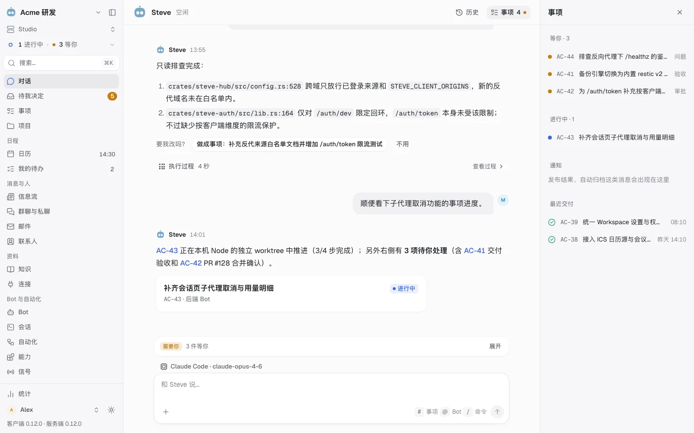
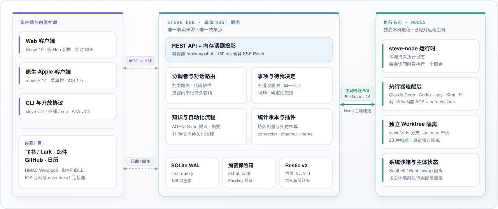
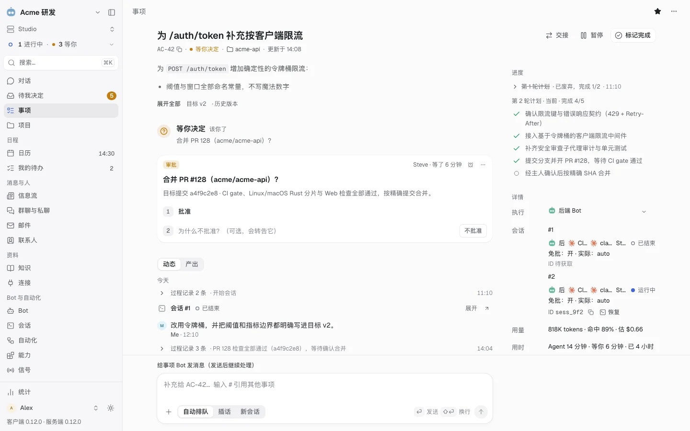
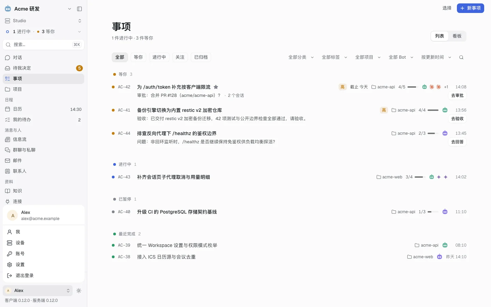

<div align="center">

<picture>
  <source media="(prefers-color-scheme: dark)" srcset="docs/assets/art/banner-zh-dark.svg">
  
</picture>

<p><strong>自托管的智能体协作工作台：跨 worktree、工具与多台机器协调编码智能体，所有需要人拍板的决定统一收口在一处。</strong></p>

[](https://github.com/Infranite/steve/releases) [](LICENSE) [](hub-rs) [](web) [](#环境要求)

[English](README.md) · 简体中文

[为什么用 Steve](#为什么用-steve) · [架构与工作原理](#架构与工作原理) · [核心能力](#核心能力) · [支持的执行器](#支持的执行器harness) · [快速开始](#快速开始) · [概念速览](#概念速览) · [安全与隐私](#安全与隐私模型) · [部署文档](docs/deployment.md)

</div>

<picture>
  <source media="(prefers-color-scheme: dark)" srcset="docs/assets/screenshots/zh/chat-dark.webp">
  
</picture>

- **一个协调者统管 18 种 ACP 编码 CLI** — Claude Code、Codex、Antigravity CLI（`agy`）、Gemini CLI、GitHub Copilot CLI、OpenCode、Cursor、Pi 等均在独立 `steve/<id>` git worktree 中运行，并结构化展示子代理与后台任务。
- **单一决定入口，自主权限有硬边界** — 交付验收、绑定精确提交的 PR 合并、智能体提问、保险箱授权与外发草稿全部汇入**待我决定**；原生免批（YOLO）只启用执行器自身模式，绝不绕过 Steve 工具、密钥、个人外发或合并确认。
- **抗重启、可跨机扩展** — 单个 Rust Hub 结合 SQLite WAL、内存读侧投影 SSE 流、内置加密 `restic` v2 备份与独立进程本机 Node（并支持实验性的多机远程 `steve-node` 配对）。
- **本地优先的安全模型，不动你的执行器配置** — 每个工作空间独立 XChaCha20-Poly1305 保险箱（主密钥存系统密钥库、Passkey 验证查看）、Seatbelt/Bubblewrap 系统沙箱、按主体隔离的执行器状态目录与分受众外发披露检查。

```sh
brew install infranite/tap/steve
steve setup
```

---

## 为什么用 Steve

单个编码智能体干活很快，同时跑三四个之后真正耗精力的是管理开销：十几个终端标签来回切换、上下文在会话间丢失、权限弹窗无人回应，最后到底交付了什么、检查通没通过，也无据可查。

Steve 在你已有的编码 CLI 之上建立一层强类型的控制面。你只需在一个主线对话里交代，由 Steve 决定直接回答、做三层只读约束的代码调研（附 `path:line` 引用），还是建一个可追踪事项派给独立 worktree 里的工作 Bot。

| | 在终端标签页里直接跑智能体 | 使用 Steve |
|---|---|---|
| **进度与交付** | 靠标签页、滚动日志和人脑记忆 | 事项具备版本化目标、多轮计划、交付标签与检查证据 |
| **执行隔离** | 多个智能体挤在同一个工作目录 | 每事项独立 git worktree（`steve/<id>`）、23 种构建工具链缓存隔离与系统沙箱 |
| **权限审批** | 看到哪个标签页才处理哪个 | 统一收口到**待我决定**，或交给执行器自己的原生审批模式 |
| **子代理与后台任务** | 淹没在原始终端输出里 | 结构化 `subtask` 追踪，嵌套展示子工具、用量并支持按子代理取消 |
| **代码合并** | 人工逐个分支处理 | 每事项一个 PR；验收、CI 通过且人工确认精确提交后由 `gh pr merge --match-head-commit` 合并 |
| **密钥使用** | 复制粘贴进提示词或环境变量 | 存入系统密钥库加密保险箱，仅在执行节点注入命令，智能体不可读取保险箱 |

---

## 架构与工作原理

Steve 将**状态与决策（Hub）**、**执行运行时（Node）**和**交互界面（客户端）**彻底解耦，边界全部以强类型 Rust 契约约束。

<picture>
  <source media="(prefers-color-scheme: dark)" srcset="docs/assets/art/arch-zh-dark.svg">
  
</picture>

- **Hub（`steve-hub`）**：唯一事实来源与唯一决策点——负责路由、容量队列、模型选择、权限裁定、保险箱、渠道、读侧投影、加密备份与指标统计。生产存储使用基于 `sea-query` 契约的 SQLite WAL；内存投影任务以零数据库查询响应 `GET /api/snapshot`，并通过 SSE 每 150 ms 合并推送增量 `Patch` 帧。
- **Node（`steve-node`）**：按 Hub 指令对每个会话一次只执行一个回合，维护本地持久执行日志，将 ACP/MCP/CLI 协议终结在驱动层内，并实施系统沙箱。默认 `STEVE_NODE_MODE=service` 在独立进程运行本机 Node，Hub 重启或升级不会打断正在执行的回合；远程 Node 始终主动向外连接 Hub（`PROTOCOL = 14`）。
- **客户端（`web/`、`apple/`）**：支持多 Hub 切换的 React Web 端，以及封装同一界面的原生 macOS 14+（含菜单栏实时状态）与 iOS 17+ 客户端，凭据存系统钥匙串，所有线协议类型由 `steve-types` 自动生成。

完整协议、存储契约、读侧投影与 32 个 crate 的分层结构见 **[docs/architecture.md](docs/architecture.md)**（英文）。

---

## 核心能力

### 协调者与对话路由

主线中的 **Steve** 定位为**协调者**，不会被静默派去当执行 Bot。每条消息都走按空间串行、带租约防重与幂等键的持久回复管线：

- **确定性规则优先**：`/汇报`、`@Bot` 点名、引用某事项、确认建议事项以及日常寒暄直接处理，不消耗路由模型调用。
- **九类路由与代码护栏**：`answer`、`research`、`item`、`suggest`、`ask`、`supplement`、`status`、`config`、`reroute`。代码级护栏可以推翻模型提议，例如防止普通提问被误建成事项、禁止把新消息静默塞进已关闭的事项。
- **三层只读就地调研**：非主人场景严格执行三道只读约束——适配器 `plan` 模式、拦截敏感目录（`.ssh`、`.steve`、`.aws`、`.config/gh`、`Library/Keychains`）的 ACP 类型/路径守卫、以及系统只读沙箱。仅在实例所有者本人的主线私聊中，当要求查看或修复 Hub 所在机器的问题时，以该系统用户权限执行，同时 Steve 自身的密钥、数据库和程序仍受沙箱隔离保护。
- **对话式配置与 A2UI**：直接用自然语言调整 Bot、项目、模型、标签、流程和联系人，通过 `steve-modules` 事务变更集落盘并支持 24 小时撤销；回复内可渲染声明式 A2UI 表单、选项、标签页与图表，不执行智能体代码且跨标签页防重复提交。

### 事项与交付语义

<picture>
  <source media="(prefers-color-scheme: dark)" srcset="docs/assets/screenshots/zh/item-dark.webp">
  
</picture>

- **五道收尾闸门**：事项经历 `ready → active → closing → closed`（及 `paused`）。进入 `closing` 会冻结 git worktree 的内容指纹，并核验五项条件：无运行中回合或排队消息、无未完成的必需操作、冻结结果未漂移或已合入默认分支、验收已落定（默认自动验收，可选手动或免验收）、收尾期间无新决策卡。重新打开会开启新周期，保留全部历史轮次。
- **类型与交付标签 + 方案门禁**：每个事项带单个**类型**标签（修复、功能、文档、重构、运维、杂项）与多选**交付**标签（方案、代码、报告、内容、数据、操作）。当目标只要求出方案或延后实现时，交付后会停在人工**方案决策门禁**（继续实现 / 仅保留方案 / 打回修改），免批模式无法绕过。
- **非 Git 产出、预览链接与精确 SHA 合并**：非代码产出持久保存在 `<STEVE_HOME>/workspaces/<item>/outputs`。Bot（`steve_deliver_file`）和用户（`steve publish <文件或文件夹>`）均可生成不可变的 Hub 预览链接（HTML 默认静态预览，交互原型可按需切到无网络隔离沙箱）及可撤销的分享链接。GitHub PR 在验收、CI 全部通过且人工批准与仓库/PR 号/完整提交 SHA/周期绑定的合并卡后，由 Steve 执行 `gh pr merge --match-head-commit`，绝不开启托管方自动合并。
- **依赖、派生与目标修改**：前置依赖写入时查环并受持久 `WaitContract` 超时策略约束；会话任意节点均可派生新会话或子事项；修改目标直接将新版本 `vN` 发给运行中的会话，不背着智能体强行换会话。

### 单一决定入口与执行器原生免批（YOLO）

<picture>
  <source media="(prefers-color-scheme: dark)" srcset="docs/assets/screenshots/zh/inbox-dark.webp">
  
</picture>

- **所有人工决策汇于一处**：**待我决定**（`#/inbox`）按六类决策（验收、审批、问题、提议、异常、确认）与三档层级（需决定、草稿、已收起）收纳交付验收、绑定提交的 PR 合并、ACP 工具权限、智能体提问、无可用执行器协调卡（`no_executor`）、交接不可用提示（`handoff_unavailable`）、保险箱密钥授权、邮件审批和项目 `AGENTS.md` 提议。已处理记录保留 7 天，可逆操作支持 24 小时撤销。
- **执行器原生免批（YOLO）**：开启**原生免批（YOLO）**后，仅对声明了原生审批模式的执行器（`claude-code`、`codex`、`goose`、`mistral-vibe`、`antigravity`）请求 `PermissionMode::Auto`，在下一空闲边界或新会话生效。不支持的执行器保持 `ask`（绝不模拟免批），Pi 等仅支持完全访问的执行器不纳入此开关；智能体提问、Steve 工具、保险箱密钥、个人身份外发、方案门禁与 PR 合并始终需要人工确认。

### 会话、子代理追踪与确定性交接

<picture>
  <source media="(prefers-color-scheme: dark)" srcset="docs/assets/screenshots/zh/session-dark.webp">
  
</picture>

- **子代理与后台任务**：各执行器上报的子代理、后台任务和原生工作流统一进入 `steve.v1` 会话记录的 `subtask` 结构化事件，不再靠硬编码工具名猜测。子工具调用嵌套在对应子代理下，活跃子任务显示在顶栏运行胶囊中；支持单子代理取消的适配器（Claude Code、Codex）直接提供**取消**按钮。
- **确定性会话交接**：遇到额度耗尽、连续模型服务错误或主人主动发起交接时，Steve 保留**同一个 Bot**（身份、权限、记忆与团队不变），只切换到该 Bot 配置的备选执行面（`harness + model + effort`）；若额度预计在 `quotaWaitMinutes`（默认 10 分钟）内恢复则等待恢复。若所有备选执行面均不可用，Steve 弹出 `handoff_unavailable` 协调卡，绝不静默更换 Bot。远程 Node 离线超过 `STEVE_NODE_HANDOFF_MIN` 分钟（默认 30）且有消息等待时，自动转至其他可用节点继续。
- **透明可控**：右侧信息栏展示上下文占用、估算花费与执行器自报花费、改动文件、引用的知识片段、消息队列（`Enter` 插话、`⌥Enter` 排队）及在原执行器中恢复会话的 CLI 命令。Steve 从不修改你的 harness 配置文件，也不写“始终允许”。

### 多机 Node 与设备管理

<picture>
  <source media="(prefers-color-scheme: dark)" srcset="docs/assets/screenshots/zh/node-dark.webp">
  
</picture>

- **六标签页任务化管理**：单台 Node 拆为**概览**、**Harness**、**会话与资源**、**权限与访问**、**版本与升级**、**诊断**六个标签页，顶部置顶需处理的告警与动作，实时呈现 CPU/内存/网络/磁盘/Token 指标与 24 小时趋势、节点级执行器探测结果，以及一键复制的脱敏诊断快照。
- **并发队列与执行绑定**：每台 Node 默认支持 **32 个并发会话回合**（可在**设备**页 1–256 热调整，无需重启），超出部分持久化排队等待。工作空间所有者可显式将工作 Bot 或团队绑定到兼容的已配对 Node。
- **组件升级与 macOS 开机自启 Node**：在**设备**页直接检查并升级托管的 npm ACP 适配器，以及经过验证的外部 CLI（`claude-code`、`codex`、`antigravity`、`pi`、`kimi-code`）。在 macOS 上执行 `steve node enable-boot` 即可注册为原普通用户运行的已签名 LaunchDaemon，无需桌面登录即可开机在线，并在**设备**页免 `sudo` 完成升级。

### 导航信息架构、身份头像与工作区连接

<picture>
  <source media="(prefers-color-scheme: dark)" srcset="docs/assets/screenshots/zh/menu-dark.webp">
  
</picture>

- **头像即身份与分组菜单**：所有主体（`人`、`Bot`、`系统`、`组织`、`团队`）通过统一 `ActorAvatar` 呈现，执行器与模型厂商使用独立徽标。桌面侧栏分为五组——主导航、日程（含下场会议时间与到期个人待办计数）、消息与人、资料、Bot 与自动化；底部固定**统计**入口、账号菜单（我、设备、账号、设置、退出登录）与 `<kbd>⌘K</kbd>` 命令面板。
- **多源连接**：内置**飞书 / Lark**（扫码建机器人 + OAuth 本人身份、空间规则、人设与话题回流）、**邮件**（IMAP/SMTP + IDLE 推送、沙箱 HTML、服务端计算收件人、绑定内容的审批与外发披露检查）、**GitHub**（App 或细粒度 PAT、HMAC Webhook、PR/Issue 关联、协作者评论与 CI 失败回灌），以及只读**日历**（`steve-calendar`：ICS 订阅/上传、`calendar.v1` 连接器插件、跨日历会议去重及 4 个只读 MCP 工具）。
- **重新定义的知识库与持久自动化**：个人知识库只沉淀联系人、组织、项目、主人偏好/规则、承诺与主人提供的资料（历史事项与对话分离到 `scope=records` 检索）；代码库工程结论沉淀为项目页的 `AGENTS.md` 提议，经确认后供后续 PR 合入而不直接改仓库。`steve-digest` 面向已存消息为可选 Digest Bot 提供确定性切窗与提取；`steve-flow` 提供 11 种节点的持久化流程图（QuickJS 沙箱脚本、防 SSRF HTTP、转义命令、Bot 节点）与自然语言定时；**信息流**承接定时汇报与按时区静默的个人完成通知；**统计**维护跨会话/事项的持久用量账本（每日同步 Models.dev 价格）与交付效率指标。

---

## 支持的执行器（Harness）

Steve 在 [`hub-rs/crates/steve-harness-spec/src/builtins.toml`](hub-rs/crates/steve-harness-spec/src/builtins.toml) 中内置了 **18 种 ACP 编码执行器**，并支持通过 `<STEVE_HOME>/harness.json`（`STEVE_HARNESS_MANIFEST`）声明自定义 ACP 适配器。

| 执行器 | ID | 安装方式 | 原生免批（YOLO） | 运行时适配层（`steve-acp`） |
|---|---|---|---|---|
| **Claude Code** | `claude-code` | npm 托管（`@agentclientprotocol/claude-agent-acp`） | 支持（`auto`） | 已验证 — RFD 子代理（取消 + 子工具嵌套）、后台任务、托管与外部 CLI 升级 |
| **Codex** | `codex` | npm 托管（`@agentclientprotocol/codex-acp`） | 支持（`agent`） | 已验证 — RFD 子代理（取消 + 子工具嵌套）、rollout 用量、托管与外部 CLI 升级 |
| **Antigravity CLI** | `antigravity` | `PATH` 发现（`agy`） | 支持（`auto`） | 已验证 — 工具回退子代理、后台任务、原生工作流、外部 `agy update` |
| **Kimi Code** | `kimi-code` | npm 托管（`@moonshot-ai/kimi-code`） | — | 已验证 — 工具回退子代理与后台任务、上下文用量、外部 CLI 升级 |
| **Pi** | `pi` | npm 托管（`@openma/pi-acp` + `@earendil-works/pi-coding-agent`） | 仅完全访问 | 已验证 — 可选 `pi-subagents` 子任务级用量、托管与外部 CLI 升级 |
| **Gemini CLI** | `gemini` | npm 托管（`@google/gemini-cli`） | — | 通用 ACP |
| **GitHub Copilot CLI** | `github-copilot-cli` | npm 托管（`@github/copilot`） | — | 通用 ACP |
| **OpenCode** | `opencode` | npm 托管（`@opencode/cli`） | — | 通用 ACP |
| **Qwen Code** | `qwen-code` | npm 托管（`@qwen-code/qwen-code`） | — | 通用 ACP |
| **goose** | `goose` | npm 托管（`@aaif/goose-acp`） | 支持（`smart_approve`） | 通用 ACP |
| **Grok Build** | `grok-build` | npm 托管（`@xai-official/grok`） | — | 通用 ACP |
| **Kilo Code** | `kilo` | npm 托管（`@kilocode/cli`） | — | 通用 ACP |
| **Factory Droid** | `factory-droid` | npm 托管（`droid`） | — | 通用 ACP |
| **CodeBuddy Code** | `codebuddy-code` | npm 托管（`@tencent-ai/codebuddy-code`） | — | 通用 ACP |
| **Cursor** | `cursor` | `PATH` 发现（`cursor-agent`） | — | 通用 ACP |
| **Kiro CLI** | `kiro` | `PATH` 发现（`kiro-cli`） | — | 通用 ACP |
| **Mistral Vibe** | `mistral-vibe` | `PATH` 发现（`vibe-acp`） | 支持（`smart-approve`） | 通用 ACP |
| **Qoder CLI** | `qoder` | `PATH` 发现（`qodercli`） | — | 通用 ACP |

- **13 种 npm 托管适配器**安装于 `<STEVE_HOME>/adapters`（可通过 `steve setup` 或 `steve adapters install <id>` 管理）；**5 种 `PATH` 发现型 CLI** 通过各自官方安装器安装后自动识别。
- 自定义 `harness.json` 不能覆盖或移除内置 ID，也不允许注入环境变量（执行器凭据始终留在执行节点本机）。

---

## 快速开始

### 通过 Homebrew 安装 *（推荐）*

```sh
brew install infranite/tap/steve
steve setup
```

`steve setup` 会启动交互式向导（可通过 `--lang zh-CN|en` 或 `STEVE_LANG` 切换中英文）：选择本机角色（**Hub** 或 **Node**）、配置监听地址（默认 `0.0.0.0:8440`，Web 端位于 `8441`）、勾选要安装的 npm 托管 ACP 适配器、在 macOS 上生成本机签名身份、签发所有者首个访问 token、注册系统服务并启动。非终端环境会以纯文本提示并不自动启动服务，配置完成后按角色启动即可：

```sh
steve hub start         # 启动 Hub 服务
steve node start        # 在“设备”页确认指纹后，启动 Linux 节点
steve node enable-boot  # 在“设备”页确认指纹后，注册并启动 macOS 开机自启节点（仅需一次 sudo）
```

随时可用 `steve hub status`、`steve hub doctor` 或 `steve node doctor` 检查运行状态。完整参数、`--reconfigure` 与同机双实例部署见 **[docs/deployment.md#homebrew-installation](docs/deployment.md#homebrew-installation)**（英文）。

### 环境要求

| | 要求 |
|---|---|
| **预编译安装（Homebrew / 发布包）** | Apple Silicon macOS 14+（`aarch64-apple-darwin`），或 glibc 2.35+ 的 Linux `x86_64`（Ubuntu 22.04+ / Debian 12+）且启用 `systemd --user`。不支持 Windows。运行时无需 Python；Homebrew 会安装 Node.js 以运行 npm 托管的 ACP 适配器。 |
| **运行智能体任务** | 在执行任务的 Node 机器上安装并登录对应的编码 CLI。未安装任何 CLI 时，Hub 服务与诊断功能仍可正常使用。 |
| **源码构建 *（开发用）*** | Git、Rust（`edition = 2024`，CI 固定 `1.99.1`）、Node.js 24 LTS + npm、`/bin/zsh`（源码发布测试夹具需要）、Python 3.11+（边界与发布脚本需要）。 |

<details>
<summary>从源码构建并试运行（开发环境）</summary>

```sh
git clone https://github.com/Infranite/steve.git
cd steve
npm ci
npm run build:web
cargo build --locked --manifest-path hub-rs/Cargo.toml -p steve-hub

# 在独立开发数据目录安装需要的 ACP 适配器
STEVE_HOME="$HOME/.steve-dev" hub-rs/target/debug/steve-hub --adapters install claude-code codex

# 启动开发 Hub（仅回环允许一键免密登录）
STEVE_HOME="$HOME/.steve-dev" \
STEVE_DEV_LOGIN=1 \
STEVE_HOST=127.0.0.1 STEVE_PORT=8440 \
STEVE_WEB_DIR="$PWD/web/dist" \
  hub-rs/target/debug/steve-hub
```

打开 **http://127.0.0.1:8440**。日常源码开发可使用 `python3 ops/dev.py up`，默认在 `127.0.0.1:18440` 启动增量 debug Hub、在 `127.0.0.1:18441` 启动 Vite 热更新界面（数据隔离在 `~/.steve-dev`）。在没有桌面 Secret Service 的无头 Linux 上，请设置 `STEVE_VAULT_KEYSTORE=dir` 并将 `STEVE_VAULT_KEY_DIR` 指向 `STEVE_HOME` 之外、权限为 `0700` 的目录。

</details>

---

## 概念速览

| 概念 | 一句话说明 |
|---|---|
| **Hub / Node / 客户端** | Hub 管状态与决策，Node 带本地执行日志跑执行器，Web 与 Apple 客户端订阅同步投影。 |
| **协调者与工作 Bot** | Steve 负责路由、调研与协调，具体事项派给工作 Bot 或团队；无可用执行者时弹出单一 `no_executor` 卡片。 |
| **事项与收尾闸门** | 可追踪工作单元（`ready → active → closing → closed`），带单选**类型**、多选**交付**标签、独立 worktree 与五道收尾检查。 |
| **待我决定（`#/inbox`）** | 验收、绑定提交的 PR 合并、工具审批、提问、密钥授权、提议与渠道草稿的唯一人工入口。 |
| **执行器原生免批（YOLO）** | 仅向支持原生自动审批的执行器下发原生模式，绝不模拟免批，也不放宽 Steve 层门禁。 |
| **确定性会话交接** | 额度或服务异常及主人要求时，保留同一 Bot 身份并切换其备选执行面（`harness + model + effort`）。 |
| **重新定义的知识库** | 只存人、组织、项目、偏好规则、承诺与主人资料；事项/对话走独立 `records` 检索；代码库规则走项目 `AGENTS.md` 提议。 |

各概念的完整规则见 **[docs/concepts.md](docs/concepts.md)**（英文）。

---

## 安全与隐私模型

- **认证与接入**：支持用户名 + 访问 token（`steve-hub --access token create`）、一次性扫码配对二维码，以及可选 OIDC（Authorization Code + PKCE，30 天 SHA-256 会话 Cookie）。`STEVE_DEV_LOGIN=1` 通过 `ConnectInfo<SocketAddr>` 严格限制回环地址。直接运行 `steve-hub` 默认绑定 `127.0.0.1:8440`，未设置 `STEVE_ALLOW_ANY_HOST=1` 时拒绝 `0.0.0.0`/`::`。
- **加密保险箱**：每个工作空间独立 256 位主密钥存于系统密钥库（macOS 通过签名稳定的 `steve-keyhelper` 存钥匙串，Linux 走 Secret Service 或外部 `0700` 目录）。每条密钥用独立数据密钥和 XChaCha20-Poly1305 加密；明文查看需与具体字段绑定的一次性 WebAuthn Passkey 挑战。`steve_secret_use` 将密钥注入环境变量、标准输入或临时文件，并**严格在会话所在的执行 Node 上执行**（无 Hub 本地兜底 shell）；银行卡和高敏感条目永不允许长期授权。
- **系统沙箱（`STEVE_CONFINE`）**：默认 1 级使用 macOS Seatbelt（`sandbox-exec`）或 Linux Bubblewrap（`bwrap`）阻断对 Steve 密钥、数据库和程序的访问，将写入限定在工作区与工具缓存内，并对非节点所有者会话隐藏主人的执行器主目录；2 级额外以全新登录环境启动。自带沙箱的执行器（如 Codex）保留自身沙箱。
- **按主体隔离状态与工具链**：默认 `STEVE_PRINCIPAL_STATE=on` 为不同主体分配独立执行器状态目录，并链接节点既有登录凭据而不复制密钥；`STEVE_TOOLCHAINS=on` 隔离 23 种内置构建工具链的产物与下载缓存。
- **披露级别与跨模型外发审查**：知识条目标注 `public`、`conclusion`、`reasoning` 或 `never`（不入索引）。发往外部受众的消息同时经过确定性规则与跨模型审计（`exclude_model` 避开起草模型），审查失败、超时或不可读时一律拦截。

> [!IMPORTANT]
> 将监听地址暴露到本机之外前，请先核查认证配置。在 Steve 下运行的编码智能体拥有执行节点对应系统用户的权限（受 `STEVE_CONFINE` 保护的文件除外）。

---

## 部署与运维

| 部署方式 | 适用场景 | 升级机制 |
|---|---|---|
| **Homebrew 托管服务（`brew install infranite/tap/steve && steve setup`）** | Apple Silicon macOS 14+ 与 Linux `x86_64` 服务器 | `steve upgrade`（签名 macOS Hub）或**设置 → 关于**（`steve-hub --supervise`）；Node 在**设备**页远程升级 |
| **独立 macOS 开机自启 Node（`steve setup node && steve node enable-boot`）** | 常开辅助 Mac，无需桌面登录 | 在**设备**页直接完成签名原地升级，无需 `sudo` |
| **源码检出（`ops/dev.py` / `ops/local-release.py`）** | 贡献者与本地开发 | 本地重新构建 |

- **默认目录与端口**：
  - 数据目录：Hub 默认 `~/.steve`，独立 Node 默认 `~/.steve-node`（均可通过 `STEVE_HOME` / `--home` 覆盖）。
  - 端口：Hub API `8440`（`STEVE_PORT`）、独立 Web 界面 `8441`（`STEVE_WEB_PORT`，`steve setup` 默认 Hub + 1）、可选 tailcat 节点入口 `8442`（`STEVE_TAILCAT_PORT`，Hub + 2）、本机独立进程 Node `8443`（`STEVE_LOCAL_NODE_PORT`，Hub + 3）、可选 Prometheus 指标 `127.0.0.1:9464`（`STEVE_METRICS=prometheus`）。
- **加密备份（内置 `restic` v2）**：每个发布包都在 `steve-hub` 同级捆绑经 SHA-256 校验的上游 `restic` 0.19.1。每日备份（当地时间 03:30 后，默认保留 7 天）、升级前备份（始终执行）、破坏性操作前备份、手动备份与诊断备份共用 `<STEVE_HOME>/backups/restic` 加密仓库，密码存于系统 KeyStore，并做 SQLite `quick_check` 与 SHA-256 校验。离线运维：`steve-hub --admin backup|backup-list|restore <id> (--database-only | --to <目录>)`。
- **常用运维手册入口（[docs/deployment.md](docs/deployment.md)，英文）**：
  - [Homebrew 安装与初始化](docs/deployment.md#homebrew-installation) · [重新配置已安装的 Hub](docs/deployment.md#reconfiguring-an-installed-hub)
  - [备份与恢复](docs/deployment.md#backups) · [发布包与自动升级](docs/deployment.md#managed-release-bundles-and-automatic-upgrades)
  - [配对独立远程 Node](docs/deployment.md#pairing-a-separate-node) · [macOS 开机自启 Node 服务](docs/deployment.md#macos-node-boot-service)
  - [执行器配置与组件升级](docs/deployment.md#harness-setup) · [能力库（MCP、技能、A2A）](docs/deployment.md#capabilities-mcp-servers-skills-and-remote-agents)
  - [访问令牌、OIDC 与 Apple 客户端](docs/deployment.md#access-tokens-and-clients) · [指标与健康检查](docs/deployment.md#metrics-and-health)

---

## 扩展 Steve

- **运行时插件**：Hub 运行时可直接从插件库（`steve-store.json`，官方库为 [`Infranite/steve-extensions`](https://github.com/Infranite/steve-extensions)，可用 `STEVE_PLUGIN_LIBRARY` 覆写）安装经 SHA-256 校验的预编译包，作为独立受管进程运行。契约 1 支持三种插件：**`connector`**（外部服务与可选 `calendar.v1` 日历源）、**`channel`**（基于 `ext_ws` / `ext_ws.bot` 的消息渠道）和 **`theme`**（纯数据 Web 主题）。详见 [docs/deployment.md#plugins](docs/deployment.md#plugins)。
- **统一 MCP 服务与能力库**：所有 Bot 会话连接 Hub 的单个 `/mcp` 端点，默认暴露 **8 个核心工具**并支持每个 Bot 固定最多 **32 个工具**，其余能力（工作空间 MCP 服务器、A2A 远程 Agent、连接器操作）通过 `steve_tools_search` 发现并经模式校验的 `steve_tool_call` 调用。Claude Desktop、Cursor 等外部 MCP 客户端也可用访问令牌（`Bearer stt_…`）连接 `/mcp` 调用受限子集。
- **A2A 服务端**：提供 `GET /.well-known/agent-card.json` 与 JSON-RPC 2.0 `POST /a2a`（`protocolVersion: "0.3.0"`，支持 `message/send`、`tasks/get`、`tasks/cancel`）。
- **编译期扩展点**：
  - **Hub Extension API**（`steve-hub/src/extension.rs`，`EXTENSION_API = 2`）：通过 `Assembly::builtin().with(...)` 注册连接提供方、渠道/邮件适配器、事件源、路由与后台任务（`Assembly::builtin()` 内置 `feishu.bot`、`feishu.self`、`ext_ws`、`mail.imap`、`github`、`calendar` 六个扩展）。
  - **流程与模块扩展点**：`FlowSetup` 扩展流程节点与动作；`steve-modules` 提供事项生命周期钩子、侧栏声明式面板、提示词上下文、外发审查和可撤销变更集。
  - **Webhook 与知识存储端口**：签名校验的 `POST /hooks/{id}` 与 `POST /hooks/github`；知识检索默认 SQLite FTS，可选 OpenViking 向量后端（`STEVE_KB_STORE=openviking`），命中结果均由 Hub 按权限复核。

---

## 当前状态与路线

Steve 当前处于 **`1.0` 之前（`0.x`）**阶段。公开契约（Hub HTTP API、Hub–Node 协议、插件 SDK 与落盘格式）仍在演进，`1.0.0` 冻结契约前的 `MINOR` 版本可能包含破坏性变更（详见 [版本与发布规范](CONTRIBUTING.md#changes-and-releases)）。

- **实验中**：
  - **多设备远程 Node**：`steve-node` 配对与跨机执行默认开启（`STEVE_NODE_LISTEN=1`），仍在持续加固中。
- **规划中 *（尚未实现）***：
  - **可插拔的存储、缓存、导出与备份目的地驱动**（包括远程 `restic` REST 备份目的地，以及超越当前 `#[cfg(test)]` 契约测试的生产 PostgreSQL 支持）。
  - **信息流与个人通知扩展**：RSS 抓取、个人报告订阅、定时摘要生成，以及除 `work.item.done` 与 `briefing.ready` 之外的个人通知事件。
  - **更多集成与外部保险箱**：Gmail / Outlook API 邮件适配器（当前支持 IMAP/SMTP）、飞书文档 / 日历 / 审批，以及 1Password / Bitwarden 外部保险箱后端。
  - **默认拒绝的视图级系统沙箱**（目前与 `STEVE_CONFINE` 并行处于影子模式）。
  - **A2A 流式输出与推送通知**，以及来自执行器的实测定时输出 token 遥测（当前实时 TPS 仅通过 API 提供流式文本估算）。

---

## 参与贡献

欢迎提交 Issue 和 Pull Request。提 PR 前请先阅读 **[CONTRIBUTING.md](CONTRIBUTING.md)**，了解：

- 本地开发检查（`cargo nextest`、`npm run check`、`npm run test:web`、浏览器冒烟测试、边界与架构守卫）。
- Conventional Commits 提交与 PR 标题规范（`type(scope): imperative summary`，需要运维操作时附 `Upgrade:` 尾注）。
- 自动版本号计算与发布说明生成（由 `ops/cut-release.py` 统一完成，切勿手选版本或手写 `docs/releases/`）。

---

## 许可证

基于 **[MIT 许可证](LICENSE)** 开源。外部编码 CLI、模型服务商和第三方集成均为独立产品，适用各自条款。`web/src/components/affect/` 下的 affectUI Pro 组件保留文件头注明的 affectUI 许可条款。

<sub>截图均由真实的 Steve Web 界面配合确定性合成夹具渲染，不包含任何生产数据。可在“设置 → 外观”随时切换中英文与深浅色主题。</sub>
