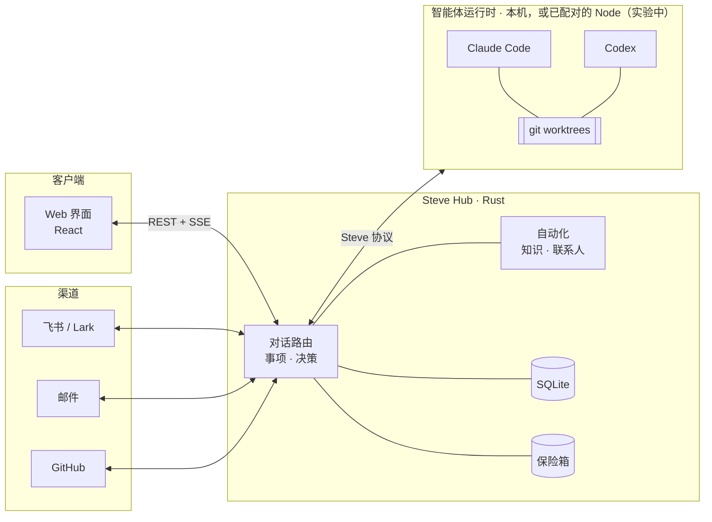

<div align="center">

<picture>
  <source media="(prefers-color-scheme: dark)" srcset="docs/assets/art/banner-zh-dark.svg">
  
</picture>

[](https://github.com/Infranite/steve/releases) [](LICENSE) [](hub-rs) [](web) [](#环境要求)

[English](README.md) · 简体中文

[设计原则](#设计原则) · [功能](#功能) · [扩展](#扩展-steve) · [工作原理](#工作原理) · [快速开始](#快速开始) · [部署](docs/deployment.md) · [参与贡献](CONTRIBUTING.md)

<br>

<picture>
  <source media="(prefers-color-scheme: dark)" srcset="docs/assets/screenshots/chat-dark.webp">
  
</picture>

</div>

---

## 为什么是 Steve

编码智能体干活很快，难的是同时开好几个之后怎么管：十几个终端标签来回切，上下文在会话之间丢掉，权限确认没人回，最后到底交付了什么、检查过没过，也没有记录。

Steve 架在 Claude Code 和 Codex 之上，负责把这些记下来、管起来。它是跑在你自己机器上的一个 Rust 程序，数据存在 SQLite 里，密钥放在加密保险箱里。你只需要在一个对话里交代，每条消息由它判断怎么处理：直接回答、只读查代码和文档、新建一个要跟踪的事项，或者转给正在进行的事项。事项交给 Bot 去做，每个事项都在自己的 git worktree 里跑。

| | 😵 终端里直接跑智能体 | ✨ 用 Steve |
|---|---|---|
| **进度** | 靠标签页、滚动记录和脑子记 | 每个事项有目标、计划、阶段和交付记录 |
| **隔离** | 几个智能体挤在同一个目录 | 每个事项一个 git worktree、一个 `steve/<id>` 分支 |
| **权限确认** | 刚好看到哪个标签页就答哪个 | 统一进“待处理”，或交给有硬边界的 YOLO |
| **算不算完成** | 智能体说完成就算 | 检查通过、计划走完、拿出目标要求的证据 |
| **合并** | 手动一个个合 | 合并通道：成批合并，只做快进 |
| **密钥** | 直接贴进提示词 | 放在保险箱里，注入到命令中 |

<div align="center">

<picture>
  <source media="(prefers-color-scheme: dark)" srcset="docs/assets/art/flow-zh-dark.svg">
  
</picture>

</div>

验收、审批和智能体的提问都汇到“待处理”里。打开 YOLO 模式后，你不在的时候例行的决定由 Steve 来做。它只能在代码写死的边界里行事，做过的每个决定都能撤销。飞书、邮件、GitHub、联系人和知识库都接在同一个工作区里，智能体干活时拿得到真实的上下文。每条知识都标了披露级别，不该说的场合不会被说出去。

## 设计原则

<table>
<tr>
<td width="33%" valign="top">

#### ⚖️ 模型提议，代码拍板

路由护栏防止一个问题被悄悄做成事项。Steve 负责协调，不替智能体做判断：计划步骤没走完或缺少证据的交付，会照实标给你看，而不是被拒绝；harness 自己的权限设置也照常生效。

</td>
<td width="33%" valign="top">

#### 🔁 同一件事不做两遍

智能体工具是“发出即结束本回合”，内存里没有挂着等的东西。外部操作带稳定 id，流程每一步先落库再往下走。崩溃之后，结果不确定的操作标记为待对账，不会盲目重跑。

</td>
<td width="33%" valign="top">

#### 🛑 自主有硬边界

YOLO 只决定留在本机、能撤销的事。涉及钱、高敏感密钥、推送、发布或以你的名义说话的事，怎么设置都不会放行。出问题时熔断器会让它停下。

</td>
</tr>
<tr>
<td width="33%" valign="top">

#### 🗝️ 用密钥，但不读保险箱

Steve 把密钥放进命令的环境变量、标准输入或临时文件来执行，命令的输出原样交给智能体。Steve 不对你输入的内容或模型说的话做任何打码或过滤。

</td>
<td width="33%" valign="top">

#### 🙊 知识分披露级别

公开、只能转述、只用于推理、不可使用。发往外部的消息先过规则检查，再由另一个模型复核，然后才发出去。

</td>
<td width="33%" valign="top">

#### ↩️ 改动都能撤销

对话里改的配置、对自动化的纠正、联系人合并、YOLO 做的决定，都存成变更集，随时可以撤回。

</td>
</tr>
</table>

## 功能

### 💬 对话与路由

每条消息会被归到九类之一：回答、调研、事项、建议、追问、补充、进度、配置、改判。代码护栏可以推翻模型的判断，CI 里会跑一套用真实消息做的路由评测。拿不准一条消息是新工作还是属于已有事项时，Steve 会先问你。

- **就地调研**：在对话里直接回答关于代码和文档的问题，并标出 `path:line`。只读有三道保证：工具白名单（Read、Grep、Glob）、碰到第一个非只读工具就终止的 Hub 守卫，以及 macOS 上的 `sandbox-exec` 沙箱。
- 回答末尾可以附一句“要我改吗？→ 做成事项：…”，点一下或回一句“改吧”就行。
- 每个事项在对话里只有一张卡片，状态（进行中、等你、已交付、已发布）原地更新，只有需要你时才挪到最下面。
- 配置可以直接说：“前端 Bot 改用 Opus，开 YOLO，billing-api 除外。”Steve 会起草字段级的改动，范围包括 Bot、项目、模型、标签、流程和联系人。一键应用，24 小时内可以撤销。
- 回复里可以渲染 A2UI 组件：表单、选项、标签页和图表。智能体写的东西不会被当成代码执行，表单只会提交一次，换标签页、刷新页面都一样。

### 📋 事项

事项依次经过“就绪 → 进行 → 收尾 → 关闭”。收尾是一道闸：先冻结结果，等进行中的回合和外部操作结束，期间没有任何变化才真正关单。再来一轮就开一个新周期，之前的周期都保留。目标小改会直接告诉正在跑的会话；大改则带着交接摘要开新会话，被替换的计划仍然看得到。

验收默认自动，也可以选手动或免验收。自动验收照收智能体的交付，没通过的检查和没做完的步骤写在卡片上，你随时可以打回。什么算完成，从目标里读：目标写了“部署”，就要等运行中的 Hub 确实包含这个提交才关单。智能体没交付就停下时，Steve 先去远端对一下完成规则（已合并，或已合并并打 tag），再提醒智能体它的工具仍然可用，让它交付或提问；harness 出错中断的回合也会先续一次，之后才来问你。

- **依赖**：添加时检查是否成环。被阻塞的事项在依赖完成后自动开始，并带上依赖做了什么的摘要。会话的任意位置都能**派生**出新会话或子事项，关系图里能看到运行、交接、依赖和派生。
- **产出**有版本，各用各的查看器：渲染后的文档、高亮代码、CSV 表格、PDF、媒体、文件夹和分支 diff。可以对一块区域、一段文字或整个文件做批注，攒好后一次发出。
- **每个会话一个消息队列**：智能体干活时，不带附件的消息会随它下一次调用 Steve 工具的结果送到，不打断当前回合。排队的消息可以编辑、撤回，可以“立即发送”打断当前回合，也可以发到新会话。重启前刚送达的消息回来时会标上“先核对，别重做”。
- **Worktree**：每个事项在自己的 worktree 里，分支是 `steve/<id>`。事项关闭或闲置时归还构建缓存，剩余空间低于下限就不再新建 worktree，删除过程不怕崩溃。
- 列表、看板和关系图三种视图，支持筛选、批量操作、标签、暂缓、星标、截止日期和自动归档。分类由路由或关键词判断，拿不准的进复核列表。

<table>
<tr>
<td width="50%"><br><sub><b>事项</b>：目标、阶段、计划，以及带检查记录的交付</sub></td>
<td width="50%"><br><sub><b>关系图</b>：运行、交接、依赖和派生</sub></td>
</tr>
</table>

### 🤖 Bot

一个 Bot 由 harness（Claude Code 或 Codex）、模型和思考强度、职责、人设、规范、权限模式、验收方式和默认项目组成。用一句话描述，Steve 就能起草出来。`@Bot` 把活交给它。改派事项时旧会话会停掉，最后的进展交给新 Bot。一个 Bot 可以在多个工作区里担任不同职责，但只看得到当前工作区的数据。

Steve 不动你的 harness 设置。权限提示只答这一次，从不写“始终允许”，也从不改你的 Codex 配置。每个会话都给出在 harness 里接着跑的命令，本机已有的 Claude Code 和 Codex 历史也能导进来。

- **记忆**：Steve 从完成的事项、每天的对话、邮件和智能体那里提出候选记忆，附上出处原话和要替换的旧记忆。你确认之前都不生效。
- **按用途选模型**：路由、对话、调研、标题、提取、YOLO、起草、流程和邮件各配各的模型、思考强度和备用顺序。价格每天从 Models.dev 同步，历史估算按当天的价格算。

<p align="center"><br><sub><b>智能体会话</b>：改动的文件、工具、花费和上下文，以及在 harness 里恢复的命令</sub></p>

### 🟢 YOLO 模式

打开 YOLO 后，这些事由 Steve 决定：事项目录内的工具权限、本地审批、按检查结果验收、要不要让卡住的智能体继续、回答智能体的提问（只在有把握时）、启动依赖已完成的事项，以及发布你自己的 Steve（有频率限制）。

下面这些红线不受任何设置影响，并由属性测试覆盖：涉及钱、高敏感保险箱条目、不带 `[AI]` 标记代你发言、碰事项目录以外的东西、推送或发布，以及被披露检查拦下的内容。

- **Shell 守卫**：默认拒绝，自带 POSIX shell 解析器。`eval`、`sh -c`、`sudo` 和命令替换一律拒绝，`kill` 只能杀智能体自己启动的进程。
- **倒计时和熔断**：你在线时它会先等，并给出“现在就做”和“我来决定”两个按钮。连续失败、连续被撤销，或者它批准的发布出了问题，整个工作区的 YOLO 都会暂停。
- **记录和撤销**：每个决定按时段和事项记下来，附带花费。撤销有五种：撤销决定、回滚发布、撤回消息、重新回答、暂停事项。

<p align="center"><br><sub><b>待处理</b>：验收、审批和提问都在一处；例行的那些交给 YOLO</sub></p>

### 🚚 合并与发布

每个目标分支有一条合并通道。合并进行中到达的请求会攒成一批，一批只需批一张卡片；你还没回答卡片时到达的请求，直接并入这一批和这张卡片。项目页可以设置合批窗口和每批上限，也有“立即合并发布”按钮。有冲突的成员逐个剔除。推送只做快进，托管方要求经 PR 或合并队列合入的分支绝不直接推送，重启后不会重复合并或重复发布。项目页还会列出 Steve 识别出的通道配置（合并队列、必需检查、发布方式），每项都附上依据。

在 GitHub 上，你验收之后 Steve 先问你要不要开 PR，合并前再问一次。私有仓库可以设成验收即开草稿 PR：只推事项自己的分支，提交先过泄露检查。外部操作走持久队列，重试前先和 GitHub 对账。Hub 所在机器上的项目（包括 Steve 自己）可以用脚本发布：构建、排空进行中的工作、重启，起来后报告结果。旧版本读不了当前数据库时，拒绝回滚。

### 🔌 连接

所有发出去的消息走同一条路：披露检查、授权、发送、记录用了哪些知识及其级别、写审计。你自己的账号不经批准不会发消息，代你发的消息会注明。

- **飞书 / Lark**：扫一次码就能建好机器人。Steve 可以以机器人身份工作，也可以通过 OAuth 以你的身份工作，消息走长连接接收。每个会话是一个空间，有关注级别（实时 / 不提醒 / 屏蔽）和响应规则（@、私聊、关键词、意图……），规则可以转成流程。人设决定回复透露多少：名字、职责、是不是 AI、是不是 Steve、主人是谁。一条消息做成事项以后，它所在话题里发起人和你的回复会直接送进这个事项。
- **邮件**：IMAP/SMTP，内置常见服务预设。IDLE 推送同步，有“需要处理”“等对方”和草稿几个视图。HTML 在沙箱里渲染，远程图片默认拦截。发信一律要过和内容绑定的审批卡片，收件人由服务端计算，智能体加不进去。接入第一个邮箱时会装上分诊流程，通知类邮件在调用任何模型之前就被分走。
- **GitHub**：用 GitHub App（manifest 流程）或细粒度 token 接入。Webhook 做 HMAC 校验和去重，轮询兜底。PR 自动关联事项，issue 可以转成事项，“PR 检查失败”流程会把失败回灌给事项。关联 PR 下仓库 owner、成员和协作者的评论与 review（包括行内评论）也会送进事项。智能体能查状态和 CI 日志、发评论（需要有时限的授权）、开 PR。
- **断开连接**前先给演练预览，备份数据库，再在一个事务里清理干净。

### 📚 知识与联系人

知识库的来源有笔记、文件、事项、对话、记忆，以及 wiki、Obsidian 库这类只读文件夹。按标题切块，中英文都能搜。`[K1]` 这样的引用能高亮到具体段落，没有真正给到模型的引用会被删掉。每条知识的披露级别决定它能被引用、转述、只用于推理，还是完全不用。密钥和“不可使用”的条目不进索引。

Steve 管理联系人、组织和团队。身份依次按账号、邮箱、姓名匹配。只是姓名相同时只会**提议**合并，合并后也能精确拆回。团队可以是虚拟的，也可以从飞书组织架构同步，还能当作可见范围用。“名下”和“负责人”记录谁拥有哪个 Bot、邮箱或设备。

### 🔐 保险箱

每个工作区一把主密钥，放在系统密钥库里（macOS 钥匙串、Linux Secret Service，或受保护的目录）。每个条目有自己的数据密钥，字段用 XChaCha20-Poly1305 加密。模板覆盖登录、银行卡、API 凭据、SSH 密钥等，哪些字段是密文由模板决定，不由客户端决定。查看密文要用通行密钥（Touch ID / Face ID），挑战一次有效，且绑定到具体字段。

Bot 通过 `steve_secret_use` 使用密钥，但读不到它。每次使用都要审批或有时限的授权，会留记录，拿回来的是命令的退出码和输出。银行卡和高敏感条目永远不能授权。Steve 不扫描、不打码、不拦截内容：你输入的内容原样交给模型；模型复述了密钥，就该换一个 harness 或模型。

### ⚡ 自动化

流程是由 11 种节点组成的图：触发、过滤、决策表、子流程、等待、审批、动作、脚本、命令、HTTP、Bot。每一步先落库再往下走，重启后从断点接着跑。

- 有副作用的操作，上游必须有审批节点或已有授权。脚本跑在 QuickJS 沙箱里，没有网络也碰不到文件。HTTP 防 SSRF，重定向和 DNS 都算在内，密钥只能放进请求头和请求体。命令参数会做 shell 转义。每次运行都有花费预算。
- 可以一句话起草流程，在画布上让 Steve 改，或者在对话里改。每次保存都留版本，演练不产生任何副作用。画布会点亮一次运行实际走过的路径。
- 进来的事件会去重、归组成信号。点一下（提醒我 / 忽略 / 建事项），纠正就生效：流程里加一个例外过滤，规则也记下来，整个改动可以撤销。
- 定时用中文写就行（“每个工作日 9 点”），处理夏令时，可以设补跑策略和防重叠。

<p align="center">
<picture>
  <source media="(prefers-color-scheme: dark)" srcset="docs/assets/screenshots/flow-dark.webp">
  
</picture>
<br><sub>画布上的<b>邮件分诊</b>流程：通知类在调用模型之前就被过滤掉，剩下的由 Bot 节点分流</sub>
</p>

### 📊 统计及其他

统计页记录 token（含缓存和推理）、缓存命中率、估算花费和 harness 自报花费的对比、缓存省下的钱、事项开始与完成数、前置 / 周期 / 等待时间、一次通过率和返工。可以按项目、Bot、模型和来源筛选。

登录支持 Hub 签发的用户名 + 访问 token、在网页或 Mac 端生成的扫码配对二维码，或选配 OIDC（PKCE）。原生 **macOS** 与 **iOS** 客户端（`apple/`）打开默认连接本机 Hub，支持接入并切换多个 Hub；手机扫码配对时，Hub 配置了公网地址默认走公网（不可达时自动回退局域网），未配置公网则直接走局域网；macOS 端提供菜单栏状态图标，实时显示 Hub 连接状态、运行中会话、待处理事项与在线设备并支持快捷切换。每个客户端的类型和连接路径都有记录。工作区是数据边界，各有自己的事项前缀。界面靠一条可续传的 SSE 流保持实时，手机页面回到前台就立刻重连。另外还有：带备份和回滚的原地升级、macOS 源码部署的每日备份、重建后仍能读取保险箱密钥的签名版 macOS 程序、<kbd>⌘</kbd> <kbd>K</kbd> 命令面板、浅色 / 深色主题，以及中英文界面。

<sub>截图来自一个演示工作区：真实的 Hub 和 Web 界面，智能体按脚本运行。</sub>

## 扩展 Steve

Steve 还没有运行时插件商店，“插件”页面目前只是占位。现在能用的是 Hub 里这些带类型的扩展点：

| 扩展点 | 可以加什么 |
|---|---|
| **Hub Extension API**（`steve-hub/src/extension.rs`） | 连接提供方、渠道适配器、邮件适配器、流程事件源、API 路由和后台任务。用 `Assembly::builtin().with(MyExt)` 构建自己的二进制。有冲突时 Hub 直接启动失败，并指出是哪个扩展。飞书、IMAP 邮件和 GitHub 都是这么接进来的。 |
| **流程扩展点**（`FlowSetup`） | 自定义节点类型、动作、事项查找器和事件适配器。 |
| **模块扩展点**（`steve-modules`） | 事项生命周期钩子、侧栏里声明式的**事项面板**（GitHub 的“PR 与检查”和邮件面板就是用它做的）、提示词上下文和外发检查。 |
| **给智能体的 MCP 工具** | 一个只监听回环地址的 `steve` MCP 服务，token 只对一个事项有效。覆盖进度、提问、审批、交付、发布，以及知识、邮件、GitHub、联系人和密钥。 |
| **Webhook** | `POST /hooks/:connection_id`，写入任何东西之前先校验签名。 |
| **知识存储端口** | 默认 SQLite FTS。[OpenViking](ops/openviking) 是可选的向量后端（`STEVE_KB_STORE=openviking`）。每条命中都会按 Hub 自己的权限规则再核对一遍。 |

## 实验中与计划中

- **会话在 Node 上运行**：Hub 不再自己拉起 agent 进程，所有会话、Steve 自己的判断调用和就地研究都在本机 Node 上运行，本机 Node 默认开启（`STEVE_NODE_MODE=off` 时会话只排队）。
- **多设备**（实验中，默认关闭）：另一台机器上的 `steve-node` 可以和 Hub 配对，在那台机器上跑 harness。Node 总是主动向外连，配对用一次性码加指纹确认，每个 Node 都有执行日志用来对账。远程 Node 用 `STEVE_NODE_LISTEN=1` / `STEVE_NODE_BIND` 开启。在“设备”页生成配对码，按页面上的命令在目标机器上完成配对（[docs/deployment.md](docs/deployment.md)）。
- **还没做的**：插件页面（先用上面的扩展点）、免打扰和每日汇报（设置里标着“接入推送后生效”）、Gmail 和 Outlook API 邮件适配器、飞书文档 / 日历 / 审批，以及外部保险箱后端（1Password、Bitwarden）。

## 工作原理



- **Hub**：唯一的事实来源，也是唯一做决定的地方：跑不跑、用哪个模型、批不批权限、队列里下一个是谁。认证、保险箱、渠道和统计也在这里。
- **运行时驱动**：智能体协议（ACP、MCP、stream-json）到驱动这一层为止。Steve 的其他部分只认会话、回合、事件、工具调用和审批，所以接一个新的 harness，按设计只需要再写一个驱动。
- **模块**：渠道、邮件、GitHub、知识、流程和保险箱通过[上面的扩展点](#扩展-steve)注册，模块之间的事件走持久化的 outbox。
- **客户端**：同一工作区的所有人、所有设备，实时看到的是同一份状态。

## 快速开始

### 环境要求

| | |
|---|---|
| **构建** | Git、稳定版 Rust/Cargo、Node.js 24 LTS 和 npm |
| **运行** | Apple Silicon macOS 14+，或 glibc 2.35+ 的 Linux x86_64（Ubuntu 22.04+、Debian 12+）。不支持 Windows。 |
| **智能体**（可选） | 已安装并登录的 [Claude Code](https://docs.anthropic.com/claude-code) 和/或 [Codex](https://github.com/openai/codex) |

### 1. 构建

```sh
git clone https://github.com/Infranite/steve.git
cd steve
npm ci
npm run build:web
cargo build --locked --manifest-path hub-rs/Cargo.toml -p steve-hub
```

### 2. 安装适配器

Steve 通过 ACP 适配器调用 harness：`@agentclientprotocol/claude-agent-acp` 和 `@agentclientprotocol/codex-acp`，需要 Node.js（npm）。`steve setup` 会把它们装进安装目录下的 `adapters`，之后由 Node 保持最新；开发用的 Hub 也这样装：

```sh
STEVE_HOME="$HOME/.steve-dev" hub-rs/target/debug/steve-hub --adapters install
```

安装目录里没有时，也会用 npm 全局安装的。`claude` 不在 `/opt/homebrew/bin/claude` 时设置 `CLAUDE_CODE_EXECUTABLE`；适配器装在别处时设置 `STEVE_ADAPTER_CLAUDE` / `STEVE_ADAPTER_CODEX`。

### 3. 运行

```sh
STEVE_HOME="$HOME/.steve-dev" \
STEVE_DEV_LOGIN=1 \
STEVE_HOST=127.0.0.1 STEVE_PORT=8440 \
STEVE_WEB_DIR="$PWD/web/dist" \
  hub-rs/target/debug/steve-hub
```

打开 **http://127.0.0.1:8440** 登录。`STEVE_DEV_LOGIN=1` 会加一个一键以所有者身份登录的入口，**只接受回环地址**，用来试用。要长期使用，请用 `steve-hub --access token create` 签发访问 token，用用户名和 token 登录；OIDC 是可选项（见下文）。

> [!TIP]
> `STEVE_HOME` 让这个实例的数据和默认的 `~/.steve` 分开。在没有桌面密钥环（Secret Service）的 Linux 上，保险箱会拒绝启动：设置 `STEVE_VAULT_KEYSTORE=dir`，再把 `STEVE_VAULT_KEY_DIR` 指向 `STEVE_HOME` 之外、权限为 `0700` 的目录。

## 配置

Steve 从环境变量读取配置。作为服务运行时写在 `$STEVE_HOME/steve.env` 里（模板：[`ops/steve.env.example`](ops/steve.env.example)）。密钥不要放在仓库目录里，用 `*_FILE` 变量引用。

| 变量 | 作用 |
|---|---|
| `STEVE_HOME` | 数据目录（默认 `~/.steve`） |
| `STEVE_HOST`、`STEVE_PORT` | 监听地址，可用逗号分隔多个，共用一个端口（默认 `127.0.0.1:8440`）；反向代理在另一台机器上时，加上它访问的地址，例如 `127.0.0.1,100.64.0.2`。`0.0.0.0`/`::` 会被拒绝，除非设置 `STEVE_ALLOW_ANY_HOST=1` |
| `STEVE_WEB_DIR` | Hub 提供的 Web 构建产物 |
| `STEVE_WEB_PORT` | 网页单独使用的端口；设置后 Hub 自己的端口只提供 API（新安装默认是 Hub 端口 + 1） |
| `STEVE_CLIENT_ORIGINS` | 额外允许跨域调用 Hub 的网页来源（已登录过的网页来源默认允许） |
| `STEVE_PUBLIC_URL` | 集成回调能访问到的地址，只在需要回调时设置。不提供共享的托管地址。 |
| `STEVE_OIDC_ISSUER`、`STEVE_OIDC_CLIENT_ID`、`STEVE_OIDC_CLIENT_SECRET_FILE` | 可选：通过你的 OIDC 服务单点登录 |
| `STEVE_DISK_FLOOR_GB`、`STEVE_DISK_LOW_GB`、`STEVE_WORKTREE_IDLE_HOURS` | 事项 worktree 的磁盘保护 |
| `STEVE_UPDATE_CHECK` | 设为 `0` 关闭定期检查新版本。debug 构建默认不检查，设为 `1` 才会检查 |
| `STEVE_YOLO` | 设为 `off` 在整个实例上关闭 YOLO |
| `STEVE_KB_STORE` | 设为 `openviking` 使用可选的向量后端（默认 SQLite FTS） |
| `STEVE_VAULT_KEYSTORE` | `auto`（钥匙串 / Secret Service）、`dir`（配合 `STEVE_VAULT_KEY_DIR`），或测试用的 `file` |
| `STEVE_NODE_MODE` | `service`（默认）让 Hub 自己的 Node 在单独的进程里运行，Hub 重启或升级时正在跑的回合不受影响（见 [docs/deployment.md](docs/deployment.md#the-hubs-own-node-in-a-process-of-its-own)）；`local` 在 Hub 进程内运行；`off` 时会话只排队 |
| `STEVE_LOCAL_NODE_PORT` | `STEVE_NODE_MODE=service` 时本机 Node 连接 Hub 使用的本机回环端口（默认 Hub 端口 + 3） |
| `STEVE_CONFINE` | Node 启动的运行进程所在的系统沙箱（macOS 用 seatbelt；Linux 用 bubblewrap）。分级：<br>`0`/`off`：不隔离。<br>`1`/`on`（默认）：Steve 的密钥、数据库和程序不可访问；在工作目录里运行的进程只能写自己的工作目录及其所属仓库、harness 和工具链目录、临时目录、常用的工具缓存和 harness 自己的主目录；读取不受限制，环境变量保持用户系统原样。<br>`2`：在 1 的基础上，运行进程从用户全新的登录环境启动，再加上 Steve 为它设置的变量。<br>Codex 等自带 seatbelt 沙箱的 harness 继续使用自己的沙箱 |
| `STEVE_CONFINE_WRITABLE` | 1、2 级下额外允许写入的位置（绝对路径，用 `:` 分隔） |
| `STEVE_NODE_LISTEN`、`STEVE_NODE_BIND` | 实验中的多设备 Node，默认关闭 |
| `STEVE_NODE_PLACEMENT` | `spread`（默认）：没有项目的事项开新会话时，交给负载明显更低的已连接远程 Node；`local`：新会话留在 Hub 所在机器，除非 `STEVE_NODE_BIND` 指定了 Node |
| `STEVE_NODE_HANDOFF_MIN` | 设备离线、又有消息在等它的会话时，过多少分钟后 Steve 在别处开新会话继续事项（默认 30；`0` 表示不转移） |
| `STEVE_TAILCAT`、`STEVE_TAILCAT_PORT` | 经 tailcat 接入远程 Node（可选，在“设备”页开启）：`tailcat` 不在 `PATH` 上时指定程序位置，以及只提供 Node 接口的本机端口（默认 Hub 端口 + 2） |
| `STEVE_NODE_INSTALLERS` | 远程安装 Node 时使用的本地目录，里面放发布的 `steve-installer.json` 和安装包，供访问不了 GitHub 的 Hub 使用 |
| `STEVE_ADAPTER_UPDATES` | Node 怎么对待 Steve 安装的 ACP 适配器的新版本：`auto`（默认：每天检查，没有会话运行时升级）、`check`（只显示）、`off` |

> [!IMPORTANT]
> 把监听地址暴露到本机以外之前，请先检查认证配置。Steve 下运行的智能体拥有你本机用户的权限。

## 部署

| 方式 | 适用场景 | 自动升级 |
|---|---|---|
| **本地构建**（上文） | 试用、开发 | 仅检查 |
| **基于源码的 macOS 服务**：`zsh ops/install.sh` | 常开的个人 Mac，使用钥匙串保险箱 | 通过 `ops/local-release.py` |
| **托管发布包**：`steve-hub --supervise` | 由 launchd/systemd 管理的 macOS 或 Linux 服务器 | ✅ 在 设置 → 关于 中升级 |

安装步骤、保险箱后端、服务管理器配置和升级流程见 **[docs/deployment.md](docs/deployment.md)**（英文）。

## 目录结构

```text
hub-rs/          Rust workspace：Hub 可执行文件和各 crate
  crates/steve-hub        HTTP 服务（axum）、REST + SSE、扩展、升级、后台任务
  crates/steve-core       事项、生命周期、对话路由、YOLO、合并通道、模型网关
  crates/steve-modules    模块扩展点（钩子、面板、变更集）、联系人、账号、保险箱
  crates/steve-acp        通过 ACP 运行 Claude Code / Codex 会话
  crates/steve-print      Steve 自己做判断时的一次性 harness 调用
  crates/steve-research   只读的就地调研（白名单、守卫、沙箱）
  crates/steve-mcp        智能体对接的 `steve` MCP 服务
  crates/steve-channels   飞书 / Lark、空间、人设、披露检查
  crates/steve-mail       IMAP/SMTP 账户、同步、草稿、分诊
  crates/steve-github     GitHub App / token、webhook、PR、检查、外部操作
  crates/steve-knowledge  知识库、检索、引用、记忆
  crates/steve-flow       信号、流程、定时
  crates/steve-vault      启动的 harness 不能读取的内容；steve-keyhelper 持有 macOS 密钥
  crates/steve-stats      用量、花费和交付指标
  crates/steve-node*      Hub–Node 协议和运行所有会话的 Node 运行时
  crates/steve-store      SQLite 表结构和迁移
web/             React + Vite + Tailwind 界面
ops/             安装、发布、备份、服务和 OpenViking 脚本
docs/            架构、协议和发布说明
```

## 参与贡献

欢迎提 Issue 和 Pull Request。提 PR 前请阅读 **[CONTRIBUTING.md](CONTRIBUTING.md)**，里面有开发检查项、如何以片段形式写发布说明，以及版本号和迁移编号如何在发布时分配。

## 许可证

[MIT](LICENSE)。外部智能体、模型服务和集成是各自独立的产品，适用各自的条款，需要你自行安装和配置。
