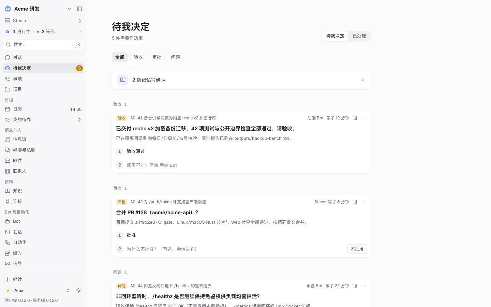
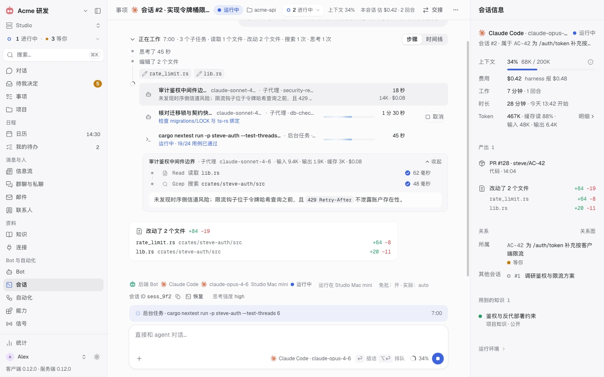
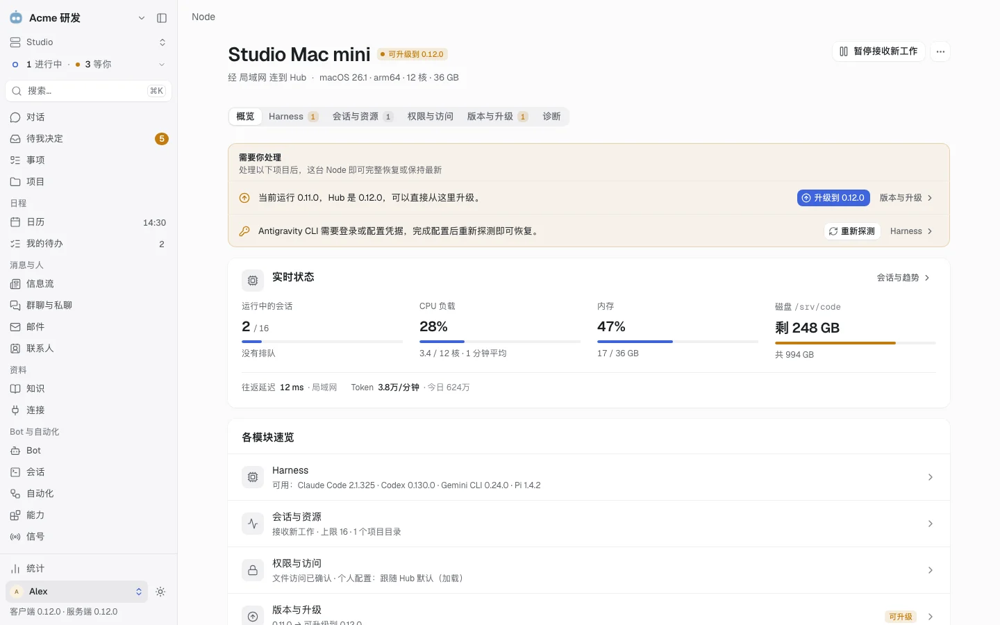

<div align="center">

<picture>
  <source media="(prefers-color-scheme: dark)" srcset="docs/assets/brand/steve-logo-horizontal-dark.svg">
  
</picture>

<p><strong>一句话交代，交付回来。</strong><br/>自托管的智能体协作工作台：跨工作树、工具与多台机器协调编码智能体，所有需要你拍板的事集中在一处。</p>

[](https://github.com/Infranite/steve/releases) [](LICENSE) [](hub-rs) [](web) [](#环境要求)

[English](README.md) · 简体中文

[为什么用 Steve](#为什么用-steve) · [架构](#架构与工作原理) · [核心能力](#核心能力) · [支持的执行器](#支持的执行器harness) · [快速开始](#快速开始) · [概念速览](#概念速览) · [安全与隐私](#安全与隐私) · [部署文档](docs/deployment.md)

</div>

<picture>
  <source media="(prefers-color-scheme: dark)" srcset="docs/assets/screenshots/zh/chat-dark.webp">
  
</picture>

- **一个对话管住所有编码智能体** — 在同一条对话里协调 Claude Code、Codex、Antigravity CLI（`agy`）、Gemini CLI、Copilot、OpenCode、Cursor、Pi 等 18 种编码 CLI。
- **每件事都有独立工作树与交付记录** — 每个事项跑在隔离的 git 分支里，保留目标、计划、检查证据与可审阅的产出。
- **所有需要你拍板的事集中在一处** — 交付验收、智能体提问、密钥授权与 PR 合并统一收口到**待我决定**；任意权限档位下都绝不越过安全边界。
- **Hub 重启升级不打断正在跑的活** — 本地执行节点独立运行，重启或升级 Hub 时进行中的任务不受影响，还能按需扩展到多台 Mac 和 Linux 机器。
- **数据与密钥留在你自己的机器上** — 本地存储、自动加密备份与系统密钥库保险箱，且 Steve 从不改动你的编码 CLI 配置文件。

```sh
brew install infranite/tap/steve
steve setup
```

## 为什么用 Steve

单个编码智能体干活很快，同时跑三四个之后最消耗精力的是管理开销：终端标签页满天飞、会话上下文丢失、权限弹窗无人回应，最后到底交付了什么、检查通没通过也无据可查。

| | 在终端标签页里直接跑 | 使用 Steve |
|---|---|---|
| **进度与交付** | 靠标签页、滚动日志和记忆 | 事项自带目标、计划、交付标签与检查证据 |
| **执行隔离** | 多个智能体挤在同一工作目录 | 每事项独立 git 工作树、隔离构建缓存与系统沙箱 |
| **权限审批** | 切到哪个标签页才看到哪个 | 统一收口到**待我决定**，或启用执行器原生审批模式 |
| **子代理与任务** | 淹没在原始终端输出里 | 结构化展示子代理与后台任务，支持按子代理取消 |
| **代码合并** | 人工逐个分支处理 | 每事项一个 PR；CI 通过且人工确认精确提交后合并 |
| **密钥使用** | 复制粘贴进提示词或 `.env` | 存入加密保险箱，仅在执行时注入命令，智能体不可读取 |

## 架构与工作原理

<picture>
  <source media="(prefers-color-scheme: dark)" srcset="docs/assets/art/arch-zh-dark.svg">
  
</picture>

- **Hub（`steve-hub`）** — 保存工作区状态、路由对话、裁定权限与密钥，并提供实时界面接口与加密备份。
- **Node（`steve-node`）** — 在独立进程、隔离工作树和系统沙箱中运行编码 CLI，Hub 重启或升级不打断进行中的任务。
- **客户端（`web/`、`apple/`）** — 支持多 Hub 切换的 Web 端，以及带菜单栏状态的原生 macOS 14+ 与 iOS 17+ 客户端，实时同步进展。

协议、存储契约、读侧投影、沙箱细节与 crate 分层见 **[docs/architecture.md](docs/architecture.md)**（英文）。

## 核心能力

### 协调者与对话路由
- **只做协调，不静默干活**：主线里的 Steve 负责直接回答、附带 `path:line` 引用的只读代码调研，或建事项派给工作 Bot 与团队。
- **确定性规则优先**：`/汇报`、`@Bot` 点名、引用事项与简短确认直接处理，不消耗路由模型；代码护栏防止普通提问被误建成事项。
- **自然语言改配置**：用对话调整 Bot、项目、模型、标签和流程，支持 24 小时撤销与声明式 A2UI 表单（[详情](docs/concepts.md#chat-routing-and-durable-threads)）。

### 事项与交付
<picture>
  <source media="(prefers-color-scheme: dark)" srcset="docs/assets/screenshots/zh/item-dark.webp">
  
</picture>

- **有据可查的收尾**：追踪版本化目标（`vN`）、多轮计划、类型/交付标签与检查证据；只要求出方案的任务会停在人工**方案门禁**。
- **可直接审阅的产出**：非代码产出内置预览器查看，也可生成不可变 Hub 预览链接（`steve publish <文件或文件夹>`）与可撤销分享链接。
- **安全的 PR 合并**：智能体只开 PR、不推默认分支；验收、CI 通过且人工确认精确提交后由 Steve 合并（[详情](docs/concepts.md#items-and-delivery-semantics)）。

### 待我决定与三档权限
<picture>
  <source media="(prefers-color-scheme: dark)" srcset="docs/assets/screenshots/zh/inbox-dark.webp">
  
</picture>

- **人工决策单一入口**：验收、PR 合并审批、工具权限、智能体提问、密钥授权与外发草稿全部汇入**待我决定**，支持稍后提醒与 24 小时撤销。
- **工作区权限（询问 / 自动 / 完全放开）**：默认**询问**；**自动**仅向声明原生自动审批的执行器开启原生模式，绝不模拟；**完全放开**使用执行器声明的完全放开模式，切换前需确认风险提示。
- **明确的安全红线**：Plan 与只读会话永远不放宽，Node 权限上限继续生效；智能体提问、Steve 工具、保险箱密钥、个人外发、方案门禁与 PR 合并始终需要人工确认（[详情](docs/concepts.md#permissions)）。

### 会话、子代理与自动交接
<picture>
  <source media="(prefers-color-scheme: dark)" srcset="docs/assets/screenshots/zh/session-dark.webp">
  
</picture>

- **结构化子代理与后台任务**：子工具调用嵌套在对应子代理下，实时展示进度与花费，支持适配器能力的单子代理**取消**。
- **同 Bot 自动交接**：遇到额度耗尽、连续服务异常或主人发起交接时，保留同一个 Bot 身份与记忆，只切换其备选 `harness + model + effort`。
- **全程透明可控**：一眼看清上下文占用、估算与自报花费、改动文件、消息队列以及本机 CLI 恢复命令（[详情](docs/concepts.md#deterministic-session-handoff)）。

### 多机 Node 与设备管理
<picture>
  <source media="(prefers-color-scheme: dark)" srcset="docs/assets/screenshots/zh/node-dark.webp">
  
</picture>

- **分标签任务化管理**：每台 Node 置顶告警与待处理动作，展示 CPU/内存/磁盘/Token 实时状态、24 小时趋势、执行器探测与脱敏诊断快照。
- **并发队列与机器绑定**：按 Node 实时调节并发回合上限（默认 32，范围 1–256），并将工作 Bot 或团队显式绑定到指定机器。
- **组件升级与 macOS 开机自启**：在**设备**页升级托管适配器与已验证外部 CLI；用 `steve node enable-boot` 让辅助 Mac 无需桌面登录即可在线（[手册](docs/deployment.md#pairing-a-separate-node)）。

### 导航、知识库与多源连接
<picture>
  <source media="(prefers-color-scheme: dark)" srcset="docs/assets/screenshots/zh/menu-dark.webp">
  
</picture>

- **清晰导航与统一头像**：人、Bot、团队与组织使用统一身份头像（与执行器/模型徽标区分），五组侧栏搭配固定**统计**入口与 `<kbd>⌘K</kbd>` 搜索。
- **打通真实工作上下文**：内置**飞书 / Lark**、**邮件**（IMAP/SMTP）、**GitHub** 与只读**日历**，引入上下文但绝不擅自替你外发。
- **知识、流程与统计**：个人知识沉淀人、项目、偏好与资料（代码库经验转为 `AGENTS.md` 提议），配合持久化流程、**信息流**与**统计**（[详情](docs/concepts.md#knowledge-digest-and-people)）。

## 支持的执行器（Harness）

内置 **18 种 ACP 编码执行器**（[`builtins.toml`](hub-rs/crates/steve-harness-spec/src/builtins.toml)），并支持通过 `harness.json` 接入自定义 ACP 适配器。

| 执行器 | ID | 安装方式 | 权限（自动 / 完全放开） | 运行时适配层 |
|---|---|---|---|---|
| **Claude Code** | `claude-code` | npm（`@agentclientprotocol/claude-agent-acp`） | `auto` / `bypassPermissions` | 已验证 — 子代理与取消、后台任务、CLI 升级 |
| **Codex** | `codex` | npm（`@agentclientprotocol/codex-acp`） | `agent` / `agent-full-access` | 已验证 — 子代理与取消、rollout 用量、CLI 升级 |
| **Antigravity CLI** | `antigravity` | `PATH`（`agy`） | 以 #610 的结论为准 | 已验证 — 子代理、后台任务、工作流、`agy update` |
| **Kimi Code** | `kimi-code` | npm（`@moonshot-ai/kimi-code`） | — / `auto` | 已验证 — 子代理、后台任务、CLI 升级 |
| **Pi** | `pi` | npm（`@openma/pi-acp` + `@earendil-works/pi-coding-agent`） | — / 仅完全放开 | 已验证 — 可选 `pi-subagents`、CLI 升级 |
| **Gemini CLI** | `gemini` | npm（`@google/gemini-cli`） | — / 支持 | 通用 ACP |
| **GitHub Copilot CLI** | `github-copilot-cli` | npm（`@github/copilot`） | — / `autopilot` | 通用 ACP |
| **OpenCode** | `opencode` | npm（`@opencode/cli`） | — / — | 通用 ACP |
| **Qwen Code** | `qwen-code` | npm（`@qwen-code/qwen-code`） | — / 支持 | 通用 ACP |
| **goose** | `goose` | npm（`@aaif/goose-acp`） | `smart_approve` / `auto` | 通用 ACP |
| **Grok Build** | `grok-build` | npm（`@xai-official/grok`） | — / 支持 | 通用 ACP |
| **Kilo Code** | `kilo` | npm（`@kilocode/cli`） | — / — | 通用 ACP |
| **Factory Droid** | `factory-droid` | npm（`droid`） | — / `auto-high` | 通用 ACP |
| **CodeBuddy Code** | `codebuddy-code` | npm（`@tencent-ai/codebuddy-code`） | — / `fullAccess` | 通用 ACP |
| **Cursor** | `cursor` | `PATH`（`cursor-agent`） | — / — | 通用 ACP |
| **Kiro CLI** | `kiro` | `PATH`（`kiro-cli`） | — / — | 通用 ACP |
| **Mistral Vibe** | `mistral-vibe` | `PATH`（`vibe-acp`） | `smart-approve` / `auto-approve` | 通用 ACP |
| **Qoder CLI** | `qoder` | `PATH`（`qodercli`） | — / 支持 | 通用 ACP |

## 快速开始

```sh
brew install infranite/tap/steve
steve setup          # 交互式安装向导（--lang zh-CN|en）
steve hub start      # 启动 Hub（独立节点用 steve node start 或 steve node enable-boot）
steve hub doctor     # Hub 停机时也可离线诊断
```

### 环境要求
- **预编译安装（Homebrew / 发布包）**：Apple Silicon macOS 14+ 或 Linux `x86_64`（glibc 2.35+、`systemd --user`），不支持 Windows。需在执行机器上登录你要使用的编码 CLI。
- **源码构建**：Git、Rust（`edition = 2024`，CI `1.99.1`）、Node.js 24 LTS、Python 3.11+。

<details><summary>从源码构建并试运行（开发环境）</summary>

```sh
git clone https://github.com/Infranite/steve.git && cd steve
npm ci && npm run build:web
cargo build --locked --manifest-path hub-rs/Cargo.toml -p steve-hub
STEVE_HOME="$HOME/.steve-dev" hub-rs/target/debug/steve-hub --adapters install claude-code codex
STEVE_HOME="$HOME/.steve-dev" STEVE_DEV_LOGIN=1 STEVE_HOST=127.0.0.1 STEVE_PORT=8440 STEVE_WEB_DIR="$PWD/web/dist" hub-rs/target/debug/steve-hub
```
打开 **http://127.0.0.1:8440**（日常开发可用 `python3 ops/dev.py up` 启动 `127.0.0.1:18441` Vite 热更新）。详见 [docs/deployment.md](docs/deployment.md#homebrew-installation)。
</details>

## 概念速览
| 概念 | 一句话说明 |
|---|---|
| **协调者与工作 Bot** | Steve 负责路由、调研与协调，具体事项交由工作 Bot 或团队执行。 |
| **事项与交付** | 拥有独立工作树、计划、标签、产出与收尾核验的可追踪工作单元。 |
| **待我决定（`#/inbox`）** | 验收、PR 合并、工具权限、提问、密钥授权与外发草稿的唯一人工入口。 |
| **工作区权限** | 提供询问 / 自动 / 完全放开三档，不放宽 Steve 层门禁与 Node 上限。 |
| **同 Bot 自动交接** | 额度或服务异常时保留 Bot 身份，仅切换其备选 `harness + model + effort`。 |

完整领域规则见 **[docs/concepts.md](docs/concepts.md)**（英文）。

## 安全与隐私
- **访问认证**：支持访问 token、一次性扫码配对或可选 OIDC；直接运行 `steve-hub` 默认仅监听本机回环地址。
- **加密保险箱**：主密钥存放在系统密钥库；查看明文需 Passkey 验证，智能体只能在命令中注入使用而无法读取保险箱。
- **沙箱与隔离**：系统沙箱阻断对 Steve 密钥、数据库和程序的访问，并按用户隔离执行器状态目录与构建缓存。
- **外发审查**：知识条目带分级披露策略（`public` / `conclusion` / `reasoning` / `never`），发往外部前同时经过规则检查与跨模型审计（[详情](docs/architecture.md#security-confinement-and-backups)）。

> [!IMPORTANT]
> 将监听地址暴露到本机之外前，请先核查认证配置；在 Steve 下运行的编码智能体拥有执行节点系统用户的权限（受沙箱保护路径除外）。

## 部署与运维
- **安装与升级**：通过 Homebrew 或发布包安装；已签名 Hub 用 `steve upgrade` 或**设置 → 关于**升级，Node 在**设备**页远程升级。
- **自动加密备份**：每个发布包内置 `restic`，自动完成每日、升级前、破坏性操作前与手动加密快照（离线用 `steve-hub --admin backup|backup-list|restore`）。
- **运维手册（[docs/deployment.md](docs/deployment.md)，英文）**：[Homebrew 与重配](docs/deployment.md#homebrew-installation) · [备份](docs/deployment.md#backups) · [自动升级](docs/deployment.md#managed-release-bundles-and-automatic-upgrades) · [远程与开机自启 Node](docs/deployment.md#pairing-a-separate-node) · [执行器与 MCP](docs/deployment.md#harness-setup) · [认证与 Apple 客户端](docs/deployment.md#access-tokens-and-clients) · [监控指标](docs/deployment.md#metrics-and-health)。

## 扩展 Steve
- **运行时插件**：Hub 运行时可直接从 [`Infranite/steve-extensions`](https://github.com/Infranite/steve-extensions) 安装经校验的 `connector`、`channel`、`theme` 插件（[docs/deployment.md#plugins](docs/deployment.md#plugins)）。
- **MCP 与 A2A**：统一 `/mcp` 端点同时服务 Bot 会话与外部 MCP 客户端；`POST /a2a` 提供标准 A2A 任务接口。
- **编译期扩展点**：支持自定义 Hub 扩展、流程节点、模块钩子、Webhook 与可选 OpenViking 向量知识库（[docs/architecture.md#extensibility](docs/architecture.md#extensibility)）。

## 当前状态与路线
Steve 处于 **`1.0` 之前（`0.x`）**阶段，公开 API、协议与落盘格式在 `1.0.0` 冻结前可能于 `MINOR` 版本发生破坏性变更（[版本规范](CONTRIBUTING.md#changes-and-releases)）。
- **实验中**：已配对远程 `steve-node` 主机（默认开启，持续加固中）。
- **规划中 *（尚未实现）***：可插拔存储/缓存/导出/备份驱动（远程 restic 目标与生产 PostgreSQL）、信息流 RSS 与更多个人通知、Gmail/Outlook API 与飞书文档/日历/审批适配器、外部保险箱（1Password/Bitwarden）、默认拒绝视图级沙箱，以及 A2A 流式输出。

## 参与贡献
欢迎提 Issue 与 PR。提交前请阅读 **[CONTRIBUTING.md](CONTRIBUTING.md)**，了解本地检查、Conventional Commits 规范及 `ops/cut-release.py` 自动发版流程（切勿手选版本或手写 `docs/releases/`）。

## 许可证
基于 **[MIT 许可证](LICENSE)** 开源。外部编码 CLI 与第三方集成适用各自条款；`web/src/components/affect/` 下的 affectUI Pro 组件保留文件头注明的 affectUI 许可。

<sub>所有截图均由真实的 Steve Web 界面配合合成夹具渲染，不包含任何生产数据。</sub>
