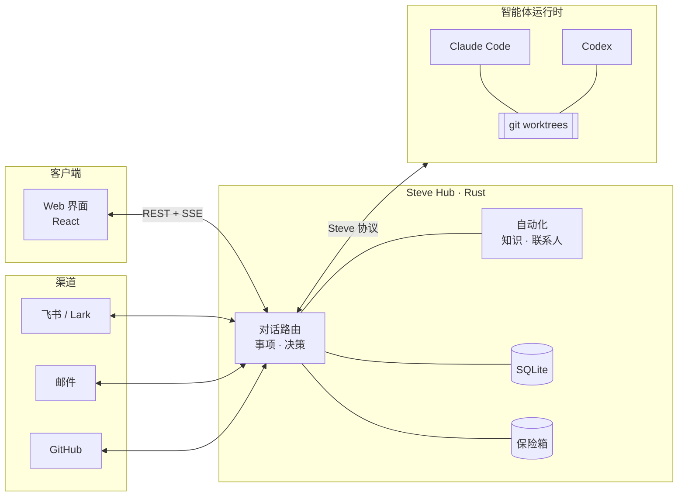

<div align="center">

# Steve

**自托管的助理工作台：一句话交代，交付回来。**

像对一位靠谱的同事那样跟 Steve 说话。能答的它直接答，需要查的它就地查，<br>
真正的活交给 Claude Code、Codex 这样的编码智能体去做。每个事项它都盯到底，只在关键处来问你。

[](https://github.com/Infranite/steve/releases)
[](LICENSE)
[](hub-rs)
[](web)
[](#环境要求)

[English](README.md) · 简体中文

[功能](#功能) · [工作原理](#工作原理) · [快速开始](#快速开始) · [部署](docs/deployment.md) · [参与贡献](CONTRIBUTING.md)

</div>

---

## 为什么是 Steve

编码智能体擅长干活，但不擅长**记账**：开着十几个终端标签，上下文丢了，审批忘了，交付了什么也没人记得。

Steve 是智能体之上的那一层。它跑在你自己的机器上，掌握全部状态，在一个地方帮你：

- **用大白话交代事情**：一个对话入口，每条消息由 Steve 判断去向：直接回答、就地调研、新建事项，或者补充给正在进行的事项。
- **放心让智能体自己干**：每个事项有独立的 git worktree、完整的生命周期和审计记录。智能体卡住时 Steve 会接管，并判断活是不是真的干完了。
- **关键的事你说了算**：审批、发布和决策都汇到一个收件箱。YOLO 模式在你不在时替你处理例行选择，每一次都留有记录。
- **把你的世界接进来**：飞书、邮件、GitHub、联系人和知识库都在同一个工作区，智能体干活时有真实的上下文。

所有东西都在你自己的设施上：一个 Rust 可执行文件、一个 SQLite 数据库和一个加密保险箱。

## 功能

<table>
<tr>
<td width="50%" valign="top">

### 💬 一个对话入口
主线对话替你分拣每条消息：直接回答、调研、新建事项、发给事项、查进度、改配置。用 `@` 把活交给指定 Bot、关联联系人或引用事项。草稿在刷新和升级后都还在。

</td>
<td width="50%" valign="top">

### 📋 事项，从接收到收尾
每件事走完 *接收 → 分拣 → 定义 → 计划 → 准备 → 执行 → 交付验收 → 收尾*，在项目内的独立 worktree 里运行。结果由你来验收、返工或放弃。

</td>
</tr>
<tr>
<td valign="top">

### 🤖 智能体 harness
通过 Agent Client Protocol 运行 **Claude Code** 和 **Codex**。每个 Bot 可单独设置模型和思考强度，并配备用模型链。重启后中断的回合会接着跑；结果不确定的执行先对账，绝不盲目重跑。

</td>
<td valign="top">

### ✅ 收件箱与审批
权限请求、交付验收和发布审批集中在一处，并保留完整的决策历史。**YOLO** 模式在你离开时倒计时处理例行选择，并说明选了什么、为什么。

</td>
</tr>
<tr>
<td valign="top">

### 🔌 连接
**飞书 / Lark** 机器人与群聊，支持交互卡片；**邮件**账户（IMAP 同步、草稿、发送）；**GitHub** 仓库与 Pull Request。Bot 可以有各自的人设和分工。

</td>
<td valign="top">

### 📚 知识与人
把文件夹和笔记建成知识库，支持检索和引用。联系人、组织和团队各有记忆，智能体知道自己在和谁打交道。

</td>
</tr>
<tr>
<td valign="top">

### ⚡ 自动化
信号、规则流程和定时任务，在可视化画布上编排，每次运行都能逐步回溯。

</td>
<td valign="top">

### 📊 统计与产出
用量、成本、耗时、质量和人工介入统计。事项产出的每个文件都能浏览、预览和批注。

</td>
</tr>
<tr>
<td valign="top">

### 🔐 值得信任
OIDC 登录、共享工作区、加密凭据保险箱（macOS 钥匙串或受保护的密钥目录），密钥通过文件加载。每日备份，每次发布前也会备份。

</td>
<td valign="top">

### 🚀 原地升级
在设置里检查更新、阅读发布说明、一键升级。Supervisor 会排空进行中的工作、备份 SQLite、验证新版本，验证失败就回滚。

</td>
</tr>
</table>

界面支持**简体中文**和 **English**，所有操作都能用命令面板（<kbd>⌘</kbd> <kbd>K</kbd>）完成。

## 工作原理



- **Hub 是大脑**：唯一的事实来源，也是唯一的决策者。跑不跑、用哪个模型、批不批权限、队列下一条是什么都由它决定；认证、保险箱、渠道和统计也在它这里。
- **Harness 负责干活**：智能体协议（ACP、MCP、stream-json）在运行时驱动里终止，Steve 的其他部分只说自己的语言：会话、回合、事件、工具调用、审批。接入新的 harness 只需加一个驱动。
- **客户端只是窗口**：同一工作区里的所有人、所有设备实时看到同一份状态。

设计详见 [docs/hub-node-client.md](docs/hub-node-client.md)，协议见 [docs/node-protocol.md](docs/node-protocol.md)。

## 快速开始

### 环境要求

| | |
|---|---|
| **构建** | Git、稳定版 Rust/Cargo、Node.js 24 LTS 和 npm |
| **运行** | Apple Silicon macOS 14+，或 glibc 2.35+ 的 Linux x86_64（Ubuntu 22.04+、Debian 12+）。不支持 Windows。 |
| **智能体**（可选） | 已安装并登录的 [Claude Code](https://docs.anthropic.com/claude-code) 和/或 [Codex](https://github.com/openai/codex) |

### 1. 构建

```sh
git clone https://github.com/Infranite/steve.git
cd steve
npm ci
npm run build:web
cargo build --locked --manifest-path hub-rs/Cargo.toml -p steve-hub
```

### 2. 安装智能体适配器（可选）

Steve 通过 ACP 适配器调用 harness，默认在 npm 全局目录里找：

```sh
npm install -g @agentclientprotocol/claude-agent-acp @zed-industries/codex-acp
```

用哪个装哪个。`claude` 不在 `/opt/homebrew/bin/claude` 时设置 `CLAUDE_CODE_EXECUTABLE`；适配器装在别处时设置 `STEVE_ADAPTER_CLAUDE` / `STEVE_ADAPTER_CODEX`。

### 3. 运行

```sh
STEVE_HOME="$HOME/.steve-dev" \
STEVE_DEV_LOGIN=1 \
STEVE_HOST=127.0.0.1 STEVE_PORT=8440 \
STEVE_WEB_DIR="$PWD/web/dist" \
  hub-rs/target/debug/steve-hub
```

打开 **http://127.0.0.1:8440** 登录。`STEVE_DEV_LOGIN=1` 开启本机一键登录，以所有者身份进入，**只接受回环地址**，适合试用。长期使用请配置 OIDC（见下文）。

> [!TIP]
> `STEVE_HOME` 让这个实例的数据单独存放，默认是 `~/.steve`。

## 配置

Steve 从环境变量读取配置。作为服务运行时写在 `$STEVE_HOME/steve.env` 里（模板：[`ops/steve.env.example`](ops/steve.env.example)）。密钥不要放在仓库目录里，用 `*_FILE` 变量引用。

| 变量 | 作用 |
|---|---|
| `STEVE_HOME` | 数据目录（默认 `~/.steve`） |
| `STEVE_HOST`、`STEVE_PORT` | 监听地址（默认 `127.0.0.1:8440`） |
| `STEVE_WEB_DIR` | Hub 提供的 Web 构建产物 |
| `STEVE_PUBLIC_URL` | 集成回调能访问到的地址，只在需要回调时设置。不提供共享的托管地址。 |
| `STEVE_OIDC_ISSUER`、`STEVE_OIDC_CLIENT_ID`、`STEVE_OIDC_CLIENT_SECRET_FILE` | 通过你的 OIDC 服务登录 |
| `STEVE_DISK_FLOOR_GB`、`STEVE_DISK_LOW_GB`、`STEVE_WORKTREE_IDLE_HOURS` | 事项 worktree 的磁盘保护 |
| `STEVE_UPDATE_CHECK` | 设为 `0` 关闭定期检查新版本 |

> [!IMPORTANT]
> 把监听地址暴露到本机以外之前，请先检查认证配置。Steve 下运行的智能体拥有你本机用户的权限。

## 部署

| 方式 | 适用场景 | 自动升级 |
|---|---|---|
| **本地构建**（上文） | 试用、开发 | 仅检查 |
| **基于源码的 macOS 服务**：`zsh ops/install.sh` | 常开的个人 Mac，使用钥匙串保险箱 | 通过 `ops/local-release.py` |
| **托管发布包**：`steve-hub --supervise` | 由 launchd/systemd 管理的 macOS 或 Linux 服务器 | ✅ 在 设置 → 关于 中升级 |

安装步骤、保险箱后端、服务管理器配置和升级流程见 **[docs/deployment.md](docs/deployment.md)**（英文）。

## 目录结构

```text
hub-rs/          Rust workspace：Hub 可执行文件和各 crate
  crates/steve-hub        HTTP 服务（axum）、REST + SSE、配置、后台任务
  crates/steve-core       事项、决策、对话路由、模型网关
  crates/steve-acp        通过 ACP 接入 Claude Code / Codex
  crates/steve-node*      智能体运行时和 Hub–Node 协议
  crates/steve-channels   飞书 / Lark、人设
  crates/steve-mail       邮件账户、同步、发送
  crates/steve-github     仓库、Pull Request
  crates/steve-knowledge  知识库、检索、引用
  crates/steve-flow       信号、自动化流程、定时任务
  crates/steve-vault      账户、连接、密钥保险箱
  crates/steve-store      SQLite 表结构和迁移
web/             React + Vite + Tailwind 界面
ops/             安装、发布、备份和服务脚本
docs/            架构、协议和发布说明
```

## 参与贡献

欢迎提 Issue 和 Pull Request。提 PR 前请阅读 **[CONTRIBUTING.md](CONTRIBUTING.md)**，里面有开发检查项、如何以片段形式写发布说明，以及版本号和迁移编号如何在发布时分配。

## 许可证

[MIT](LICENSE)。外部智能体、模型服务和集成是各自独立的产品，适用各自的条款，需要你自行安装和配置。
