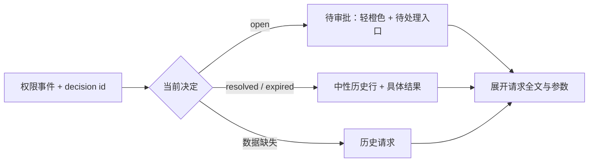

# ST-22 审批样式整理

依据附件 `截图-20261102-001025.png`：历史权限请求被渲染为整块橙色待办，长命令直接当正文展开；频繁请求让会话被重复警示块占满。

本次沿用现有黑白灰视觉体系和 Base UI 组件，不增加新的审批流程或修改权限策略。

| 区域 | 终态 | 验证 |
| --- | --- | --- |
| 会话、事项工作记录 | 权限请求压成一行：图标、命令预览、展开按钮、真实状态 | 长命令折叠、展开后全文可读 |
| 待审批 | 使用轻橙色提示，展开后可前往待处理 | 跳转入口、审批后状态更新 |
| 已处理 | 中性细边框，区分允许、拒绝、失效、撤回 | 状态回归测试 |
| 旧记录无决定数据 | 显示“历史请求”，不推断审批结果 | 缺失数据测试 |
| 待处理卡片 | 元信息可换行；标题、请求全文、参数、操作分层；参数默认折叠 | 桌面和手机、深浅主题截图 |

不做批量允许，不改变“总是允许”的授权范围和已有按钮行为。回滚本分支提交即可恢复界面。

## 验收记录

- `npm run check`：Hub 和 Web 类型检查通过。
- `npm test`：52 项通过，其中权限状态回归覆盖允许、拒绝选项、YOLO 允许、撤回、失效和历史数据缺失。
- `npm run build`：Hub 和 Web 构建通过。
- 浏览器使用隔离模拟 API 数据，复现截图中的连续请求与长命令，验证展开全文/参数、前往待处理、允许一次提交原始 option id、原会话状态立即刷新。
- 1280px 桌面与 390px 手机，深浅主题截图检查通过，无卡片横向溢出、无页面 JS 异常。
- 截图与验收结果：`/private/tmp/st22-qa/`，包括 `session-dark.png`、`session-light.png`、`session-expanded.png`、`inbox-mobile-dark.png`、`inbox-mobile-light.png` 和 `visual-result.json`。
- 没有向生产环境发送审批、推送或发布；生产环境实际操作未验证。

默认假设：沿用现有视觉体系；状态仅按服务端返回的待处理与最近决定显示。超出最近决定范围的旧请求显示“历史请求”，不伪造审批结果。
