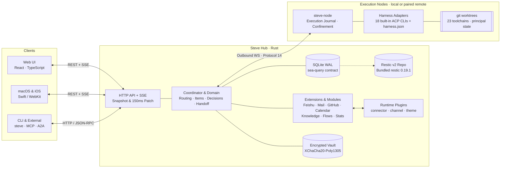

# Architecture

Steve is a self-hosted workspace for running coding agents across one or more machines. It separates **decision-making and state** (Hub), **agent execution** (Node), and **presentation** (Web and native Apple clients) behind typed contracts.

## System topology

### Three-layer separation

| Layer | Crates / Packages | Responsibility | What it must not do |
|---|---|---|---|
| **Hub** | `steve-hub`, `steve-core`, `steve-store`, `steve-modules`, domain & integration crates | Single source of truth and sole decision-maker: routing, queues, model selection, permission rulings, vault, channels, read projections, backups, metrics. | Never spawns coding harnesses directly; filesystem/process boundaries outside Node crates are enforced by CI (`node_boundary.rs`). |
| **Node** | `steve-node`, `steve-node-cli`, `steve-acp`, `steve-confine`, `steve-toolchains` | Executes one attempt at a time per session on a host machine, maintains a durable local execution journal, terminates ACP/MCP/CLI protocols, enforces OS confinement. | Holds no Hub database, makes no business or permission policy decisions, never retries ambiguously. |
| **Client** | `web/`, `apple/` | Multi-Hub UI synced over `GET /api/snapshot` and one resumable SSE stream (`/api/stream`), plus macOS menu bar status and Keychain credential storage. | Holds no authoritative state; renders typed views generated from `steve-types` (`ts-rs`). |

By default (`STEVE_NODE_MODE=service`), the Hub runs its own local Node in a separate `steve-node --local-node` process over loopback (`STEVE_LOCAL_NODE_PORT`, default Hub port + 3). All coding sessions, model/research jobs, git operations, project setup, and `stdio` MCP servers execute in the independent Node process, so Hub restarts and in-place upgrades leave active turns running. Set `STEVE_NODE_MODE=off` to run a remote-only Hub without a colocated Node (`STEVE_NODE_MODE=local` is no longer supported).

Default directories and ports: `~/.steve` (Hub) and `~/.steve-node` (separate Node), overridable with `STEVE_HOME` / `--home`; Hub API `8440` (`STEVE_PORT`), separate Web UI `8441` (`STEVE_WEB_PORT`, Hub + 1 on `steve setup`), optional tailcat Node listener `8442` (`STEVE_TAILCAT_PORT`, Hub + 2), local service Node `8443` (`STEVE_LOCAL_NODE_PORT`, Hub + 3), and optional Prometheus metrics `127.0.0.1:9464` (`STEVE_METRICS=prometheus`).

## Hub–Node protocol

Communication between Hub and Node uses `steve-node-api` (`PROTOCOL = 14`, `EVENT_SCHEMA = 1`) over `steve-node-wire`:

- **Outbound-only dial**: Every remote `steve-node` dials out to the Hub over a single bidirectional WebSocket (direct HTTPS/TLS or optional `tailcat` loopback listener on Hub port + 2). Pairing uses a one-time code and human fingerprint confirmation in **Devices**.
- **Typed ports**:
  - Hub → Node: `SessionExecutor` (including per-subtask `cancel_subtask`), `JobExecutor` (`Think` / `Research`), `ExecutionControl` (`operation`, `cancel`, `abandon`, `recover`, `resolve_permission`, `snapshot`, `streams`, `replay`, `acknowledge`), `WorkspaceExecutor` (execution-scoped file/delivery reads), and `Discovery` (capability probes, capacity limits, vitals, harness install/updates, self-upgrade, removal).
  - Node → Hub: `EventSink`, `HubTools`, `HubFiles` (including inline reply image capture before worktree cleanup), and `HubSecrets` (one-shot short-lived secret fetch by operation ID; never journaled or logged).
- **Non-retrying failure semantics**: The transport never retries blindly. A failure before transmission returns `offline`; a drop or timeout after transmission returns `outcome_unknown`, and the Hub reconciles against the Node's local execution journal once reconnected.
- **Version-independent upgrades**: A permanent `upgrade_v1` control channel stays reachable even across protocol version mismatches so outdated Nodes can still be upgraded from the Hub.

## Storage contract and read-side projections

### Storage (`steve-store`, `steve-store-sqlite`)

- **Production database**: SQLite in WAL mode with a single serialized writer connection (`BEGIN IMMEDIATE`) and a bounded `r2d2` read-only connection pool (4–16 connections, clamped to host CPU count). Schema history currently spans 139 migrations tracked in `hub-rs/crates/steve-store/migrations/LOCK`.
- **Typed query contract**: Domain reads and writes go through `Store::read` / `Store::write` built on `sea-query` (`steve-store/src/contract/`). A `#[cfg(test)]` PostgreSQL harness (`steve-store/src/contract/postgres/`) verifies backend dialect portability in CI (`postgres:18`); PostgreSQL is contract-tested only and is not a production Hub backend.

### Read-side projections (`steve-hub/src/projection/`, `steve-hub/src/api/views.rs`)

- A single background projector maintains per-workspace hot views (`Decision`, `Item`, `Session`, `Message`) in memory.
- Store commits mark affected entities dirty; the projector coalesces bursts over a 150 ms window and publishes 256 KiB-chunked `Patch` frames on the SSE stream with monotonic bus revisions, plus a periodic 600-second full reconciliation pass.
- `GET /api/snapshot` answers from memory with zero database queries and supports ETag / `304 Not Modified`. Older items and sessions outside the hot set are fetched via `GET /api/views` (up to 500 IDs) and `GET /api/views/page`.
- All wire views are generated from Rust types in `steve-types` via `ts-rs` into `web/src/gen/`.

## Harness adapter layer

Steve isolates coding-CLI differences inside `steve-harness-spec` and `steve-acp`:

- **Declarative catalog (`steve-harness-spec/src/builtins.toml`)**: Defines 18 built-in ACP harnesses (13 npm-managed into `<STEVE_HOME>/adapters`, 5 PATH-discovered), their CLI arguments, state directories, permission mode mappings, and resume/fork commands.
- **Custom adapters (`harness.json`)**: Additional ACP adapters can be declared in `<STEVE_HOME>/harness.json` (`STEVE_HARNESS_MANIFEST`). Custom manifests cannot inject arbitrary environment variables and cannot shadow or remove built-in harness IDs.
- **Runtime adapters (`steve-acp/src/adapter/`)**:
  - Five empirically verified runtime adapters translate harness-specific subagents, background tasks, usage attribution, and upgrade paths into Steve's unified `steve.v1` transcript (`steve-transcript`):
    - **Claude Code**: ACP RFD #1992 subagents (with child tool nesting and per-subagent cancel), tool-fallback background tasks (`Bash run_in_background`, `Monitor`, `TaskStop`), turn & model usage, managed npm + verified external CLI upgrades.
    - **Codex**: ACP RFD #1992 subagents (with child tool nesting and cancel), rollout usage accounting, managed npm + verified external CLI upgrades.
    - **Antigravity CLI (`agy`)**: Tool-fallback subagents (`invoke_subagent`, `manage_subagents`, `swarm`), background tasks (`run_command`, `manage_task`, `schedule`), native workflows (`run_workflow`), turn-level usage, verified external CLI upgrade (`agy update`).
    - **Kimi Code**: Tool-fallback subagents and background tasks, context-only usage, verified external CLI upgrade.
    - **Pi**: Full-access-only runtime (`@earendil-works/pi-coding-agent` + `@openma/pi-acp`), optional `pi-subagents` extension with per-subtask usage attribution, managed npm + verified external CLI upgrades.
  - All other built-in and custom harnesses run through `GenericAdapter` with forward-compatible support for RFD `subagent_update` / `session_message` events.

## Security, confinement, and backups

- **Authentication (`steve-auth`, `steve-hub/src/access.rs`)**: Username + access token (`POST /auth/token`, SHA-256 stored), single-use QR device pairing, optional OIDC with Authorization Code + PKCE (30-day opaque session cookie, SHA-256 stored), and strictly loopback-only `STEVE_DEV_LOGIN=1` verified via `ConnectInfo<SocketAddr>`.
- **Vault (`steve-modules/src/vault/`, `steve-vault`, `steve-keyhelper`)**: Per-workspace 256-bit master key (KEK) in the OS keystore (`auto` uses macOS Keychain via `steve-keyhelper` with a stable code signature, or Linux Secret Service; `dir` uses an external `0700` directory on headless Linux; `file` is dev/test only and refused on `~/.steve`). Each secret item has its own data key encrypted with XChaCha20-Poly1305 and AAD binding workspace, item, and field. Revealing a secret requires a WebAuthn Passkey challenge bound to that field. `steve_secret_use` injects secrets into env/stdin/temp file and executes strictly on the session's execution Node with no Hub-local shell fallback; high-sensitivity items and cards can never be granted.
- **OS confinement (`steve-confine`)**: Uses macOS Seatbelt (`sandbox-exec`) or Linux Bubblewrap (`bwrap`). Level `1` (default) blocks access to Steve's own keys, database, and binaries, confines workspace writes, and hides the Node owner's harness homes from non-owner sessions. Level `2` additionally starts runs from a fresh login environment. Harnesses with their own sandbox (such as Codex) retain it. Inline read-only research adds three layers: adapter `plan` mode, ACP kind/path guard blocking sensitive home directories (`.ssh`, `.steve`, `.aws`, `.config/gh`, `Library/Keychains`), and a read-only OS sandbox.
- **Principal state and toolchains (`steve-toolchains`)**: `STEVE_PRINCIPAL_STATE=on` isolates per-principal harness directories on each Node while linking the Node's own sign-in without copying credentials. `STEVE_TOOLCHAINS=on` isolates build outputs and download caches across 23 built-in toolchains (`cargo`, `npm`, `pnpm`, `yarn`, `bun`, `pip`, `uv`, `poetry`, `conda`, `go`, `gradle`, `maven`, `swiftpm`, `xcode`, `cocoapods`, `bazel`, `cmake-make`, `dotnet`, `bundler`, `dart`, `mix`, `js-frameworks`, `python-tools`).
- **Encrypted backups (`steve-hub/src/backup/`)**: Every release archive bundles verified upstream `restic` 0.19.1 next to `steve-hub`. All five backup purposes (`Daily` after 03:30 local time, `PreUpgrade`, `PreDestructive`, `Manual`, `Diagnostic`) share one encrypted restic v2 repository at `<STEVE_HOME>/backups/restic`, with the repository password stored in the installation KeyStore and passed over stdin with `env_clear()`. SQLite snapshots are verified with `quick_check` and SHA-256 before receipts are recorded.

## Extensibility

- **Runtime plugins (`steve-hub/src/plugins/`)**: Installed from plugin libraries (`steve-store.json`, default official library `Infranite/steve-extensions`) as SHA-256-verified prebuilt archives running as separate supervised processes under the Hub user. Contract 1 defines three kinds: `connector` (`ext_ws` + optional `calendar.v1`), `channel` (`ext_ws` / `ext_ws.bot`), and `theme` (data-only web skin).
- **Hub Extension API (`steve-hub/src/extension.rs`, `EXTENSION_API = 2`)**: Compile-time `Assembly::builtin().with(...)` registers connection providers, channel/mail adapters, flow event sources, routes, and background jobs. `Assembly::builtin()` ships 6 extensions: `feishu.bot`, `feishu.self`, `ext_ws`, `mail.imap`, `github`, and `calendar`.
- **Flow and Module seams**: `FlowSetup` adds custom flow node kinds, actions, item finders, and event adapters; `steve-modules` provides item lifecycle hooks, declarative sidebar item panels, prompt context providers, outbound checks, decision handlers, and changeset operations.
- **Unified MCP server (`steve-mcp`, `tool_registry.rs`, `outside_mcp.rs`)**: Every session connects to a single Hub `/mcp` endpoint exposing 8 core tools (`steve_update`, `steve_ask`, `steve_request_approval`, `steve_deliver`, `steve_items_search`, `steve_knowledge_search`, `steve_tools_search`, `steve_tool_call`) plus up to 32 per-Bot pinned tools across library MCP servers, A2A agents, and connector tools. External MCP clients connect to `/mcp` with a user access token (`Bearer stt_…`) for a scoped read/dispatch subset.
- **A2A server (`steve-hub/src/a2a_server.rs`)**: Serves `GET /.well-known/agent-card.json` and JSON-RPC 2.0 `POST /a2a` (`protocolVersion: "0.3.0"`) supporting `message/send`, `tasks/get`, and `tasks/cancel`.
- **Webhooks & Knowledge store port**: `POST /hooks/{id}` and `POST /hooks/github` verify signatures before persistence. Knowledge retrieval uses SQLite FTS by default and supports an optional OpenViking vector backend (`STEVE_KB_STORE=openviking`) with Hub-side access re-checking.

## Workspace layout

The Rust workspace in `hub-rs/` contains **32 crates**:

| Layer | Crates | Role |
|---|---|---|
| **Contracts & primitives** | `steve-types`, `steve-runtime`, `steve-i18n`, `steve-harness-spec`, `steve-toolchains`, `steve-work-api` | Pure wire/domain types (`ts-rs` bindings), clocks/schedules/caches, localization, harness catalog, toolchain rules, work outbox contracts. |
| **Node & execution** | `steve-node-api`, `steve-node-wire`, `steve-node`, `steve-node-cli`, `steve-acp`, `steve-transcript`, `steve-confine`, `steve-research` | Hub–Node protocol 14 and transport, Node execution engine & CLI, ACP client & runtime adapters, `steve.v1` transcripts, OS sandboxing, read-only research guard. |
| **Storage & security** | `steve-store`, `steve-store-sqlite`, `steve-auth`, `steve-vault`, `steve-keyhelper`, `steve-mcp` | SQLite WAL + `sea-query` contract + 139 migrations, SQLite backup/intake primitives, OIDC/token auth, harness secret boundaries, macOS Keychain helper, `/mcp` server. |
| **Core & modules** | `steve-core`, `steve-modules`, `steve-channels`, `steve-mail`, `steve-github`, `steve-calendar`, `steve-knowledge`, `steve-digest`, `steve-flow`, `steve-stats` | Coordinator/routing/items/handoff, module seams & vault/contacts/changesets, Feishu/Lark & `ext_ws`, IMAP/SMTP mail, GitHub, ICS/connector calendar, personal knowledge & proposals, conversation digest, flow engine, usage & delivery metrics. |
| **Binaries & installer** | `steve-hub`, `steve-install` | `steve-hub` server/projections/plugins/backups/upgrades/metrics; `steve` native setup & service CLI. |

Top-level directories outside `hub-rs/`:

- `web/` — React 19 + Vite 8 + Tailwind CSS 4 + TypeScript 6 client and Playwright browser tests.
- `apple/` — Native macOS 14+ and iOS 17+ Swift wrapper apps (`SteveClientKit`, `SteveMac`, `SteveIOS`).
- `packaging/` — Homebrew tap formula template (`packaging/homebrew/tap/steve.rb.in`) and release sync checks.
- `ops/` — Release cutting (`cut-release.py`), development runner (`dev.py`), service/backup scripts, and optional OpenViking helpers.
- `docs/` — Architecture, concepts, deployment guide, generated release notes (`docs/releases/`), and visual assets.
