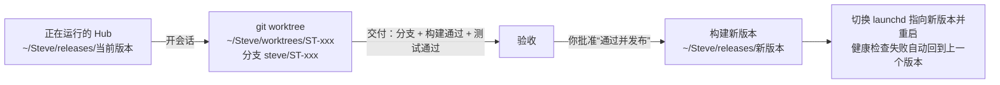

结论：第一个目标是**用 Steve 2.0 开发 Steve 2.0**。只做让这件事成立的最小切片：

- **主线**：主线对话 → 事项 → 在 Mac mini 上起 Claude Code 会话改 Steve 自己的代码 → 事项里实时看到它在干什么，能插话、回答、审批 → 交付后验收 → 你批准后发布新版本。
- **基础**：平台层只做这条线必需的部分，数据结构按终态设计来，后面不返工。
- **不做**：渠道、联系人、保险箱、自动化、插件、多设备。

预计分 5 步，每一步都有可以实际操作的验收。

## 一、现场

| 项 | 现状 |
| --- | --- |
| 机器 | 就是 Mac mini（Mac17,16，macOS 27.0.1），Hub 直接部署在这里 |
| 旧版 Steve（失败的 3.0 尝试）| `~/Agents/steve`，Rust + Axum + React。约 3000 行后端：ACP 运行时、排队、插话、中断、恢复、问答表单、事件流、附件、OIDC 登录。当前分支 `feat/visual-foundation`，main 在 `b609cb2` |
| 正在运行的旧版 | 两个开发预览实例（端口 8431、8419，debug 构建，用的是测试用的假 agent），不是正式服务 |
| harness | Claude Code 2.1.308、Codex 0.166.0、Pi 已安装 |
| ACP 适配器 | 本机没装。可用：`@agentclientprotocol/claude-agent-acp` 0.99.1（Claude Code）、`@zed-industries/codex-acp` 0.16.0（Codex） |
| 关键缺口 | 旧版 建会话时传 `mcpServers: []`，Steve 工具注入还没做 |
| 原型 | `~/Agents/artifacts/steve-20261030/proto-v13`，组件和视图按真实组件写，可以直接迁 |

## 二、自举的范围

| 做 | 不做（以后按阶段加） |
| --- | --- |
| 单工作空间、单用户；数据表带 `workspace_id` | 多用户、成员权限 |
| 主线对话，Steve 判断闲聊还是事项 | `@`、`/` 命令、附件之外的输入增强 |
| 事项：编号、目标、状态机、计划、动态、产出、验收、返工、暂停、放弃 | 前置依赖、派生、关系图、标签自动归类、事项类型 |
| 一个事项一个会话；会话模式（插话、排队、中断、换模型） | 多会话、交接、补充排队的延迟送达 |
| 决定：验收、问题、审批（来自 harness 的权限请求和 Steve 工具） | 稍后提醒、撤销期限 |
| Steve 工具（MCP）：更新现在和计划、提问、请求审批、交付 | 记忆、联系人、机密相关的工具 |
| Bot：主 Bot + 一个“Steve 开发”Bot（Claude Code），设置可改 | 对外身份、能力开关、系统提示词编辑 |
| 模型网关：通过 harness 的无界面调用做分流和起标题 | API 直连、披露检查 |
| 单设备：Hub 本机执行器 | 设备配对、调度 |
| 关联、修订、审计三张平台表（最小实现） | 对话式配置、标签、记忆存储 |
| 部署：launchd 常驻、发布与回退、备份 | 手机端、Tauri |

## 三、关键设计：Steve 改自己的代码时怎么不把自己弄坏

- **运行和开发分开**：Hub 从独立的发布目录运行，会话只在 git worktree 里改代码，改坏了不影响正在运行的 Hub。
- **发布是一个单独的决定**：验收通过只代表代码可以合并；发布新版本需要你单独批准，符合“对外动作要批准”的安全规则。
- **重启不丢状态**：数据在 `~/Steve/data`（SQLite + 附件），不随版本切换。重启后，运行中的会话按 旧版 已有的恢复逻辑标记为可恢复，不会自动重放。
- **回退**：保留最近 3 个版本；新版本启动后健康检查不通过，自动切回上一个版本，并在待处理里报异常。

## 四、技术方案

| 层 | 做法 |
| --- | --- |
| 后端 | 在 旧版 基础上开新分支：保留 `runtime.rs`（ACP）、`harness.rs`、`media.rs`、`auth.rs`；新增 `items`、`decisions`、`threads`（主线对话）、`bots`、`links`、`revisions`、`audit` 模块。存储层先继续用 rusqlite，但所有访问都经过仓储接口，以后换 sqlx 只改一层 |
| Steve 工具 | Hub 内置一个 MCP 服务（官方 Rust SDK `rmcp`，HTTP 方式），每个会话签发一个只限本事项的令牌；建会话时通过 ACP 的 `mcpServers` 注入。工具：`steve.update`（现在和计划）、`steve.ask`、`steve.request_approval`、`steve.deliver` |
| 编排 | 事项 → 会话的映射；会话事件流驱动事项动态；Steve 工具的调用驱动事项状态和决定 |
| 模型网关 | 第一版通过 `claude -p --output-format json` 做分流和起标题，带结构化输出约束；超时或失败时直接建成事项，不卡住对话 |
| 前端 | 新建 `web-v3`，从原型 v13 迁过来：视觉 token、组件、对话、待处理、事项列表和详情、会话模式、Bot 设置；数据从假 store 换成 API + SSE |
| 登录 | 见“需要你决定”第 1 条 |
| 部署 | `~/Steve/`：`releases/`、`data/`、`worktrees/`、`backups/`；launchd 常驻；发布脚本带健康检查和回退；每天备份 `data/` |

## 五、步骤与验收

| 步 | 内容 | 验收（实际操作） |
| --- | --- | --- |
| 1. 技术验证 | 装两个 ACP 适配器；验证 Claude Code 和 Codex 下的 MCP 注入、工具调用往返、会话加载与恢复、用量上报、权限请求 | 写一份验证报告：每个 harness 每项能力“通 / 不通 / 替代方案”。Claude Code 必须全部打通，否则先解决再往下走 |
| 2. 后端主线 | 新表与仓储、事项状态机、决定、主线对话、Steve 工具（MCP）、编排、REST + SSE | 用命令行脚本走一遍：建事项 → 起会话 → agent 调 `steve.update` 和 `steve.deliver` → 生成验收决定 → 验收通过；中途重启 Hub，状态一致 |
| 3. 前端 | 从原型迁移五个视图，接真实接口 | 浏览器里：对话交代一件事 → 事项里实时看到思考和工具调用 → 进会话插话、中断 → 回答问题 → 验收；手机宽度可用 |
| 4. 部署与发布 | 目录结构、launchd、发布与回退脚本、备份、worktree 策略 | 发布一个新版本 → 故意发布一个启动失败的版本 → 自动回退；重启 Mac mini 后 Hub 自动起来 |
| 5. 自举验收 | 在 Steve 2.0 里交代一件 Steve 2.0 自己的需求，全程不离开 Steve | 例如“给事项列表加按状态筛选”：Claude Code 在 worktree 里实现 → 构建和测试通过 → 你验收 → 批准发布 → 新版本上线，页面上能用到这个筛选 |

每一步结束都按约定交付：完成了什么、怎么验证的、还缺什么、入口在哪。

## 六、风险

| 风险 | 应对 |
| --- | --- |
| ACP 适配器的 MCP 注入或会话恢复不稳定 | 第 1 步先验证；Claude Code 不通时，备选是直接用 Claude Agent SDK 写一个最小适配器 |
| 通过 harness 做分流太慢（几秒） | 分流异步进行，先回“收到”，结果出来再更新；用户可以在设置里配 API |
| Steve 改坏自己 | worktree 隔离、发布单独批准、健康检查自动回退 |
| 旧版 的预览实例占着端口和数据 | 新版用新端口和 `~/Steve/data`，不碰 旧版 的数据 |

## 七、已确认（2026-10-31）

| 问题 | 决定 | 落实 |
| --- | --- | --- |
| 登录与远程访问 | 要做，上班时要能远程看效果 | 复用现有入口 `steve.example.com` 和 Authentik 里的 Steve OIDC 应用（owner 组准入）；切换时只把入口的后端从 Debian 改到 Mac mini 的 Hub（WireGuard `100.64.0.10`），回调地址不变 |
| 代码 | 旧版 铲掉，从 0 开始 | 新代码库，不复用 旧版 代码；旧版 的经验（ACP 恢复、排队、媒体限制）作为参考 |
| 安装适配器 | 可以 | 全局安装 `@agentclientprotocol/claude-agent-acp`、`@zed-industries/codex-acp` |
| 旧版 | 全部可以删 | 本机两个预览实例停掉；本机 旧版 代码移到归档目录（不直接删除，远端仓库不动、不推送）；Debian 上的正式 旧版 在新版本切换入口后停用并归档数据 |

**2026-10-31 更正：后端必须是 Rust。** 用户要求后端用 Rust 保证性能。当前的 TypeScript Hub 是过渡版：先在它上面修完卡顿和流程问题、恢复自举，再用 Rust 重写 Hub，沿用同一套 API、数据库结构和 Web 界面，并行运行，e2e 全部通过后切换。前端保持 React/TypeScript。下面这段是当时的选型记录，已被这条更正取代。

**（已取代）技术选型调整：全栈 TypeScript**。从 0 开始后不再受 旧版 的 Rust 代码约束：

| 理由 | 说明 |
| --- | --- |
| 协议 SDK | ACP 和 MCP 的官方 SDK 都是 TypeScript，适配器本身也是 TypeScript |
| 一种语言 | 前端、Hub、执行器、插件 SDK 用同一种语言和同一套类型定义 |
| 自举效率 | Steve 的主力 harness 是 Claude Code，在 TypeScript 代码库上迭代最快 |
| 不受影响的约束 | 存储仍通过仓储层，先 SQLite、保留 Postgres；数据结构按终态设计 |

组成：Node 22+；HTTP 用 Hono；存储用 Drizzle ORM + SQLite（better-sqlite3）；ACP 用 `@agentclientprotocol/sdk`；MCP 用 `@modelcontextprotocol/sdk`；前端沿用原型 v13 的 React 19 + Tailwind v4 + shadcn。
