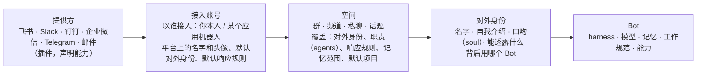
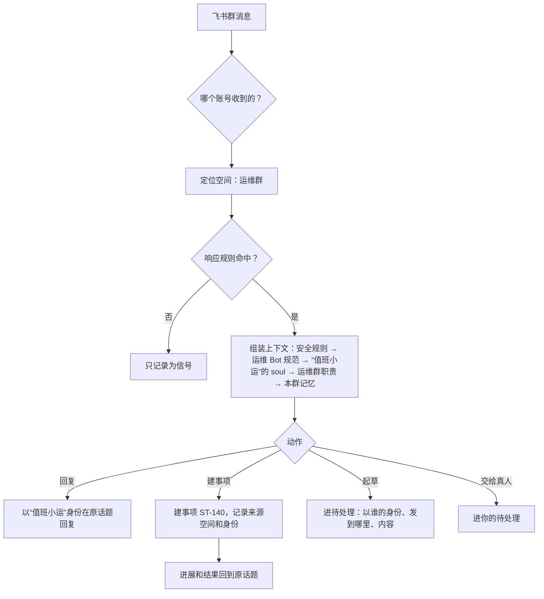
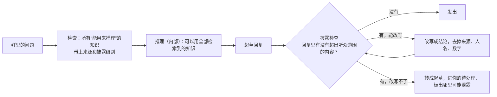

结论：把“渠道”从“事件源的一种”升级为系统里的一类独立对象，拆成四层：**提供方**（飞书、Slack……，由插件提供）→ **接入账号**（以谁的身份接入：你本人，或某个平台应用机器人）→ **空间**（某个群、频道、私聊、话题）→ **对外身份**（在这里说话的是谁、负责什么、怎么说）。Bot 管“脑子”（harness、模型、记忆、工作规范），对外身份管“脸”（名字、自我介绍、职责、口吻、能透露什么），两者分开，一个 Bot 可以在不同群里戴不同的“马甲”。

提示词分两层：**soul**（我是谁、性格、口吻，跟着对外身份走）和 **agents**（在这里做什么、规则和流程，跟着空间走）。一个群的特定身份 = 选一个对外身份 + 写这个群的职责，不需要为每个群复制一份完整人格。

## 现状的问题

| 问题 | 现在 | 应该 |
| --- | --- | --- |
| 渠道写死 | “IM（飞书）”是一个开关；IM 是一个事件源 | 飞书、Slack、钉钉、企业微信、Telegram、邮件都是同一类对象的不同提供方 |
| 没有接入身份 | 账号只是一条授权记录 | 要说清以谁接入：你本人，还是某个平台机器人；一个提供方可以接多个机器人 |
| 没有对外身份 | 回复的永远是“Steve” | 在运维群里叫“值班小运”，在需求群里叫“需求官”，各自介绍自己的职责 |
| 响应规则太粗 | 群只有“全部消息 / 只看 @我 / 不接收” | 什么时候回复、什么时候只记录、什么时候起草等你批准，要能按群设置 |
| 只进不出 | 渠道只产生信号 | 同一个渠道既收消息也发消息；事项的进展要能回到发起它的那个话题里 |

## 四层模型

### 1. 提供方

由插件提供，内置飞书 / Lark、Slack、邮件，其他走插件。每个提供方声明自己的能力，界面和规则据此降级：

| 能力 | 用途 |
| --- | --- |
| 接收：群消息、私聊、@提及、话题回复、表情回应 | 决定能设置哪些响应条件 |
| 发送：文本、富文本卡片、按钮、文件、话题内回复 | 决定回复的形式；不支持按钮时审批改成“回复 1/2” |
| 编辑、撤回 | 决定“撤销已发送”是否可用 |
| 多机器人：一个工作区能否装多个应用 | 决定能否给不同群配不同的平台身份 |
| 以用户身份收发（user token） | 决定能否用“你本人”接入 |
| 成员信息：姓名、部门 | 用于“只响应指定成员”和自我介绍里称呼对方 |

### 2. 接入账号：以谁的身份接入

一个提供方下可以有多个接入账号。账号有两种：

| | 你本人 | 应用机器人 |
| --- | --- | --- |
| 例子 | 用你的飞书账号授权 | 你在飞书开放平台建的“值班小运”“需求官”应用 |
| 别人看到的 | 你本人在说话 | 一个机器人，名字和头像在平台上设置，Steve 读取同步 |
| 适合 | 替你看消息、整理待办、起草回复 | 在群里长期承担某个职责 |
| 发送 | 默认只起草，经你批准才以你的名义发出；可对单个私聊放开 | 按响应规则自动回复 |
| 能看到的消息 | 你能看到的全部 | 只有它被拉进的群和私聊 |

账号上的设置：

- **默认对外身份**：这个账号在没有特别设置的空间里用哪个身份说话。机器人账号通常一个账号对应一个对外身份；“你本人”账号的默认身份就是你自己，Steve 只起草。
- **默认响应规则**：见下文。
- **加入的空间**：自动列出它所在的群和私聊，新被拉进群时提醒你设置。

### 3. 空间：在哪里、做什么

空间是平台上具体的群、频道、私聊或话题。每个空间可以覆盖账号的默认设置：

| 设置 | 说明 |
| --- | --- |
| 对外身份 | 用账号默认的，或换一个 |
| 职责（agents） | 在这个群里负责什么、遵守什么规则，例如“只回答部署和告警相关的问题；不确定时 @Alice” |
| 响应规则 | 什么时候回复、只记录还是建事项 |
| 记忆范围 | 只在这个群内记忆（默认），还是和这个身份共享 |
| 事项默认值 | 从这里产生的事项默认打什么标签、归哪个项目、交给哪个 Bot |
| 静默 | 临时让它在这个群里不说话 |

### 4. 对外身份：说话的是谁

对外身份是一个独立对象，管理在 Bot 菜单下。

| 字段 | 说明 |
| --- | --- |
| 名字、头像 | 用户可见。机器人账号以平台上的为准；“你本人”账号不适用 |
| 背后的 Bot | 由哪个 Bot 干活：Steve 或某个普通 Bot |
| 自我介绍 | 被问“你是谁”时怎么说，例如“我是值班小运，负责运维群的告警和部署答疑” |
| 口吻（soul） | 性格、语气、称呼方式、长短 |
| 透露范围 | 能不能说自己背后是 Steve、是 AI、归谁管；能不能提到其他群里的事 |
| 签名 | 可选，例如回复末尾加“— 小运（AI 助手）” |

**为什么把对外身份和 Bot 分开**：同一个运维 Bot 可以在运维群叫“值班小运”，在客户群叫“技术支持”，能力和记忆一样，但脸和口吻不同；反过来，“需求官”这个身份以后可以换成更强的模型，群里的人感觉不到变化。

## soul 和 agents 的分工

| | soul | agents |
| --- | --- | --- |
| 回答的问题 | 我是谁、怎么说话 | 在这里做什么、守什么规矩 |
| 挂在 | 对外身份 | 空间（群），以及 Bot 的工作规范 |
| 例子 | “你是需求官，说话简洁友好，叫对方名字，不用表情包” | “这个群是产品需求群。整理成需求时用‘背景 / 诉求 / 优先级’格式，不要承诺上线时间” |
| 变化频率 | 很少 | 每个群不同，经常调整 |

一条消息到来时，最终交给模型的上下文按下面的顺序叠加，越往下越具体；**冲突时，越具体的职责优先，但安全规则永远在最上面不可覆盖**：

1. Steve 的安全规则：对外发送、花钱、删除需要批准；不跨空间泄露信息；不冒充真人（机器人账号）。
2. Bot 的工作规范和能力。
3. 对外身份的 soul 和透露范围。
4. 账号的默认职责。
5. 空间的职责（agents）。
6. 这个空间的记忆和最近的对话。

## 什么时候响应

响应规则 = 条件 + 动作，按账号设默认，按空间覆盖。

| 条件 | 例子 |
| --- | --- |
| 被 @ 或私聊 | 默认开启 |
| 回复了它的消息、在它发起的话题里 | 默认开启 |
| 关键词或意图 | 消息里出现“部署”“报警”，或者 AI 判断是在提需求 |
| 指定成员 | 只响应组内成员；外部成员只记录 |
| 时间 | 工作时间内回复，其他时间只记录、第二天汇总 |
| 全部消息 | 只记录，不回复，用于整理群聊纪要 |

| 动作 | 说明 |
| --- | --- |
| 直接回复 | 机器人账号的常用动作 |
| 起草，等你批准 | “你本人”账号的默认动作；也可以给机器人在敏感群里用 |
| 只记录为信号 | 进信号页，可被流程处理 |
| 建事项 | 回一句“收到，已记为 ST-140”，事项进展和结果回到同一话题 |
| 交给真人 | 回一句“我请 Alice 来看”，进你的待处理 |

更复杂的判断（比如“是需求就建事项，是闲聊就忽略”）交给已有的**流程**编排；响应规则负责最常见的情况，流程负责复杂的情况，两者用同一套条件和动作。

## 一条消息怎么走

## 一个例子

你在飞书上建了三个应用机器人，同时用你本人的账号授权：

| 接入账号 | 对外身份 | 背后的 Bot | 空间 | 职责 | 响应 |
| --- | --- | --- | --- | --- | --- |
| 你本人 | 你自己 | Steve | 所有群和私聊 | 替你看消息、整理待办 | 只记录；@你的消息起草回复，等你批准 |
| 应用“值班小运” | 值班小运 | 运维 Bot | 运维群 | 告警排障、部署答疑 | @ 或包含“告警”时直接回复；需要操作时建事项 |
| 应用“需求官” | 需求官 | Steve | 产品需求群、客户 Acme 群 | 需求群里整理需求；Acme 群里只记录不说话 | 需求群：判断是需求就提议建事项；Acme 群：静默 |
| 应用“小助理” | 小助理 | Steve | 全员私聊 | 回答通用问题 | 私聊直接回复 |

在运维群里有人问“你是谁”，回答是“我是值班小运，负责运维群的告警和部署答疑”，而不是“我是 Steve”。

## 和系统其他部分的关系

| 部分 | 关系 |
| --- | --- |
| 事件源 | 渠道是一种事件源，收到的消息照常进信号页；但渠道多了“发出”和“身份” |
| 流程 | 流程里新增“以某个身份回复”“发到某个空间”两个动作 |
| 事项 | 事项记录来源空间和身份；“回到来源”成为默认的交付方式之一 |
| 待处理 | 起草的消息显示：以谁的身份、发到哪个群、原消息上下文 |
| 通知 | 通知不再是“IM（飞书）”开关，而是选一个接入账号和空间（通常是机器人和你的私聊），身份是 Steve |
| 记忆 | 默认按空间隔离；对外身份可以选择共享 |
| 插件 | 新的提供方 = 插件，实现收、发、能力声明、成员信息几个接口 |

## 界面位置

| 位置 | 内容 |
| --- | --- |
| 自动化 · 渠道（新，替代事件源里的 IM） | 提供方 → 接入账号 → 空间，三级管理；每个空间一页：对外身份、职责、响应规则、记忆、事项默认值、最近消息 |
| Bot · 对外身份（新页签） | 每个对外身份：名字、自我介绍、soul、透露范围；列出它在哪些空间出现 |
| 设置 · 通知 | 选一个账号和空间作为通知渠道 |
| 待处理 | 起草的消息卡片，标明身份和空间 |

## 对话式配置

上面这些配置项很多，但都不要求用户自己逐项填。每个渠道、账号、群、身份页面顶部都有“告诉 Steve”，主对话里也可以直接说，例如“运维群只在被 @ 时回复，这里有客户，不要透露其他群的细节”。Steve 起草一份改动草稿，逐项列出原值和新值，你确认后应用，可以撤销。说不清对应哪个字段的内容，追加进群的职责或身份的口吻。

## 已确认（2026-10-31）

| 问题 | 决定 |
| --- | --- |
| 对外身份 | 独立对象，管理在 Bot 菜单下，可以复用，背后的 Bot 可以更换 |
| 以“你本人”接入时自动回复 | 默认只起草；允许在特定情况下自动执行，例如消息以 `/bot` 这类触发语开头。触发语和适用的私聊、群由你设置 |
| 被问“你是谁、是不是 AI、是不是 Steve” | 默认回答自己的身份和可公开信息（名字、职责、是 AI 助手）；你可以逐项设成隐藏 |
| 多个机器人在同一个群里互相 @、协作 | 有开关，默认关闭 |
| 记忆和知识 | 知识可以跨组织使用，但使用不等于暴露，见下一节 |

`/bot` 触发语的规则：

| 项 | 默认 |
| --- | --- |
| 谁能触发 | 只有你本人。别人在群里发 `/bot` 不会让 Steve 以你的名义说话 |
| 在哪里生效 | 你指定的私聊和群；其他地方只起草 |
| 发出的消息 | 以你的身份发出，默认带一个小标记“（由 Steve 代发）”，可以关闭 |
| 触发后能做什么 | 回答、总结、查资料、建事项；对外承诺、花钱、删除仍然需要你批准 |

## 知识：能用，但不一定能说

最常见的情况是：运维群里的问题，答案在另一个群的讨论、某封邮件或另一个事项里。Steve 应该能用这些知识把问题解决，但不能把别的群里谁说了什么、具体数字、客户名字原样搬过来。就像思维链：推理可以用到，输出里不出现。

所以每一条知识都要分开回答两个问题：**能不能用来推理**，和**能不能出现在回复里**。

### 每条知识带上来源和披露级别

记忆、事项产出、信号、会话摘要、文档，进入知识库时都记录：

| 字段 | 说明 |
| --- | --- |
| 来源 | 哪个空间、哪个事项、哪封邮件；谁说的 |
| 可见范围 | 原本能看到它的人：某个群的成员、你本人、某个客户 |
| 披露级别 | 见下表，默认由来源决定，可以按空间、按条目修改 |

| 披露级别 | 能用来推理 | 回复里能说什么 | 默认适用 |
| --- | --- | --- | --- |
| 公开 | 能 | 原文和细节都能说 | 公开文档、你标记为公开的内容 |
| 可转述结论 | 能 | 只说结论，不说来源、人名、原话、具体数字 | 公司内部群、内部事项 |
| 仅用于推理 | 能 | 不能出现任何可辨认的内容，只体现在回答质量里 | 客户群、私聊、邮件 |
| 不可使用 | 不能 | 不能 | 你标记的敏感内容、法务、人事 |

规则是“按听众判断”：一条知识在某个空间能说到什么程度，取决于这个空间里的听众是否原本就能看到它。听众都在原始可见范围内，就可以按“公开”处理，比如在同一个群里引用这个群之前的讨论。

### 回答时分两步：先想，再说

- **检索**：跨组织检索，但只取“能用来推理”的条目，每条都带着来源和披露级别进入上下文。
- **推理**：模型看到完整内容，并被告知每条能说到什么程度。
- **披露检查**：发出前单独检查一遍。规则检查找人名、客户名、金额、链接、文件名这类可辨认的内容，再由模型判断回复是否透露了超出听众范围的信息。检查用的模型和回答用的分开。
- **处理**：能改写就改写成结论；改写后仍有风险，就转成起草等你批准，不自动发出。

### 你能看到内部用了什么

像思维链一样，群里的人只看到回复；你在 Steve 里能看到每次回复的“依据”：用了哪些知识、各自的披露级别、哪些内容被改写或拦下。这样出了问题能追查，也能据此调整某个来源的披露级别。

### 还要在实现时解决的问题

| 问题 | 说明 |
| --- | --- |
| 组合泄露 | 每条单独看都没问题，组合起来能推出敏感信息，例如“某客户下季度预算缩减”。检查要看整段回复，而不是逐条比对 |
| 存在性泄露 | 回答“这个我不能说”本身就暴露了有这件事。默认像不知道一样回答，只在你本人面前说明原因 |
| 推理痕迹 | 回复的措辞可能间接暴露来源，例如“根据之前和 Acme 的讨论”。改写时要去掉这类指代 |
| 等级变化 | 一条知识的披露级别被调高或调低后，已经发出的回复不追溯，但之后的回复按新的级别处理 |
| 评测 | 需要一组泄露测试题，覆盖直接问、换个说法问、分多次问，用来衡量检查的效果 |

## 还需要你决定

1. 披露级别的默认值按上表（公司内部群“可转述结论”，客户群、私聊、邮件“仅用于推理”），可以吗？
2. `/bot` 代发的消息默认带“（由 Steve 代发）”标记，可以吗？
