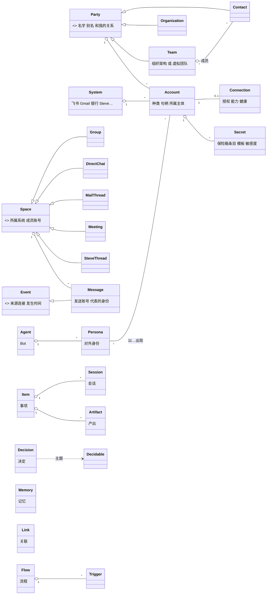
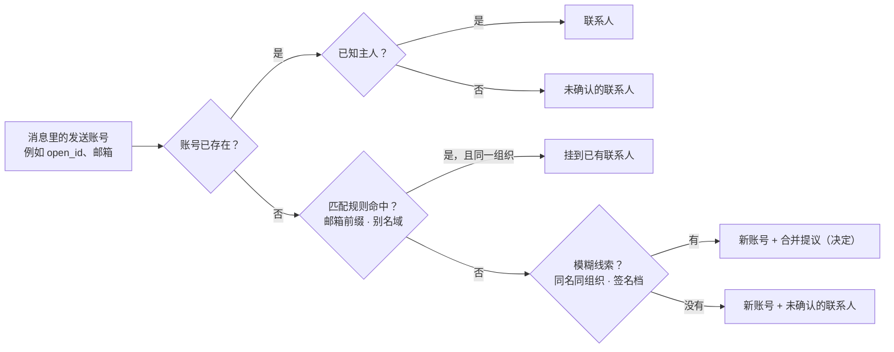
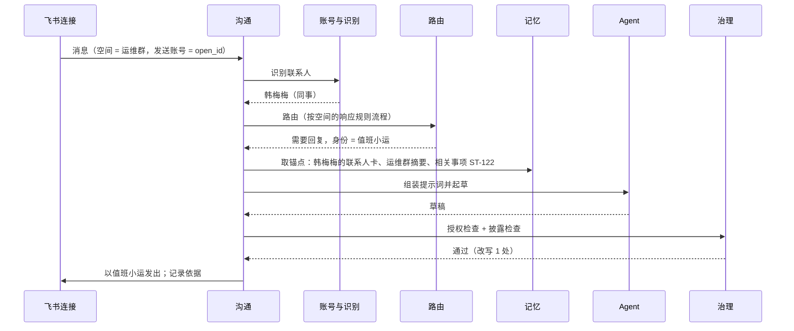
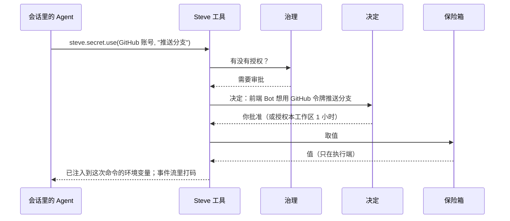

结论：Steve 的所有对象收敛成 **13 个模块、约 35 个实体**，用面向对象的方式组织：少数抽象基类，加上一组共性能力（可关联、可打标签、可记忆、可配置、可决定、可披露……），具体实体按需组合这些能力。

几处最关键的收敛：

| 原来分散的概念 | 终态 |
| --- | --- |
| 人、组织、未确认的发件人、部门、兴趣小组 | **主体**（抽象）：联系人、组织、团队是它的子类。团队分组织架构（从办公 IM 同步）和虚拟团队（你自己组建）。界面上不出现“主体”“人”这样的词 |
| 邮箱地址、飞书 open_id、电话、接入账号、事件源账号、银行卡、GitHub | **账号**：某个主体在某个系统里的一个身份。我的账号可以**连接**给 Steve 使用，也可以关联**保险箱条目**（Steve 自己的保险箱，建模参考 1Password） |
| 渠道、事件源 | 不再是实体，而是**连接的能力**：能收发消息的连接就是渠道，能产生事件的连接就是事件源 |
| 群、私聊、频道、邮件往来、会议，以及和 Steve 的主线对话 | **空间**的子类；里面的发言、邮件都是**消息**；消息是**事件**的一种 |
| 信号 | 不是实体，是“事件 + 路由结果”的视图 |
| 待处理、配置草稿、渠道起草、记忆候选、联系人合并 | **决定**：主题可以是任何“可决定”的实体；配置草稿是一种**变更集** |
| Bot 记忆、群记忆、人物档案、知识、事项结论 | **记忆**：挂在一个或几个实体上，带来源、可见范围和披露级别 |
| 流程、定时任务、渠道响应规则 | **流程 + 触发器**；响应规则是内置的流程模板 |
| 三种权限 | **授权**：谁 × 能做什么 × 在什么范围 × 是否要审批，底下压着不可覆盖的安全规则 |
| 运行环境、项目目录、本机会话（默认只有一台机器） | **设备**：一个中心节点（Hub）加若干执行节点和客户端；运行环境、项目目录、会话都挂在某台设备上 |

## 一、建模原则

1. **一个现实概念只有一个实体**。同一件事在两个模块里出现时，抽象成一个实体，两个模块各自引用它。
2. **组成关系用外键，语义关系用关联**。事项拥有计划、会话属于事项，这种固定的组成关系直接建在实体上；“谁提出了这件事”“邮件提到了谁”这类多对多、会变化、有来源的关系，统一走**关联**。
3. **共性能力用组合，不用继承链**。实体通过组合“可关联、可打标签、可配置……”获得行为，平台层对每种能力只实现一次。
4. **机密的值永远不进模型**。密码、令牌、卡号加密存在 Steve 的保险箱里，Agent 只能按条目和用途申请使用，由 Steve 在执行端注入。
5. **所有推断都有来源和可信度，所有改动都有修订和审计**。Steve 推断的关联、记忆、联系人合并，低于阈值只做提议；所有配置改动可以回退。
6. **工作空间隔离从第一天开始**。所有实体都属于一个工作空间（多人共用 Steve 时的数据边界），带可见范围；跨工作空间不共享、不合并。

## 二、领域全景

## 三、共性能力

每个实体组合下面若干能力。平台层对每种能力只实现一次，所有实体自动获得对应的界面和接口。

| 能力 | 含义 | 平台提供 | 典型实体 |
| --- | --- | --- | --- |
| 可识别 | id、所属工作空间、创建者、创建与更新时间 | 存储层 | 全部 |
| 有可见范围 | 只有我、工作空间、某团队或某个群的成员 | 查询与检索一律先过滤 | 联系人、记忆、消息、事项 |
| 可关联 | 能作为关联的两端 | 关联表、关系图、时间线 | 几乎全部 |
| 可打标签 | 能打标签 | 标签服务、自动打标签 | 事项、联系人、组织、产出、空间 |
| 可记忆 | 能作为记忆的“关于” | 记忆存储、检索锚点 | 联系人、组织、事项、空间、Agent、我 |
| 可配置 | 有结构描述和修订历史 | 配置服务：编辑、对话式草稿、回退 | Agent、对外身份、连接、空间设置、流程、标签、设置 |
| 可决定 | 能作为决定的主题 | 决定服务、待处理页、通知 | 事项、消息草稿、变更集、机密使用、插件授权、联系人合并、记忆候选 |
| 可披露 | 带披露级别 | 披露检查 | 记忆、属性、消息、产出 |
| 有保留期限 | 原文按期限清理 | 保留任务 | 消息、事件 |
| 可审计 | 每次写入有审计 | 审计表 | 全部 |
| 有时间线 | 能按时间看到相关的一切 | 由关联拼出 | 联系人、组织、事项、空间、账号 |

## 四、逐模块设计

### 模块 1：工作空间与用户

| 实体 | 关键字段 | 说明 |
| --- | --- | --- |
| 工作空间 | 名称、对应的组织（可选）、设置 | 数据隔离的边界（多租户）。第一版只开一个 |
| 用户 | 登录身份（OIDC）、对应的联系人（就是“我”） | 能登录 Steve 的人 |
| 空间成员 | 用户、工作空间、角色（所有者、成员） | 角色决定能否管理工作空间级的配置 |
| 项目 | 工作空间、名称、说明、目录（设备 + 路径）、目录种类（普通目录、git 仓库）、是否为每个事项开 worktree、默认 Bot、发布动作（可选）、归档 | 一个工作空间管理多个项目；每个项目有一个独立目录，不一定是 git 仓库 |
| Bot 成员 | Bot、工作空间、在这个空间里的职责补充 | 一个 Bot 可以加入多个工作空间 |

- 每个用户都有一个主 Agent（Steve，可以改名）和一个主线对话。
- 工作空间级的东西（共享联系人、共享的 Bot、共享的连接）由所有者管理；个人的东西只有自己能看到。
- “工作空间”只是数据边界，和下一个模块里联系人组成的“团队”无关。
- **Bot 属于用户，按成员关系加入工作空间**（2026-10-31 确认）。Bot 在某个工作空间里干活时，只能看到这个空间的事项、项目、联系人和记忆；Bot 的记忆按工作空间分开存。
- **事项属于工作空间，项目可选**。事项选了项目，就在项目目录里干活：git 仓库且开了 worktree 时，每个事项一个分支 `steve/<编号>`；普通目录直接在目录里干活。没选项目的事项（比如“整理账单”），Steve 给它一个临时目录。
- 项目目录不再挂在 Bot 上。Bot 只有“默认项目”这类偏好，路由时 Steve 根据事项内容和项目说明选项目。
- 发布是项目的能力，不是 Bot 的能力：只有配置了发布动作的项目，Bot 才能申请发布（Steve 自己的项目用 `ops/release.sh`）。

### 模块 2：联系人与组织（主体）

| 实体 | 关键字段 |
| --- | --- |
| 主体（抽象） | 名字、别名、头像、和我的关系（可多选、可自定义）、重要程度、备注、可见范围 |
| 联系人 | 类型：真人、虚拟账号、未确认 |
| 组织 | 域名（用于从邮箱推断组织）、类型：本公司、客户、供应商、合作方…… |
| 属性定义 | 适用对象（联系人或组织）、键、名称、类型（文本、电话、日期、地址、链接、枚举）、默认披露级别 |
| 属性值 | 对象、键、值、来源、时间、披露级别、状态（候选、已确认、已过时） |

- **固定字段只放所有主体都有的**。电话、地址、职位、生日、时区、语言、偏好的称呼都是属性：团队可以自定义，Agent 可以提议新增，确认后生效。
- **任职是关联**：联系人 · 任职于 · 组织，带职位、部门和起止时间。换公司时关闭旧的、开始新的。
- **联系人和账号的关系**：联系人通过账号出现在各个系统里，下一个模块的“识别联系人”就是“认出账号的主人”。
- **合并与拆分**：两个联系人合并时，账号、属性、关联、记忆一起合并；保留合并记录，可以拆回。

**团队**是主体的第三个子类：一组联系人，可以被 `@`、关联事项、挂记忆、绑定一个群。

| 实体 | 关键字段 |
| --- | --- |
| 团队 | 名称、种类（组织架构、虚拟团队）、来源（同步自哪个连接，或你建的）、上级团队（组织架构的树）、所属组织、目的或说明、绑定的群（可选）、标签、可见范围 |
| 团队成员 | 团队、联系人、角色（负责人、成员）、加入时间、来源 |

| | 组织架构 | 虚拟团队 |
| --- | --- | --- |
| 例子 | 易人实验室 › 研发 › Steve 组 | “AI 读书会”、“Acme 交付小组”（跨部门、含客户） |
| 来源 | 从办公 IM 的通讯录同步（飞书、企业微信、钉钉、Slack 用户组），连接需要“读通讯录”能力 | 你自己建，或者对 Steve 说“把李雷、王芳和 Sarah 拉一个 Acme 交付小组” |
| 成员 | 跟随同步，只读；上下级关系同步为联系人之间的“上级”关联 | 自己增删；可以包含外部联系人 |
| 本地补充 | 可以加说明、标签、绑定的群、记忆；不改同步来的字段 | 全部可改 |
| 删除 | 跟随同步源；源里删除后标为“已解散”，历史保留 | 你删除；历史事项里的引用保留 |

团队在其他模块里的作用：

| 模块 | 作用 |
| --- | --- |
| 对话 | `@团队` 关联整个团队；“产品组提的需求”这类说法能解析成团队 |
| 事项 | “相关团队”；按团队筛选和汇总 |
| 渠道 | 响应规则的条件可以是“发送人属于某团队”；团队可以绑定一个群，团队的消息默认在那里讨论 |
| 记忆 | 团队可以作为记忆的“关于”，例如“Acme 交付小组每周三同步”；可以作为可见范围（只对这个团队的成员可见） |
| 汇报 | 按团队汇总进展和等待 |

### 模块 3：账号、连接与保险箱

这个模块回答三个问题：谁在哪个系统里是谁（账号）；哪些账号交给了 Steve 用、能做什么（连接）；登录这些账号要用的机密放在哪里、怎么用（保险箱）。

| 实体 | 关键字段 | 说明 |
| --- | --- | --- |
| 系统 | 名称、种类（通讯、代码、云服务、金融、Steve 自己）、由哪个插件提供、账号句柄的规则 | 飞书、Gmail、Slack、GitHub、某银行…… |
| 账号 | 系统、所属主体、种类（个人、应用机器人、共享邮箱、银行卡、服务账号……）、句柄（邮箱地址、open_id、用户名、卡号后四位）、显示名、是否已确认、可信度、来源 | 别人的邮箱是账号；我的 Gmail 是账号；飞书应用“值班小运”也是账号，主体是我的团队 |
| 连接 | 账号、插件、授权范围、能力（收消息、发消息、读日历、读仓库、读机密……）、凭据引用、健康状态、最近同步 | 我把这个账号授权给 Steve 用。只有我或团队的账号能有连接 |
| 账号匹配规则 | 系统、规则（邮箱前缀、别名域、规范化方式）、范围 | 用来把句柄认到主体上 |
| 保险库 | 名称、归属（个人、共享）、成员、存储后端（Steve 内置；以后可以是外部保险库插件） | 参考 1Password 的 Vault |
| 条目 | 保险库、模板（登录、银行卡、API 凭据、证件、安全笔记、SSH 密钥、恢复码……）、标题、字段、关联账号、网站、敏感度（普通、敏感、高密）、标签、更新时间 | 参考 1Password 的 Item |
| 字段 | 条目、标签、类型（文本、密码、一次性验证码、卡号、日期、文件）、是否机密、值（加密） | 机密字段只显示掩码 |
| 条目模板 | 名称、字段定义 | 内置一组，插件可以加 |
| 使用授权 | 条目、使用者（Bot）、用途、范围（工作区、网站）、期限 | 不在授权内的使用，每次都是一个决定 |
| 使用记录 | 条目、使用者、用途、方式（环境变量、浏览器代填、一次性文件）、结果、时间 | 只记录用了什么，不记录值 |

**账号的几种典型情形**：

| 情形 | 账号 | 连接 | 机密 |
| --- | --- | --- | --- |
| Sarah 的邮箱 | 有，主体是 Sarah | 无 | 无 |
| 我的 Gmail | 有，主体是我 | 有：读邮件、起草 | OAuth 令牌在钥匙串 |
| 飞书应用“值班小运” | 有，主体是本公司（组织），种类是应用机器人 | 有：收发消息 | App Secret 在保险箱（共享） |
| 我本人的飞书 | 有，主体是我 | 有：读消息、起草；触发语时可代发 | 用户令牌在钥匙串 |
| GitHub | 有，主体是我 | 有：读写 PR（插件） | PAT 在保险箱 |
| 招商银行卡 | 有，主体是我，种类是银行卡 | 通常没有 | 卡号、CVV 在保险箱（高密）；平时只显示后四位和有效期 |

**识别联系人**就是认出账号的主人：

- 只有精确句柄和已确认的匹配规则才自动识别。邮箱前缀规则默认开启，但只在同一组织的域名之间生效，并排除 `admin`、`info`、`noreply` 这类公共前缀。
- 模糊线索只生成“合并提议”这一种决定，你确认后才合并。

**保险箱**：Steve 自己的能力，建模参考 1Password，现在不接入任何外部保险库。

| 项 | 设计 |
| --- | --- |
| 组织方式 | 保险库（个人、共享）→ 条目（按模板）→ 字段；条目可以关联账号，账号页能看到它用到哪些条目 |
| 存储与加密 | 机密字段加密存储（信封加密：每个条目一把数据密钥，再用工作空间主密钥包裹）；主密钥放在 Mac mini 的系统钥匙串里。数据库和备份里只有密文 |
| 查看 | 你在 Steve 里查看机密字段需要本机验证（Touch ID 或密码），查看也写进使用记录 |
| Agent 使用 | Agent 只能调用 `steve.secret.use(条目, 用途)`，拿不到值。Steve 在执行端注入：给命令注入环境变量、在浏览器里代填、或写一次性文件，用完删除 |
| 打码 | 会话事件流、工具输出、日志里出现机密值时自动打码 |
| 审批 | 默认每次使用都是一个决定，写明哪个 Bot、哪个条目、做什么。普通和敏感的条目可以授权给某个 Bot 在某个工作区或网站上使用，最长 24 小时；高密（银行卡、证件）不允许授权，每次都要批准 |
| 花钱 | 用银行卡支付属于花钱，按安全规则必须你批准，任何授权都不能覆盖 |
| 对外 | 机密值永远不进模型上下文，不会出现在任何回复里 |

**预留：外部保险库**。保险库的存储后端做成接口（`list`、`get_meta`、`inject`），现在只有 Steve 内置一种实现。以后 1Password、Bitwarden 可以作为插件实现这个接口，以“引用型保险库”出现：条目的值留在外部，Steve 只存引用和元数据，界面和授权规则不变。

### 模块 4：沟通——空间、消息与事件

| 实体 | 关键字段 | 说明 |
| --- | --- | --- |
| 空间（抽象） | 所属系统、经由哪个连接、外部 id、名称、成员（账号）、是否有外部成员 | |
| 群 / 频道 | | 飞书群、Slack 频道 |
| 私聊 | | |
| 邮件往来 | 主题、线程 id | 一串往来邮件 |
| 会议 | 时间、地点或链接、纪要 | 日程里的会议；参会人是成员 |
| Steve 对话 | | 你和主 Agent 的主线对话，也是一个空间；系统是 Steve 自己 |
| 空间设置（可配置） | 对外身份、职责（agents）、响应规则、静默、协作开关、记忆范围、披露级别、事项默认值 | 只对“经由我的连接接入”的空间有效 |
| 事件（抽象） | 来源连接、外部 id、发生时间、负载、去重键、线程键 | 检查失败、日程变更、Webhook…… |
| 消息 | 空间、发送账号、代表的身份（对外身份或代发）、正文、附件、提到的账号、原文保留期限 | 群消息、邮件、会议发言、你在对话里说的话 |

- 主线对话和渠道里的群聊用同一套消息模型，所以搜索、记忆抽取、时间线都只做一次。
- Steve 发出的消息同时记录两件事：**发送账号**（值班小运这个应用，或你本人的账号）和**代表的身份**（值班小运这个对外身份、背后的 Agent；你本人账号代发时标记“代发”）。
- 消息原文按保留期限清理（群消息和事件默认 7 天），之后只留摘要和抽取出的记忆。

### 模块 5：Agent——Bot、对外身份、运行环境、能力

| 实体 | 关键字段 | 说明 |
| --- | --- | --- |
| Agent（Bot） | 名字、头像（Agent Robot Avatar：颜色、皮肤、头型圆度）、职责、性格、主动程度、工作规范、验收方式、加入的工作空间、默认项目、运行环境、能力授权、系统提示词（自动生成或自己写） | 主 Agent 是其中一个，带“主”标记 |
| 对外身份 | 名字、头像、背后的 Agent、自我介绍、soul、透露设置、签名 | 一个 Agent 可以有多个；绑定到一个或多个应用机器人账号上使用 |
| 身份绑定 | 账号、对外身份、范围（整个账号或某个空间） | “值班小运这个应用默认用值班小运这个身份；在 Acme 群里改用需求官” |
| 运行环境 | harness、模型、本机路径、版本、可用状态 | Claude Code、Codex、Pi……；也是模型网关的默认执行者 |
| 项目目录 | 见模块 1 的“项目” | 目录属于项目，不属于 Bot |
| 能力 | 来源（内置、Steve、插件）、名称、需要的授权 | 工具、技能、MCP 服务 |

**提示词按固定顺序组装**，越往下越具体：

1. 安全规则；
2. Agent 的工作规范；
3. 对外身份的 soul 和透露设置；
4. 账号默认职责；
5. 空间职责；
6. 锚点记忆（发送账号主人的联系人卡、空间摘要、相关事项）；
7. 检索到的记忆。

### 模块 6：工作——事项、会话、产出、决定

| 实体 | 关键字段 | 说明 |
| --- | --- | --- |
| 事项 | 编号、种类（任务、闲聊）、标题、目标（有版本）、状态、阶段、事项类型、优先级、截止、执行 Agent、工作空间、项目（可选）、验收方式、计划步骤、归档 | 闲聊不占编号、不进列表 |
| 事项类型 | 匹配条件、默认 Agent 与工作区、验收标准模板、计划模板、工具、检查项、发布动作 | 插件提供，也可以把一次做得好的事项存成类型 |
| 会话 | 运行环境、工作区、阶段、ACP id、来源（Steve、导入且只读） | 旧版 Steve（失败的 3.0 尝试）已有 |
| 补充 | 事项、正文、状态（排队、已送达、撤回）、送达到哪个会话 | |
| 产出 | 事项、种类（PR、文件、文档、草稿、截图）、作者、位置、披露级别 | |
| 决定 | 主题（任一“可决定”的实体）、种类（验收、审批、问题、提议、异常、确认）、问题、草稿、选项、发起方、等待谁、截止、状态、结果、撤销期限 | 待处理页只读这一张表 |
| 变更集 | 目标对象、一组字段补丁、发起方（你、Steve、插件）、依据 | 对话式配置的草稿；应用后成为目标对象的一条修订 |

**事项的状态机**（状态给你看，阶段是内部进度）：

| 状态 | 进入条件 | 可以去 |
| --- | --- | --- |
| 提议 | 路由判断为“需要你同意才开始” | 进行中、已放弃 |
| 等前置 | 规划完成、但前置事项没完成 | 进行中（前置全部完成后自动） |
| 进行中 | 准备、执行阶段 | 等你、已暂停、交付 |
| 等你 | 存在打开的决定 | 进行中、已完成 |
| 已暂停 | 你暂停，或者异常后“我来看看” | 进行中、已放弃 |
| 已完成 | 验收通过、收尾结束 | 重新打开、归档 |
| 已放弃 | 你放弃 | 重新打开、归档 |

**决定的状态机**：打开 → 已决定（可以在撤销期限内撤回）或已过期；稍后提醒是打开状态的一个属性，不是单独的状态。

### 模块 7：对话与路由

| 对象 | 说明 |
| --- | --- |
| 主线对话 | 一个 Steve 对话空间，见模块 4 |
| 路由 | 所有输入的统一分流：主线消息、渠道消息、事件、定时触发、前置完成。输出是一条带依据的路由结果 |
| 路由结果 | 闲聊回答、补充到某个事项、新事项（带类型、标签、Agent、相关的联系人）、提议、变更集（配置）、只记录、转给你 |
| 引用 | 输入里的 `#事项`、`@联系人`、`@Bot`、`/命令`，以及识别出的联系人和组织，都会解析成关联 |

`@` 同时用来选联系人和 Bot，菜单里分两组：`@Bot` 表示交给它做，`@联系人` 表示把这个联系人关联到这件事上。

### 模块 8：记忆

| 实体 | 关键字段 |
| --- | --- |
| 记忆 | 种类（事实、偏好、规则、摘要、事件）、内容、关于（一个或多个实体）、来源（消息、事项、产出、你说的、插件）、可见范围、披露级别、状态（候选、已确认、已过时）、有效期、写入者、全文与向量索引 |
| 依据记录 | 一次回复或一个决定用到了哪些记忆、各自的级别和处理方式（原样、改写为结论、仅用于推理、拦下） |

- **写入规则**：你亲口说的、从连接精确同步的资料直接确认；Steve 推断的、和已有记忆冲突的、会改变行为的（新规则、换公司、关系变化）先做候选，以“确认”类决定交给你。
- **读取规则**：先按可见范围过滤，再按锚点取（发消息的账号的主人、所在空间、提到的事项），然后检索；每条内容都带着披露级别进上下文，发出前做披露检查。
- **规则类记忆**本质上是配置：“GitHub 通知以后都忽略”会同时生成一个变更集，修改对应的流程。
- **默认可见范围**：多人共用以后，联系人默认在工作空间内共享，记忆默认只有自己。
- **原来几种记忆都是视图**：Bot 记忆是写入者或“关于”为这个 Agent 的记忆；群记忆是关于这个空间的；联系人档案是属性加上关于这个联系人的记忆；事项结论是关于这个事项的摘要和事件。

### 模块 9：自动化——触发器、流程、运行

| 实体 | 关键字段 | 说明 |
| --- | --- | --- |
| 流程 | 名称、启用、图定义（节点和连线，与文本形式等价）、版本 | 可配置 |
| 触发器 | 种类（事件、消息、时间、前置完成、手动）、条件 | 一个流程可以有多个 |
| 运行 | 流程版本、触发的输入、每个节点的输入输出、状态、耗时 | 信号页就是事件加上运行的视图 |

- **定时任务**是触发器为时间的流程，界面保留单独的入口。
- **渠道响应规则**是内置的流程模板：“当被 @ 时直接回复”编译成“消息触发器 → 条件 → 回复节点”。在空间设置里用简单的表单编辑；需要复杂判断时可以“转成流程”继续编辑。
- **对外动作节点**（回复、发邮件、付款、调用 HTTP）一律经过授权和披露检查。

### 模块 10：扩展——插件

| 实体 | 关键字段 |
| --- | --- |
| 插件 | 名称、版本、来源（内置、官方、本地开发）、运行方式（MCP 进程、WASM）、清单、状态 |
| 插件授权 | 清单里声明、你已同意的权限 |
| 钩子调用 | 插件、钩子、种类（贡献、把关、观察）、耗时、结果 |

插件可以提供这些东西（每一项都对应前面某个模块里的实体）：

| 提供 | 对应 |
| --- | --- |
| 系统适配器 | 新的系统，以及它的账号种类、句柄规则、连接能力（例如飞书、某银行）；以后也包括外部保险库后端 |
| 能力 | Agent 可以用的工具和技能 |
| 事项类型 | 模块 6 |
| 流程节点 | 模块 9 |
| 属性定义 | 模块 2（例如 GitHub 插件给联系人加“GitHub 用户名”） |
| 钩子 | 事项各阶段的贡献、把关、观察 |
| 界面嵌入 | 声明式界面；需要时用沙箱 iframe |

### 模块 11：治理——授权、修订、审计、保留、通知

| 实体 | 关键字段 | 说明 |
| --- | --- | --- |
| 授权 | 谁（Agent、对外身份、插件）、能做什么（能力、数据、动作）、范围（工作区、空间、账号、网站）、是否每次审批、期限 | 原来的 Bot 权限、插件权限、能力开关、机密授权都在这里 |
| 安全规则 | 常量，不可覆盖：对外发送、花钱、删除需要你批准；不跨可见范围泄露；验收、放弃、修改目标只有你能做；机密值不进模型 | |
| 修订 | 对象类型、对象 id、版本、补丁、作者、时间 | 所有可配置对象共用；撤销就是回退到某个修订 |
| 审计 | 时间、谁、以什么身份、什么动作、依据 | 回复依据也是一种审计 |
| 保留策略 | 对象类型、期限、到期后保留什么 | 消息和事件原文默认 7 天 |
| 通知偏好 | 推送渠道（经由哪个连接）、哪些决定推送、免打扰、汇报时间 | |

### 模块 12：平台

| 组件 | 职责 |
| --- | --- |
| 存储 | sqlx 仓储层；先 SQLite，保留 Postgres；所有表带 `workspace_id` |
| 事件总线 | 领域事件：在事务里写出站表，异步投递；钩子也是领域事件的订阅者 |
| 任务执行 | 持久化任务：流程运行、等待、重试、定时、补充的延迟送达、保留清理；跨重启继续 |
| 模型网关 | Steve 自己的短任务（路由、打标签、类型匹配、变更集起草、交接摘要、汇报、记忆抽取、披露检查）。默认走 harness 的无界面调用；你配置了 API 时，实时任务优先走 API |
| 检索 | 全文（FTS5）+ 向量（sqlite-vec / pgvector），按可见范围过滤 |
| 会话运行时 | 旧版 Steve（失败的 3.0 尝试）复用：ACP、harness、事件流、附件；拆成 Hub 侧编排和节点侧执行器 `steve-node`，Hub 本机也运行一个执行器 |
| Steve 工具 | MCP server，按会话签发令牌，范围限定在所属事项和授权内 |
| 身份与密钥 | OIDC 登录；系统钥匙串存工作空间主密钥和连接令牌；其余机密加密存在保险箱 |

### 模块 13：设备

Hub 是中心化的节点：数据、连接、路由、调度、保险箱主密钥都在 Hub 上。其他设备通过配对接入，作为执行节点干活，或作为客户端查看和审批。

| 实体 | 关键字段 | 说明 |
| --- | --- | --- |
| 设备 | 名称、角色（Hub、执行节点、客户端，可多选）、系统与版本、所属用户、在线状态、最近在线、网络（Tailscale 地址或经 Hub 中转）、Steve 节点版本、状态（正常、暂停接活、已吊销） | 每个工作空间恰好一个 Hub |
| 设备能力 | 设备、种类（harness、浏览器操作、本地文件、GPU、本地模型、推送通知）、详情（版本、型号、显存） | 节点上报，Hub 用来调度 |
| 运行环境 | 设备、harness、模型、路径、版本、可用状态 | 原来的运行环境挂到设备上 |
| 项目目录 | 项目、设备、路径 | 项目的目录落在某台设备上；同一个仓库在两台设备上各有一份时，是同一个项目的两个目录 |
| 设备授权 | 设备、能做什么（执行命令、读写项目目录、注入机密、操作浏览器、导入本机会话）、范围 | 并入治理模块的授权 |
| 配对 | 一次性配对码、发起时间、过期时间、结果 | 新设备通过配对码接入，拿到设备证书 |

**三种角色**

| 角色 | 做什么 | 例子 |
| --- | --- | --- |
| Hub | 存储、连接（飞书、邮件等的长连接）、路由与调度、流程和定时任务、保险箱主密钥、模型网关；也可以兼做执行节点 | Mac mini |
| 执行节点 | 运行 harness 会话、访问本机的项目目录、操作浏览器、导入本机历史会话；按需接收 Hub 注入的机密 | MacBook、Linux GPU 服务器、办公室的 Windows 电脑 |
| 客户端 | 打开 Steve 界面、接收通知、做决定；查看保险箱原值时做本机验证 | iPhone、平板、任意浏览器 |

**连接方式**：所有设备主动连到 Hub（长连接，双向认证），不需要在设备上开放端口。默认走 Tailscale；不在同一个 tailnet 时经 Hub 的隧道入口。设备证书可以随时吊销。

**调度：一个会话在哪台设备上跑**

| 依据 | 说明 |
| --- | --- |
| 需要的东西 | 事项的项目目录在哪台设备上、需要的 harness 和模型、是否要浏览器或 GPU |
| 指定 | Bot 或事项可以指定设备；不指定就自动选 |
| 可用 | 在线、没有暂停接活、并发没满 |
| 偏好 | 优先 Hub 自己（不占用你正在用的电脑），其次最近用过的设备 |
| 没有可用设备 | 事项进入“等设备”，设备上线后自动开始；超过一段时间进待处理 |

- **会话不跨设备迁移**：会话的本地状态在那台设备上。设备离线时，正在运行的会话标记为“设备离线”；需要继续时，在另一台设备上带交接摘要开新会话，事项照常推进。
- **机密注入在执行节点上发生**：Hub 只把这一次要用的值，经加密通道发给开启了“注入机密”的设备，用完即删；没有这项授权的设备拿不到机密。
- **丢失设备**：吊销证书后，这台设备上的会话立即停止，它不再能接活、拿机密；Hub 记录审计，并提示你检查这台设备用过的条目。

**对其他模块的影响**

| 模块 | 变化 |
| --- | --- |
| Agent | “运行环境”和“项目目录”都带上设备；Bot 设置里新增“运行设备：自动 / 指定” |
| 工作 | 会话记录在哪台设备上运行；事项详情的会话行显示设备；新增状态原因“等设备” |
| 治理 | 授权的范围可以是设备；“注入机密”“执行命令”是设备级授权 |
| 平台 | Hub 内置调度器和节点通道；会话运行时（旧版）拆成 Hub 侧的编排和节点侧的执行器 `steve-node` |
| 通知 | 推送按客户端设备投递；可以设置哪台设备收哪类通知 |
| 导入 | 本机历史会话按设备导入，标明来自哪台设备 |
| 设置 | 原“运行环境”分类并入设备页 |

## 五、关联的谓词

| 主体 | 谓词 | 客体 | 来源 |
| --- | --- | --- | --- |
| 联系人 | 任职于（职位、部门、起止） | 组织 | 同步、推断、手动 |
| 联系人 | 上级、同事、介绍人…… | 联系人 | 手动、推断 |
| 账号 | 属于 | 主体 | 识别（外键：账号的所属主体） |
| 账号 | 成员 | 空间 | 同步 |
| 事项 | 提出人、相关、等谁回复、关于 | 联系人、组织 | 路由、手动 |
| 事项 | 依赖 | 事项 | 手动、Steve 提议 |
| 事项 / 会话 | 派生自（第几条） | 会话 | 派生 |
| 会话 | 交接自 | 会话 | 交接 |
| 事项 | 来自 | 消息、事件 | 路由 |
| 消息 | 提到 | 账号、事项 | 解析 |
| 会议 | 相关 | 事项 | 推断、手动 |
| 产出 | 交付给 | 联系人 | 发布 |
| 机密 | 用于 | 账号 | 外键 |

关系图和时间线都直接读这张表。

## 六、四条关键链路

**1. 一条飞书群消息**

**2. 交代一件事到交付**：同开发就绪评审，增加两点：路由时解析相关的联系人，从邮件建的事项自动关联发件人；交付后抽取记忆（例如“Sarah 同意改到周五 14:00”）。

**3. Agent 需要登录一个网站**

**4. 对话式配置**：一句话 → 路由判为配置 → 配置服务取目标对象的结构和当前值 → 模型网关生成补丁 → 变更集 → 决定 → 你确认 → 写修订 → 撤销即回退。改联系人也走同一条：“Sarah 换到 Globex 做 PM 了”→ 变更集包括：关闭 Acme 任职、新增 Globex 任职、职位属性、一条事件类记忆。

## 七、现有概念到终态的对照

| 现有概念 | 终态 |
| --- | --- |
| 人、身份标识 | 联系人 + 账号 |
| 接入账号（本人 / 机器人） | 账号（种类：个人 / 应用机器人）+ 连接 |
| 渠道提供方 | 系统（由插件提供） |
| 事件源、事件源账号、范围、事件类型 | 连接的“产生事件”能力及其配置 |
| 空间、群职责、响应规则 | 空间 + 空间设置；响应规则是内置流程 |
| 信号 | 事件 + 运行的视图 |
| 对外身份 | 对外身份 + 身份绑定 |
| Bot、Bot 能力、Bot 权限 | Agent + 授权 |
| Bot 记忆、群记忆、知识 | 记忆的视图 |
| 回复依据 | 依据记录（审计） |
| 待处理 | 决定 |
| 配置草稿、撤销 | 变更集 + 修订 |
| 定时任务 | 触发器为时间的流程 |
| 设置 · 账号与授权 | 账号页 |
| 通知渠道“IM（飞书）” | 通知偏好里选一个连接 |

## 八、界面命名与导航

内部的抽象名（主体、实体、连接）不出现在界面上。

| 内部 | 界面 |
| --- | --- |
| 主体 · 联系人 / 组织 | 联系人、组织 |
| 账号、连接 | 账号；接入后显示“已接入 Steve”及能做什么 |
| 机密 | 保险箱 |
| 空间 | 按子类显示：群、频道、私聊、邮件往来、会议 |
| Agent | Bot |
| 决定 | 待处理 |
| 变更集 | Steve 起草的改动 |

导航终态（底部新增“设备”）：

- **左上角**：工作空间切换（Steve 的头像下面），切换后所有页面只显示这个工作空间的内容
- **主区**：对话 · 待处理 · 事项 · 项目 · 会话 · 联系人 · 信号 · 自动化 · Bot
- **底部**：设备 · 账号 · 设置
- **手机**：对话 · 待处理 · 事项 · 我的；其余放在“我的”里

| 页面 | 内容 |
| --- | --- |
| 项目 | 这个工作空间的项目：名称、说明、目录（设备与路径、是否 git）、默认 Bot、进行中的事项；新建项目时选目录，可以让 Steve 根据目录内容起草说明 |
| 联系人 | 联系人、团队、组织三个页签；按关系、组织、标签筛选；待确认的联系人（合并提议） |
| 联系人页 | 关系与任职、属性（可扩展）、账号（各系统的句柄）、时间线、相关事项、记忆（来源、级别、可删）、相关联系人 |
| 组织页 | 域名、成员与职位、往来汇总、相关事项 |
| 账号 | 按系统分组的我的账号和本公司的账号（应用机器人等）；每个账号显示是否已接入 Steve、能做什么、绑定的对外身份、所在的群、关联的机密；新接入；账号匹配规则 |
| 保险箱 | 保险库和条目（机密字段只显示掩码）、使用授权、使用记录；外部保险库作为预留入口 |
| 自动化 | 流程、定时任务（事件源的设置回到各自的账号页） |
| 设备 | Hub 和其他设备：角色、在线状态、能力、运行环境、项目目录、正在运行的会话、设备授权；配对新设备；暂停接活、吊销 |

## 九、对开发阶段的影响

| 阶段 | 增加或调整 |
| --- | --- |
| P0 平台底座 | Hub 与本机执行器（单设备）；工作空间与用户；共性能力的平台实现（关联、标签、修订、审计、可见范围）；记忆存储；授权与安全规则；账号与系统的基础表；钥匙串 |
| P1 事项主线 | 联系人、组织、虚拟团队（手动维护、属性、合并）；事项的相关联系人；`@联系人`；决定的统一实现；变更集 |
| P3 沟通与知识 | 通讯录同步成组织架构；连接（飞书先行）、空间、消息、识别联系人、身份绑定、披露检查、记忆抽取、按联系人汇报 |
| P2 多会话与关系（追加） | 设备配对、多执行节点、调度、设备授权、离线与等设备 |
| P4 自动化与扩展 | 流程与触发器、插件运行时、保险箱与机密使用、日程与邮件插件；外部保险库只留接口 |

## 十、已确认（2026-10-31）

- 导航按第八节调整：主区新增“联系人”，底部新增“账号”，取代“设置 · 账号与授权”；渠道和事件源的配置回到各自的账号页。
- 保险箱默认每次使用都审批；普通和敏感的条目可以授权最长 24 小时；高密条目不允许授权。
- 保险箱是 Steve 自己的能力，建模参考 1Password；现在不接入 1Password，只预留外部保险库的接口。
- 新增“设备”：Hub 是中心节点，其他设备配对后作为执行节点或客户端；运行环境、项目目录、会话都挂在设备上。
- 新增“团队”：组织架构从办公 IM 同步，虚拟团队自己组建；原来的数据边界“团队”改称“工作空间”，本机代码目录“工作区”改称“项目目录”。
