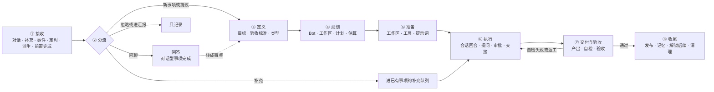

结论：Steve 做的每件事都是一个**事项**。用户找 Steve 只有两种情况：**闲聊**，Steve 直接回答就算完成；**办事**，要 agent 动手操作，通常还有产出。两种请求走同一条流程，闲聊只走前面几步。流程分 8 个阶段：接收、分流、定义、规划、准备、执行、交付与验收、收尾。阶段之间留有钩子，插件就在这些钩子上工作。

钩子分三种：

- **贡献**：往流程里加东西，例如上下文、验收标准、工具、检查项。
- **把关**：可以放行、修改、拦下，或者转给你审批。
- **观察**：只看结果，用来同步和记录。

按插件在流程里做的事，可以把它们归成 10 种角色。上一版写的“安装、启用、升级、卸载”是插件自身的管理过程，不是这里要回答的问题，降为管理面。

配套文档：[[30_项目/易人实验室/方案/Steve助手化交互重构|交互方案]]、[[30_项目/易人实验室/方案/Steve自动化与插件|自动化与插件]]。[打开原型 v9](https://wiki.example.com/reviews/steve-assistant-interaction-20261031-v9/)，在设置 → 插件里可以看到每个插件挂在流程的哪一段。

## 两种请求

| | 闲聊 | 办事 |
| --- | --- | --- |
| 例子 | “FTS5 和外部搜索服务比怎么样？” | “把登录后跳回首页的 bug 修了” |
| 完成标准 | 回答了 | 有产出，并且通过验收 |
| 是否需要会话 | 不需要，Steve 自己回答 | 需要，交给 Bot 开会话执行 |
| 走哪些阶段 | 接收 → 分流 → 回答 | 全部 8 个阶段 |
| 在界面上 | 只留在对话里 | 进事项列表，有编号 |

闲聊也记成一条**对话型事项**：默认不进事项列表、不占编号，但能被搜到。聊着聊着想让 Steve 动手时（“那就帮我加上”），点“转成事项”或直接这么说，它就变成办事型事项，从“定义”阶段继续，对话内容作为上下文带进去。Steve 判断错了也可以一键改：把办事改回闲聊，或者反过来。

## 流程总览

事项的状态（进行中、等你、已完成等）是给你看的；阶段是系统内部的进度。两者的对应：

| 状态 | 所在阶段 |
| --- | --- |
| 提议 | 分流之后、定义之前，等你同意 |
| 等前置 | 规划结束，卡在开始前的把关 |
| 进行中 | 准备、执行 |
| 等你 | 执行中提问或请求审批；规划阶段让你确认方案；交付后等你验收；发布前等你批准 |
| 已完成 | 收尾结束 |
| 已暂停 / 已放弃 | 任何阶段都可以进入 |

事项详情的“现在”区会显示当前阶段，让你知道事情走到了哪一步。

## 各阶段与钩子

钩子名称里，`before_` 开头的是把关，没有这个前缀的贡献钩子用动词命名（如 `item.define`），过去式（如 `item.created`）是观察。

### ① 接收

请求的来源有六种：你在对话里说的话、你在事项上写的补充、事件源的事件、定时任务、派生、前置事项完成。这一步把它们统一成一条**请求**，包含文字、附件、引用的事项编号、来源和发起人。

| 钩子 | 类型 | 插件可以做什么 |
| --- | --- | --- |
| `request.received` | 贡献 | 语音转文字、解析附件、展开链接、把同一个群里 10 分钟内的消息合并成一条 |

### ② 分流

Steve 决定这条请求怎么处理：直接回答、补充到已有事项、新建事项、提议（来自后台的请求先问你）、只进汇报，或者忽略（后两种只对后台来源）。事件源上配置的“流程”（原“规则”），就是后台请求在这一步的处理方式。

| 钩子 | 类型 | 插件可以做什么 |
| --- | --- | --- |
| `request.classify` | 贡献 | 给出分类建议和理由，例如“这是 Linear ENG-42 的补充”“这条群消息像一个需求”。最后由 Steve 决定 |
| `item.before_create` | 把关 | 去重（同一封邮件不重复建事项）、合并到已有事项、限制频率 |
| `chat.context` | 贡献 | 闲聊回答前补充资料，例如相关日程、知识库条目 |
| `chat.before_reply` | 把关 | 过滤敏感内容 |

### ③ 定义

把请求写成一张**事项卡**：标题、目标、验收标准、产出类型、事项类型、相关上下文、截止时间。Steve 起草，你可以改。开始方式选了“先给我方案”的，到下一步规划完再一起让你确认。

| 钩子 | 类型 | 插件可以做什么 |
| --- | --- | --- |
| `item.define` | 贡献 | 匹配事项类型（见下文），补上验收标准、截止时间和相关资料（例如往来邮件、关联的 Issue） |
| `item.created` | 观察 | 同步到外部系统，例如在 Linear 建一条 Issue |

### ④ 规划

确定由哪个 Bot、哪个 harness 和模型、在哪个工作区做，拆出计划步骤，估算用量，检查有没有未完成的前置事项。

| 钩子 | 类型 | 插件可以做什么 |
| --- | --- | --- |
| `item.plan` | 贡献 | 推荐 Bot 和工作区、给出计划模板、估算费用、按会议时间推算截止时间 |
| `item.before_start` | 把关 | 检查额度、权限、前置事项和允许运行的时间段；可以要求先把方案给你确认 |

### ⑤ 准备

把会话组装起来：建工作区（例如 git worktree），拉取资料，拼系统提示词（Bot 的性格和工作规范、事项卡、记忆），注入工具和技能。

| 钩子 | 类型 | 插件可以做什么 |
| --- | --- | --- |
| `session.prepare` | 贡献 | 提供工作区、环境变量、MCP 工具、技能、提示词片段、文件 |
| `session.started` | 观察 | 记录、计时 |

插件也可以提供整个**执行环境**，例如一个新的 harness 适配器、一台远程机器或一个容器。

### ⑥ 执行

会话一轮一轮地跑：思考、调用工具、向你提问、请求审批。你的补充在两轮之间送达，上下文快满时交接到新会话，也可以从任一回复派生。

| 钩子 | 类型 | 插件可以做什么 |
| --- | --- | --- |
| `session.before_turn` | 把关 | 额度用完时暂停，并问你要不要继续 |
| `session.before_tool_call` | 把关 | 拦下危险命令；对外操作改为先审批 |
| `session.after_tool_call` | 观察 | 识别产出，例如看到 `git push` 就把 PR 关联到事项 |
| `session.turn_ended` | 观察 | 更新“现在”，送达排队的补充 |
| `item.route_supplement` | 贡献 | 建议补充是追加到当前会话、开新会话，还是另建事项 |
| `session.handoff` | 贡献 | 往交接摘要里补充内容 |
| `decision.request` | 贡献 | 提供专用的决策卡（例如邮件草稿审批），选择通知渠道 |
| `decision.resolved` | 观察 | 你做出决定后执行后续动作 |

### ⑦ 交付与验收

Bot 宣布完成后，Steve 收集产出并跑自检。自检全部通过才交给你验收，或者按策略自动验收。自检失败就退回执行，不打扰你。你返工时也退回执行。

| 钩子 | 类型 | 插件可以做什么 |
| --- | --- | --- |
| `item.collect_outputs` | 贡献 | 登记产出：PR、文件、截图、报告 |
| `item.verify` | 贡献 | 加检查项：构建、测试、CI 结果、截图对比、链接检查。任何一项失败就退回执行 |
| `item.before_review` | 把关 | 准备给你看的证据和风险提示；在自动验收时可以否决，改为交给你验收 |
| `item.reviewed` | 观察 | 记录通过或返工 |

### ⑧ 收尾

对外发布产出（合并 PR、发送邮件、在群里回复），把这次学到的东西沉淀进记忆，解锁后续事项，清理工作区，写进汇报。

| 钩子 | 类型 | 插件可以做什么 |
| --- | --- | --- |
| `item.publish` | 把关 | 执行对外动作。默认需要你批准；验收时可以勾选“通过并发布”，一次批准 |
| `item.closed` | 观察 | 同步状态、沉淀记忆、统计、删除分支 |
| `item.dropped` | 观察 | 清理 |

### 贯穿全程

| 钩子 | 类型 | 说明 |
| --- | --- | --- |
| `item.status_changed` | 观察 | 状态变化，供同步类插件使用 |
| `item.goal_revised` | 观察 | 你修改了目标，事项回到定义和规划；改动较大时开新会话 |

## 三种钩子的规则

| | 贡献 | 把关 | 观察 |
| --- | --- | --- | --- |
| 调用时机 | 阶段进行中，同步调用 | 进入下一步之前，同步调用 | 事情发生之后，异步调用 |
| 返回什么 | 要加入的内容 | 放行、修改、拦下或要求审批，附理由 | 不返回 |
| 多个插件同时挂上 | 列表类结果合并（上下文、工具、检查项）；单值结果（推荐的 Bot、分类）由 Steve 综合判断，并在工作记录里写明依据 | 按顺序调用，任一插件拦下就算拦下；要求审批的进待处理 | 并行，互不影响 |
| 超时或失败 | 5 秒超时后跳过，记一笔 | 3 秒超时后默认放行；安全类插件可以声明超时按拦下处理 | 失败重试，至少送达一次，插件按事件编号去重 |

有两条规则插件不能改：对外发送、花钱、删除类动作必须经过你批准；验收、放弃、修改目标只有你能做。

插件做的每件事都写进事项的工作记录，并注明来源，例如“GitHub 插件：CI 检查通过”“额度守卫：预估费用超过上限，已暂停”。

## 插件扮演的角色

一个插件可以同时扮演几种角色。

| 角色 | 挂在哪些钩子 | 例子 |
| --- | --- | --- |
| 来源 | `request.received`（事件源也属于这里） | 邮件、IM、GitHub、Webhook |
| 分类 | `request.classify`、`item.before_create` | 识别“ENG-42 的补充”，同一封邮件不重复建事项 |
| 事项类型 | `item.define`、`item.plan`、`item.verify` | “修 bug”类型自带验收标准、计划模板和检查项 |
| 上下文 | `chat.context`、`item.define`、`session.prepare` | 知识库、日程、往来邮件、Issue |
| 工具 | `session.prepare` | 给会话加 MCP 工具和技能 |
| 执行环境 | `session.prepare` | 新的 harness 适配器、远程机器、容器工作区 |
| 把关 | 所有 `before_` 钩子 | 额度守卫、危险命令拦截、工作时间限制 |
| 检查 | `item.verify` | 测试、CI、截图对比 |
| 发布 | `item.publish` | 合并 PR、发送邮件、在群里回复 |
| 观察与同步 | `item.created`、`item.status_changed`、`item.closed` | 同步 Linear、统计、沉淀记忆 |

插件在界面上出现的位置（事项侧栏、产出卡片、决策卡、`/` 命令、设置页）沿用 [[30_项目/易人实验室/方案/Steve自动化与插件|自动化与插件]] 里的嵌入点清单。嵌入点只负责把插件贡献的内容显示出来。

## 事项类型：插件最主要的贡献

一类事要怎么做才算做完，往往有固定套路。插件把这些套路打包成**事项类型**，在定义阶段由 Steve 匹配，你也可以手动改。

| 字段 | 例子：修 bug | 例子：回复邮件 |
| --- | --- | --- |
| 匹配条件 | 对话提到 bug、报错；来源是失败的检查 | 来源是邮件，并且需要回复 |
| 默认 Bot 与工作区 | 前端 Bot · 对应仓库 | 邮件 Bot · 不需要工作区 |
| 验收标准模板 | 能复现 → 修复 → 测试通过 → 有回归测试 | 回答了对方的问题，语气符合你的习惯 |
| 计划模板 | 复现、定位、修改、验证 | 读往来邮件、查日程、起草 |
| 工具 | 仓库、浏览器测试 | 起草、查联系人 |
| 检查项 | 构建、测试、CI | 收件人核对 |
| 发布动作 | 验收后合并 PR | 你批准后发送 |

流程里的“执行预设方案”也是指定一个事项类型。用户可以在对话里让 Steve 把一次做得好的事项保存成新的类型。

## 三个例子

**闲聊转办事**：“FTS5 和外部搜索服务比怎么样？”

1. 接收：对话消息。
2. 分流：判断为闲聊；知识库插件通过 `chat.context` 补上实验室已有的搜索方案。
3. Steve 回答，对话型事项完成。
4. 你接着说“那就帮我给会话页加上”，转成办事型事项，从定义阶段继续，对话作为上下文带入。

**代码修复**：“把登录后跳回首页的 bug 修了”

| 阶段 | 发生了什么 | 插件 |
| --- | --- | --- |
| 分流 | 新事项 | — |
| 定义 | 匹配“修 bug”类型，补上验收标准 | GitHub（事项类型） |
| 规划 | 交给前端 Bot，工作区 steve/web，预估 ¥2 | 额度守卫（`item.before_start` 放行） |
| 准备 | 建 worktree，注入仓库和浏览器工具 | GitHub（工作区）、浏览器测试（工具） |
| 执行 | 修改代码，`git push` 后自动关联 PR #12 | GitHub（`session.after_tool_call`） |
| 交付与验收 | 收集 PR 和截图；CI 通过；交给你验收 | GitHub（`item.verify`） |
| 收尾 | 你点“通过并发布”，合并 PR，删除分支，解锁 ST-121 | GitHub（`item.publish`、`item.closed`） |

**回复邮件**：Sarah 问周五评审能不能改到下午 2 点

| 阶段 | 发生了什么 | 插件 |
| --- | --- | --- |
| 接收 | 邮件事件，附件和往来邮件一起解析 | 邮件（来源） |
| 分流 | “邮件分诊”流程判断为需要回复，新建事项 | 邮件 Bot 判断 |
| 定义 | 匹配“回复邮件”类型 | 邮件（事项类型） |
| 规划 | 截止时间按会议前一天推算 | 日程（`item.plan`） |
| 准备 | 注入起草工具和日程查询 | 邮件、日程（工具） |
| 执行 | 查到周五 14:00 有空，起草回复 | — |
| 交付与验收 | 草稿交给你 | 邮件（专用决策卡） |
| 收尾 | 你批准后发送，并更新日历 | 邮件（`item.publish`）、日程（观察） |

## 对界面和数据的影响

- 事项详情的“现在”区显示阶段进度：定义、规划、准备、执行、交付与验收、收尾。
- 插件详情页按阶段列出它挂了哪些钩子，并标出它的角色（原型 v8 已改）。
- 工作记录里插件做的事注明来源。
- 设置里加一页“流程”，按阶段列出每个钩子上挂着哪些插件、按什么顺序调用，可以调整顺序或临时停用某个钩子。
- 数据上新增 `item_stage`（事项当前阶段）、`item_types`（事项类型）、`hook_calls`（每次钩子调用的插件、类型、耗时、结果，供工作记录和排查使用）。原来的 `hook_deliveries` 合并进 `hook_calls`。

## 已确认

1. 闲聊记为对话型事项：不进事项列表、不占编号，可以搜索，可以转成事项。
2. 事项类型是插件最主要的扩展形式。
3. 多个插件给出不同的单值建议时，由 Steve 综合判断，并把依据写进工作记录。
4. 验收时提供“通过并发布”，一次批准验收和对外发布。自动验收的事项，发布仍要你单独批准。

## 已确认（2026-10-31）

- 插件先不开放社区目录，只允许内置、官方和本地开发的插件。
- 流程先不设额度上限。
- 事件原文默认保留 7 天，之后只保留处理结果和摘要。
