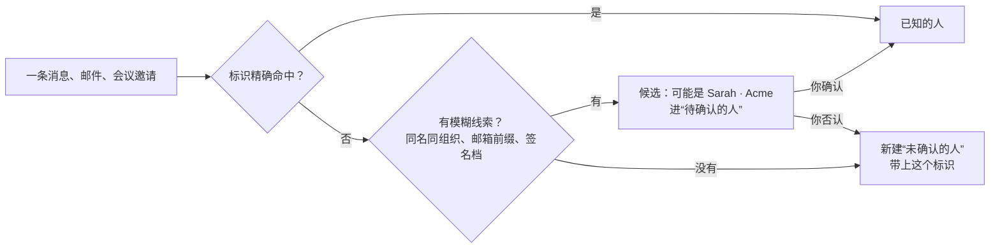
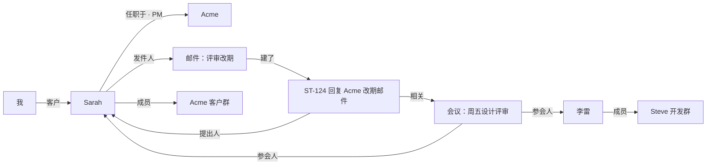
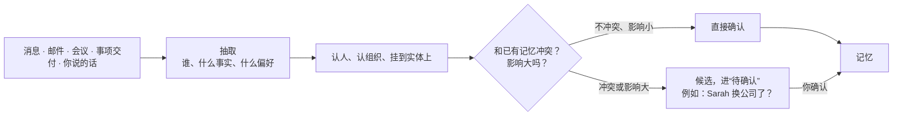
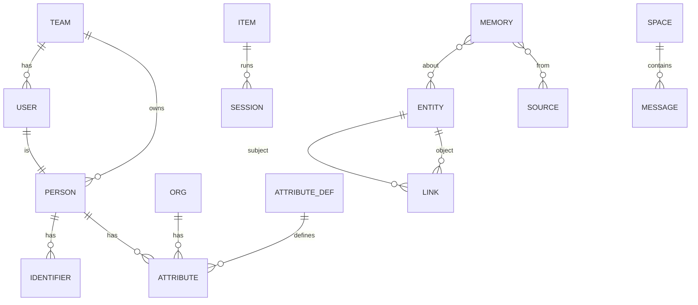

> 已被 [[30_项目/易人实验室/方案/Steve终态领域设计|Steve 终态领域设计]] 取代：“人”改为“主体（联系人、组织）”，身份标识并入“账号”。

结论：在现有对象之上加一层**人**，并把整套对象改成“**实体 + 关联 + 时间线 + 记忆**”的统一结构：

- **实体**：人、组织、事项、会话、消息、会议、产出等，各有自己的表和字段。
- **关联**：实体之间统一用带类型的关联连接，例如“谁提出了这个事项”“这封邮件发给了谁”“谁在哪家公司任职”。每条关联都有来源和可信度。
- **时间线**：任何实体都能按时间看到和它相关的一切。人的时间线就是你和他的往来与合作记录。
- **记忆**：Steve 记住的东西，统一成一种带来源、可见范围和披露级别的条目，挂在一个或几个实体上。Bot 记忆、群记忆、人物档案、事项结论，都是它的不同视图。

人是这张网的中心之一。消息、邮件、会议进来时，先认出是谁，再沿着这个人找到相关的事项、往来和记忆。Agent 需要了解一个人时，查一次就能拿到。

## 一、已确认的前提（2026-10-31）

| 问题 | 决定 | 对设计的影响 |
| --- | --- | --- |
| 使用者范围 | 未来会开放给其他人 | 从第一天起所有数据带**团队**归属和可见范围；第一版只开一个团队、一个用户，但结构上不返工 |
| 部署 | Mac mini 常驻 | 单机部署；飞书用长连接、Slack 用 Socket Mode 接收事件，不需要公网回调；需要 Webhook 的插件再走 Tailscale Funnel 或 Cloudflare Tunnel |
| Steve 自己的模型调用 | 尽量走 harness，允许用户自己配置 API | 模型网关默认用 harness 的无界面调用（一次性会话、结构化输出）；用户配了 API 时，实时性要求高的任务（分流、披露检查）优先走 API |
| 阶段 | 先做平台底座，再做事项主线 | 人、关联、记忆属于平台底座，放进 P0 |

## 二、人

### 人和账号的区别

| | 人 | Steve 用户 |
| --- | --- | --- |
| 是什么 | 你世界里的一个人或账号：同事、客户、朋友、网上的某个 ID | 能登录 Steve 的人 |
| 数量 | 成百上千 | 一个团队里几个 |
| 关系 | 每个 Steve 用户自己也是一个“人”，标记为“我” | 一个用户对应一个人 |

### 人的字段

固定字段只放所有人都有的，其余都是可扩展的属性。

| 字段 | 说明 |
| --- | --- |
| 名字、别名 | 显示名；别名用于识别，例如“Sarah”“莎拉”“Sarah Chen” |
| 类型 | 真人、虚拟账号（网上的 ID、匿名账号）、机器人、未确认 |
| 和我的关系 | 同事、上级、客户、合作方、朋友、家人……可多选，可自定义 |
| 头像 | 从渠道同步，或按名字生成 |
| 备注 | 自由文本 |
| 标签 | 和事项共用标签体系 |
| 重要程度 | 影响通知和汇报排序 |
| 可见范围 | 只有我，或团队共享 |

**属性**是可扩展的：电话、地址、公司、职位、生日、时区、语言、偏好的称呼……每个属性有类型（文本、电话、日期、地址、链接、枚举）、来源、时间和披露级别。团队可以自己加属性定义，Agent 也可以提议新属性，你确认后生效。

### 身份标识

一个人可以有很多标识，用来在各个渠道里认出他：

| 类型 | 例子 | 识别方式 |
| --- | --- | --- |
| 邮箱 | sarah@acme.com | 精确匹配 |
| 邮箱前缀规则 | `lee.p`（同一个人在多个域名下的邮箱） | 前缀相同，并且域名属于同一组织或已确认的别名域 |
| 电话 | +86 138… | 规范化后精确匹配 |
| 飞书 | open_id、union_id、user_id | 精确匹配，按应用区分 open_id |
| Slack、GitHub、微信…… | 用户 ID、用户名 | 由插件声明类型和匹配方式 |
| 名字 + 组织 | “Sarah · Acme” | 模糊，只用于提议，不自动合并 |

每个标识记录：类型、值、来源（哪个渠道、哪封邮件、你手动加的）、是否已确认、可信度。新的标识类型由插件声明。

### 认人：消息进来时怎么知道是谁

规则：

- 只有精确标识才自动认人；模糊线索只做提议，你确认后才合并。
- 合并、拆分都可以撤销；合并后所有关联、时间线、记忆跟着走。
- 未确认的人照常工作（消息正常处理），只是不会被当成熟人对待，例如不会套用“同事”的响应规则。
- 同一个人在不同渠道的标识，Steve 会在发现线索时提议合并，例如邮件签名里写了飞书号。

### 组织

| 字段 | 说明 |
| --- | --- |
| 名称、别名 | “Acme”“Acme Inc.” |
| 域名 | acme.com，用于从邮箱推断组织 |
| 和我的关系 | 本公司、客户、供应商、合作方…… |
| 属性 | 可扩展，同人 |

人和组织之间是**任职**关联：职位、部门、起止时间。换公司时旧的任职关闭、新的开始，历史还在。

## 三、关联：把所有对象连起来

强类型的实体各自建表，实体之间统一用一张关联表：

| 字段 | 说明 |
| --- | --- |
| 主体、谓词、客体 | 例如：事项 ST-124 · 提出人 · Sarah |
| 属性 | 例如任职的职位、会议里的角色 |
| 来源 | 自动识别、Steve 推断、你手动、插件 |
| 可信度 | 推断出来的关联带可信度，低于阈值只做提议 |
| 有效期 | 开始、结束时间；过期的关联保留为历史 |

常用的谓词：

| 主体 | 谓词 | 客体 |
| --- | --- | --- |
| 事项 | 提出人、相关的人、关于、等谁回复 | 人、组织 |
| 消息 / 邮件 | 发件人、收件人、提到 | 人 |
| 会议 | 参会人、组织者 | 人 |
| 人 | 任职于 | 组织 |
| 人 | 上级、同事、介绍人…… | 人 |
| 人 | 成员 | 空间（群） |
| 产出 | 作者、交付给 | 人 |
| 事项 | 依赖、派生自 | 事项、会话 |

已有的关系（事项依赖、会话交接、派生）也统一写成关联，关系图直接读这张表。

## 四、时间线

时间线不是一张单独的表，而是按关联把相关的记录按时间排起来：

| 实体 | 时间线里有什么 |
| --- | --- |
| 人 | 和他的消息、邮件、会议；他提出或参与的事项；Steve 记住的关于他的事 |
| 组织 | 组织里所有人的往来汇总；和这家组织相关的事项 |
| 事项 | 现在的“动态” |
| 空间（群） | 群里的消息、群里产生的事项 |

“合作记录”就是人的时间线里，你们共同参与、已经完成的事项及其结果。

## 五、记忆：统一成一种东西

### 记忆条目

Steve 记住的一切都是一条记忆：

| 字段 | 说明 |
| --- | --- |
| 关于 | 一个或几个实体：某个人、某个组织、某个事项、某个群、某个 Bot、你自己 |
| 种类 | 事实、偏好、规则、摘要、事件（见下表） |
| 内容 | 文本；能结构化的同时写成属性（例如“Sarah 的职位是 PM”同时更新属性） |
| 来源 | 哪条消息、哪封邮件、哪个事项、你说的、插件写的；可以有多个 |
| 可见范围 | 来源原本谁能看到：某个群的成员、只有你、团队 |
| 披露级别 | 公开、可转述结论、仅用于推理、不可使用 |
| 状态 | 候选、已确认、已过时 |
| 有效期 | 什么时候开始成立、什么时候过期；例如“这周在出差” |
| 写入者 | 你、Steve、某个 Bot、某个插件 |

| 种类 | 例子 | 怎么用 |
| --- | --- | --- |
| 事实 | Sarah 是 Acme 的 PM；备份每晚 02:00 运行 | 直接进上下文 |
| 偏好 | 你习惯先看结论；Sarah 喜欢简短的邮件 | 影响写作和汇报 |
| 规则 | GitHub 通知类邮件直接忽略；运维群只回答部署问题 | 影响路由和行为，本质是配置，有修订历史 |
| 摘要 | 和 Acme 最近三个月的往来要点；某个群本周的讨论 | 定期生成，替代大量原文 |
| 事件 | 10 月 2 日 Sarah 确认了合同条款 | 时间线上的里程碑 |

**原来的几种记忆都变成视图**：

| 原来 | 现在 |
| --- | --- |
| Bot 的记忆 | 写入者是这个 Bot、或者关于这个 Bot 的记忆 |
| 群记忆 | 关于这个空间、来源在这个空间的记忆 |
| 人物档案 | 关于这个人的事实和偏好 + 属性 |
| 事项结论 | 关于这个事项的摘要和事件 |
| 信号纠正（以后这类忽略） | 规则类记忆，生成对应的流程改动 |

### 写入：从哪里来

- 你亲口说的、渠道里精确同步的资料（飞书通讯录里的职位）直接确认。
- Steve 推断的，和已有事实冲突，或者会改变行为（新规则、换公司、关系变化）的，先做候选，你确认后生效。
- 新事实取代旧事实时，旧的标为“已过时”，不删除，时间线上能看到变化。

### 读取：Agent 怎么拿到需要的信息

按**锚点**组装上下文。一条消息进来，锚点是：发消息的人、所在的群、提到的事项。

| 锚点 | 取什么 |
| --- | --- |
| 人 | 人物卡：名字、关系、组织与职位、偏好的称呼和语言、最近的往来摘要、和他相关的进行中事项、等他回复或他在等的事 |
| 空间 | 群的职责、群的摘要、最近的讨论 |
| 事项 | 目标、现在、计划、相关的人 |
| 问题本身 | 全文和语义检索，只取能用来推理的记忆 |

每条进上下文的内容都带着披露级别；发出前照常做披露检查，人的属性也受它约束。例如 Sarah 的手机号只对你“公开”，在任何群里都不会被说出来。

Agent 用 Steve 工具访问：

| 工具 | 用途 |
| --- | --- |
| `steve.person.find` | 按名字、标识、组织找人，返回人物卡 |
| `steve.person.timeline` | 某人最近的往来和合作记录 |
| `steve.memory.search` | 按问题检索记忆，可限定关于谁 |
| `steve.memory.propose` | 提议一条新记忆，按上面的写入规则处理 |
| `steve.link.propose` | 提议一条关联，例如“这个事项和 Sarah 有关” |

### 保留与删除

| 内容 | 默认 |
| --- | --- |
| 事件原文（信号） | 7 天，之后只留处理结果和摘要（已确认） |
| 群消息原文 | 7 天，之后只留摘要和抽取出的记忆 |
| 记忆 | 长期，过期的标为过时 |
| 人 | 长期；可以删除一个人，他的标识、属性、记忆一起删，事项和消息里的引用改为“已删除的人” |

## 六、对现有模块的影响

| 模块 | 变化 |
| --- | --- |
| 导航 | 新增“人”：人的列表（按关系、组织、标签筛选，搜索）、人物页、组织页、待确认的人 |
| 人物页 | 头部是名字、关系、组织职位；下面是属性（可扩展）、身份标识、时间线、相关事项、记忆（每条可看来源、改披露级别、删除）、相关的人 |
| 对话 | `@` 同时能选人和 Bot，分两组：`@Bot` 是交给它，`@人` 是关联这个人；“Sarah 换到 Globex 做 PM 了”这类话会生成记忆和关联的草稿 |
| 事项 | 新增“相关的人”（提出人、相关、等谁回复）；事项列表可以按人筛选；从邮件、消息建的事项自动带上发件人 |
| 待处理 | 决定卡写明在等谁、要回复谁 |
| 渠道 | 发消息的人先认人；响应规则的条件可以用“同事”“客户”“未确认的人”；回复时按人物卡里偏好的称呼和语言 |
| 信号 | 可以按人分组；“这个人的邮件以后都提醒我”是一条关于这个人的规则 |
| 汇报 | 可以按人汇总：“Sarah 在等你回复两件事” |
| 标签 | 人也能打标签，和事项共用一套 |
| 知识与披露 | 并入记忆；披露级别的设置不变 |
| 对话式配置 | 人的属性、关系、合并都可以在对话里说，Steve 起草改动，你确认 |
| 设置 | 新增“人与组织”：属性定义、关系类型、认人规则（是否允许邮箱前缀匹配、别名域）、保留期限 |

## 七、数据模型

| 表 | 主要字段 |
| --- | --- |
| team、user、membership | 团队、用户、成员角色；所有业务表带 `team_id` |
| person | 名字、别名、类型、重要程度、可见范围、`user_id`（是“我”时） |
| org | 名称、别名、域名 |
| identifier | 人、类型、值（规范化）、来源、已确认、可信度；`(team, type, value)` 唯一 |
| attribute_def | 适用对象（人 / 组织）、键、名称、类型、默认披露级别 |
| attribute | 对象、键、值、来源、时间、披露级别、状态 |
| link | 主体（类型 + id）、谓词、客体（类型 + id）、属性、来源、可信度、有效期 |
| memory | 种类、内容、来源列表、可见范围、披露级别、状态、有效期、写入者；全文和向量索引 |
| memory_about | 记忆 ↔ 实体 |
| message | 渠道消息和邮件的统一记录：空间、发件人（人）、原文（按保留期限）、摘要 |
| meeting | 日程里的会议：时间、组织者、参会人（走 link） |
| 其余 | 事项、会话、决定、Bot、对外身份、渠道、流程等沿用开发就绪评审里的定义，统一带 `team_id`，彼此的关系改走 link |

可见范围的规则：每条记录带 `team_id` 和可见范围（只有创建者、团队、某个空间的成员）。查询和检索一律先按可见范围过滤，再看披露级别。

## 八、放进阶段

| 阶段 | 增加的内容 |
| --- | --- |
| P0 平台底座 | 团队与用户、实体与关联、记忆存储（含来源、可见范围、披露级别）、属性定义 |
| P1 事项主线 | 人的列表与人物页、手动建人和合并、事项的相关的人、`@人`、记忆的写入规则与待确认 |
| P3 渠道与知识 | 认人（标识匹配、候选、合并）、渠道和邮件自动建人、人物卡进上下文、按人汇报、披露检查覆盖人的属性 |

## 九、需要你决定

1. `@` 同时用于人和 Bot（分两组显示），可以吗？另一种做法是人用 `@`、Bot 改用 `/交给`。
2. 邮箱前缀规则默认开启吗？它能把一个人在多个邮箱里认出来，但也可能把不同的人认成同一个（例如 `admin@` 前缀）。我建议默认只在同一组织的域名之间生效，并排除常见的公共前缀。
3. 团队共享以后，人和记忆默认是“只有我”还是“团队共享”？我建议人默认团队共享，记忆默认只有我，由你逐条或按来源放开。
4. 群消息原文也按 7 天保留，可以吗？
